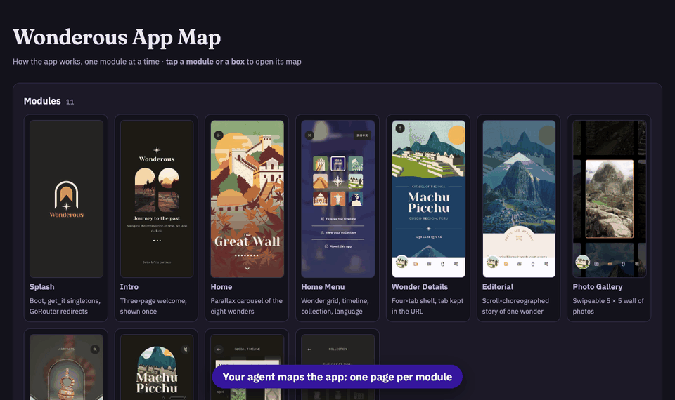
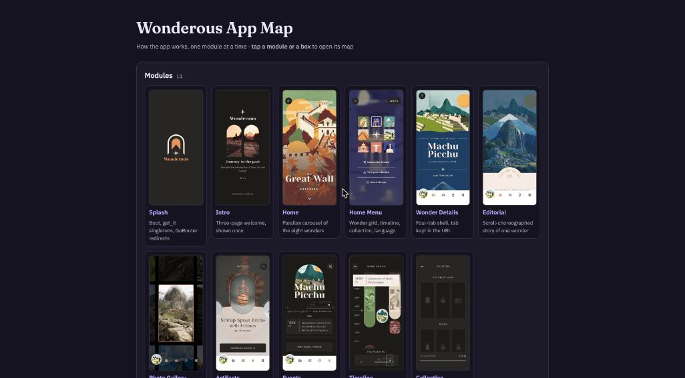
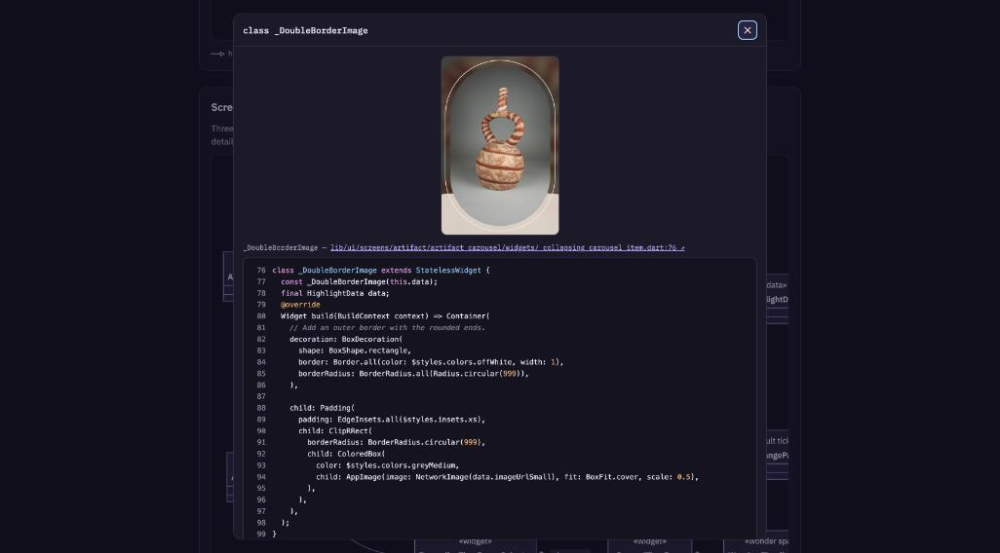

# App Map — an AI agent skill for mobile apps

[](https://github.com/yonivav/app-map/actions/workflows/check.yml) · [Site](https://yonivav.github.io/app-map/) · [Live examples](https://yonivav.github.io/app-map/examples/wonderous/)

**Give your AI coding agent one skill, and it maps your mobile app.** Install App Map into
Claude Code, Cursor, Codex, Gemini CLI or GitHub Copilot, then ask: *"build an app map of this
repo"*. The agent reads your app and writes one page per module — what it does, UML class maps,
screen composition, state machines and the main-flow sequence. Click any class, method or arrow
to see its **real source code**; pages and widgets also show **how they look in the running app**.
Ask again after code changes and it updates only what changed.

**For mobile apps:** Flutter (Dart), native iOS (Swift, Objective-C) and native Android (Kotlin,
Java) — class maps, screen composition and state machines for all of them. Screenshots (the
on-screen crops in popups) are Flutter-only so far; native screenshots are in progress.



> **[▶ Wonderous](https://yonivav.github.io/app-map/examples/wonderous/)** — the Flutter team's
> showcase app by gskinner (~31k lines, MIT) · **[NetNewsWire](https://yonivav.github.io/app-map/examples/netnewswire/)**
> — Brent Simmons' iOS RSS reader (~25k lines, MIT) · **[Now in Android](https://yonivav.github.io/app-map/examples/now-in-android/)**
> — Google's Compose showcase app (~29k lines, Apache-2.0), all mapped by this skill.





## Why

Architecture docs go stale the day they're written, and UML tools draw boxes nobody can check.
An App map is different:

- **Grounded in the code.** Each diagram is drawn from the classes the code actually builds and
  calls (`app-map facts`). Each name is checked against the source (`app-map verify`).
- **Clickable down to the line.** Class names, members, relation labels and sequence calls open
  the exact code in a popup, with an "open in VS Code" link.
- **Shows the real UI.** A simulator run logs where every page and widget sits on screen. Each
  popup then shows a crop of that widget from the running app.
- **Markdown in your repo.** Each module is a Markdown file GitHub renders as it is (Mermaid
  included); `app-map build` makes the clickable site from it. Map changes are reviewable diffs.
- **Both directions.** From a box to its code, and from code to the map: every popup says where
  else the class appears, the overview finds any class or file, `app-map where` does it in the
  terminal.
- **Stays current.** The map remembers the commit it describes; `app-map changes` lists, per
  module, what changed since. A GitHub Action builds and checks the map on every PR.

## When to use it

- **Onboarding** — point a new engineer, or an AI agent working on the codebase for the first
  time, at the map before the code. It's faster to correct a wrong diagram than to re-derive the
  architecture from scratch.
- **Before a refactor, a platform port or a native rewrite** (a Flutter screen going native, or
  the reverse) — see what calls what before you change it, across Dart, Swift, Kotlin and Java
  alike.
- **Keeping docs from going stale** — wire the GitHub Action once
  ([`assets/app-map-check.yml`](skills/app-map/assets/app-map-check.yml)) and `app-map changes`
  tells you exactly what a PR touched, on every PR, instead of hoping someone remembers to update
  a wiki page.
- **Code review** — link a PR to the module it touches instead of re-explaining the architecture
  in the description; `app-map where` turns a changed file straight into "which diagrams does
  this affect."
- **A codebase that mixes platforms** — a Flutter core with a native iOS/Android shim, or a team
  that ported Dart screens to Swift and Kotlin, gets one map that reads all of them the same way.

Not a fit for: a single file you're about to edit (just read it — a map is for the shape of a
*module*, not a line), or a repo that changes faster than anyone reviews PRs for it (the map
reflects the commit it was last synced to; it won't track a branch nobody's merging).

## Use it — with any AI coding agent

App Map is an [Agent Skill](https://agentskills.io): a `SKILL.md` with scripts, in the open
format that most coding agents now read. Install it once, then ask your agent:
*"Build an app map of this repo"*. It finds the modules, reads them, writes the pages, indexes
the code and checks every page. You open `docs/app-map/index.html`.

```bash
git clone https://github.com/yonivav/app-map ~/.app-map
cd your-app && ~/.app-map/install.sh          # into this repo (commit it to share with your team)
~/.app-map/install.sh --user                  # or once, for every repo on your machine
```

| Agent | Reads it from |
|---|---|
| OpenAI Codex | `.agents/skills/app-map` |
| Gemini CLI | `.agents/skills/app-map` |
| GitHub Copilot (CLI, VS Code, JetBrains, cloud agent) | `.agents/skills/app-map` |
| Cursor | `.cursor/skills/app-map`, plus a `.cursor/rules/app-map.mdc` pointer |
| Claude Code | `.claude/skills/app-map` (or, inside Claude Code: `/plugin marketplace add yonivav/app-map`) |
| Anything else | point it at `.agents/skills/app-map/SKILL.md` (e.g. from `AGENTS.md`) |

`--link` symlinks instead of copying, so `git -C ~/.app-map pull` updates every repo.

## Ask your agent

Once installed, talk to your agent in plain words. For example:

| Ask | What happens |
|---|---|
| *"Build an app map of this repo"* | It proposes the modules, then writes one page each, builds the site and checks every page |
| *"Update the app map"* | It lists what changed in the code since the map was synced and edits only those pages |
| *"Is the app map up to date?"* | It reports, per module, the classes that changed, the names that no longer exist, and new classes not on the map |
| *"Where is `WondersLogic` on the map?"* or *"…`lib/logic/wonders_logic.dart`?"* | It lists every diagram that draws that class, or that file's classes |
| *"Add the new Settings screen to the app map"* | It adds the screen to the right module (or a new one) and to the overview |
| *"Take screenshots for the app map"* | It runs the app on a simulator, adds each module's screenshots, and crops every page and widget for the popups |
| *"Using the app map, explain how the timeline works"* | It reads the module's page and code to answer, with links to the exact lines |

**Before you publish a map:** the built site includes excerpts of your source code (that's what
the popups show). Keep a private app's map private — commit it to the app's own repo, don't host
it on public GitHub Pages.

The skill's own tools also work on their own:

| Command | What it does |
|---|---|
| `app-map build <map>` | Markdown → the clickable site: pages, code popups, search |
| `app-map changes <map>` / `sync <map>` | what changed in the code since the map was synced, per module; mark it current |
| `app-map where <map> <Class or file>` | code → map: every diagram that draws it |
| `app-map facts <map> <Class>…` | what each class builds and uses, by role: the raw material for its diagrams (Dart, with the Dart SDK; role/`extends`/`implements` only for Swift, Kotlin, Java, Objective-C, or Dart without an SDK) |
| `app-map verify <map>` | renders every page in headless Chrome; flags Mermaid pitfalls, leftover placeholders and names that won't click |
| `app-map shots <app> <scenario> <out>` | runs a Flutter screenshot scenario on its own iOS simulator |
| `app-map crop <shots> <map>` | crops each page/widget from its best shot (nothing covering it) |

## How it works

- **Parsing.** Dart is read with the official `analyzer` when a Dart SDK is installed, and with
  [tree-sitter](https://tree-sitter.github.io/) otherwise; Swift, Kotlin, Java and Objective-C are
  read with tree-sitter directly — classes, structs, protocols/interfaces/categories, enums,
  SwiftUI `View`s and `@Composable` functions, all with their members. Declarations are cached per
  file, so a rerun only parses what changed.
- **Diagrams.** The diagrams are Mermaid, rendered in the page with the page's own theme (light
  and dark). Each source sits in a `<script type="text/plain">`, so `<<stereotypes>>` survive.
- **Screenshots.** The Flutter adapter is an `integration_test` helper. At each shot it records
  every diagram widget's on-screen rectangle. It also hit-tests five points per widget to know
  whether a panel or dialog covers it, and scrolls widgets that were cut off into view for a
  shot of their own.

## Status

- **Phase 1 (done):** Flutter/Dart, with screenshots on the iOS simulator.
- **Phase 2 (done):** native Android (Kotlin/Java) and iOS (Swift/Objective-C) class maps, screen
  composition and state machines. Native screenshots (crops via `uiautomator` on Android, XCUITest
  on iOS) are next.
- **Phase 3:** web (React).

## Credits

The examples map three open-source apps, none affiliated with or endorsing this project:

- [Wonderous](https://github.com/gskinnerTeam/flutter-wonderous-app) by gskinner (MIT). Source
  excerpts and screenshots in `examples/wonderous/` are © gskinner.com under the MIT license; see
  `examples/wonderous/LICENSE-wonderous`.
- [NetNewsWire](https://github.com/Ranchero-Software/NetNewsWire) by Brent Simmons and
  contributors (MIT). Source excerpts in `examples/netnewswire/` are © Brent Simmons under the
  MIT license; see `examples/netnewswire/LICENSE-netnewswire`.
- [Now in Android](https://github.com/android/nowinandroid) by Google (Apache-2.0). Source
  excerpts in `examples/now-in-android/` are © The Android Open Source Project under the
  Apache-2.0 license; see `examples/now-in-android/LICENSE-now-in-android`.

MIT © 2026 Yoni Vizel
