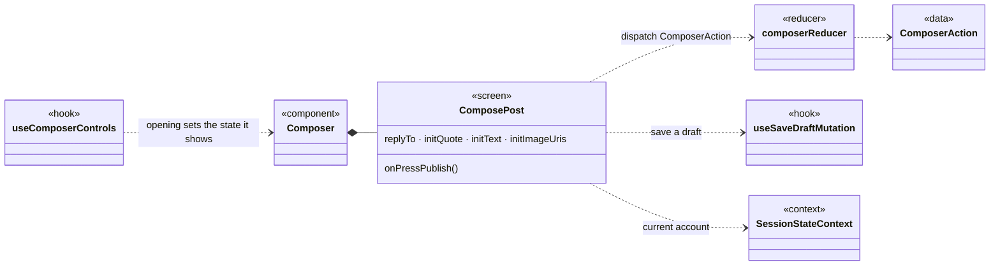
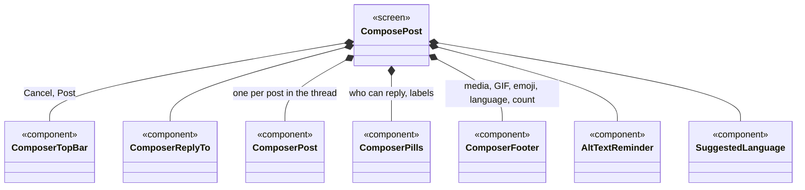
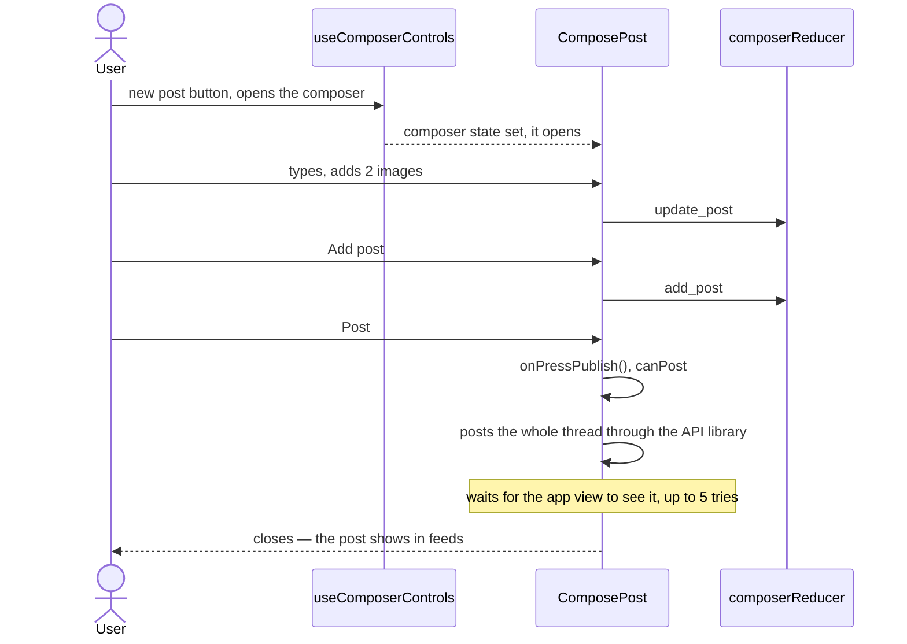

## What it does {#what}

The composer opens over any screen: `useComposerControls().openComposer()` stores the options (a reply target, a quote, a mention, initial text or images) in the shell's composer state, and the shell's `Composer` renders `ComposePost` when that state is set. Everything you write is a thread: `composerReducer` holds a list of posts, each with its rich text, embeds and languages, and **Add post** appends another one. A post can carry up to 4 images or one video (uploaded and processed while you keep typing; with "publish on upload" it posts when processing finishes), a link card, a quote or a GIF. **Post** is enabled when at least one post has content, none is over 300 characters, and no media is still uploading. Publishing calls `post()` from the API library for the whole thread, then waits for the app view to see it — retrying up to 5 times — before closing, so the new post appears in your feeds and thread right away. Leaving with unsaved text offers to save a draft (up to 1,000 characters); drafts can be reopened later. Alt-text reminders, a language suggestion, interaction settings (who can reply, quote) and a thread gate are part of the same screen.

## Logic · class diagram {#classes}

- `◆──` contains
- `┄┄▷` uses

## Screen · component composition {#widgets}

- `◆──` contains

## Write and publish a thread · sequence {#sequence}

## Key files {#files}

- `src/view/com/composer/Composer.tsx` · composer screen and publishing
- `src/view/com/composer/state/composer.ts` · thread reducer, limits
- `src/view/com/composer/` · text input, photos, video, link cards, footer
- `src/state/shell/composer/` · open and close from anywhere
- `src/view/shell/Composer.tsx` · shows the composer over the shell
- `src/lib/api/index.ts` · `post()`: records, blobs, thread gate
