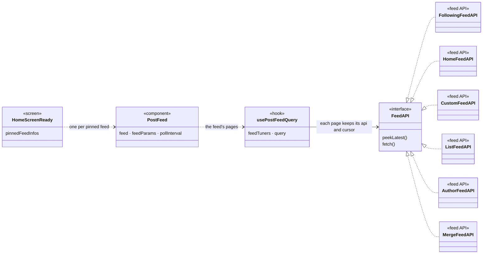
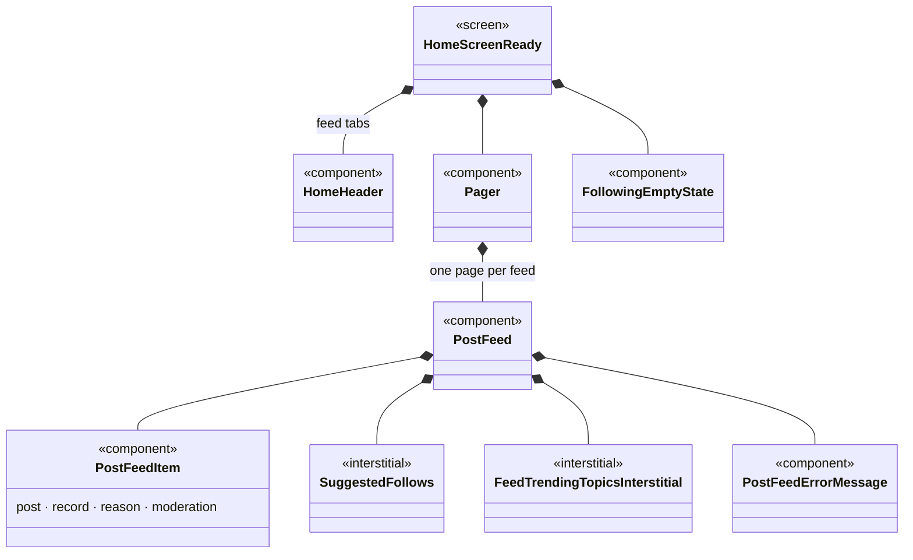
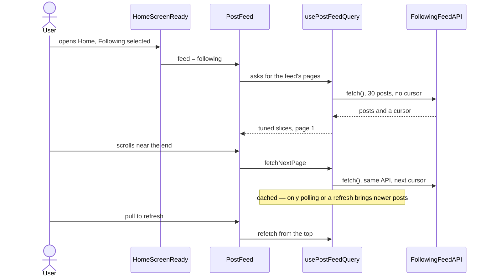

## What it does {#what}

`HomeScreen` waits for your preferences and pinned feeds, then renders `HomeScreenReady`: a `Pager` with one page per pinned feed and a tab bar in the header, remembering the selected feed (`useSetSelectedFeed`). Each page is a `FeedPage` around `PostFeed`, which calls `usePostFeedQuery` with a feed descriptor — `following`, `feedgen|…`, `list|…`, `author|…`, `likes|…` or `posts|…`. The query turns the descriptor into a `FeedAPI`: `FollowingFeedAPI` (or `MergeFeedAPI` when merging is on, or `HomeFeedAPI` when an empty Following falls back to Discover), `CustomFeedAPI`, `ListFeedAPI`, `AuthorFeedAPI`, `LikesFeedAPI` or `PostListFeedAPI`. It fetches 30 posts per page, keeps the API instance in the page params so the next page uses the same cursor, and never goes stale on its own (`STALE.INFINITY`): new posts come from polling `peekLatest()` and a "new posts" pill, or a pull to refresh. Feed tuners remove duplicates and posts your preferences hide before rendering. `PostFeed` renders rows of `PostFeedItem` and mixes in interstitials — suggested follows, trending topics, the progress guide — plus empty and error states.

## Logic · class diagram {#classes}

One hook, many feed kinds: the descriptor picks the API; the query caches the pages.

- `──▷` holds
- `◇──` list of
- `┄┄▷` uses
- `┄┄▷|` implements

## Screen · component composition {#widgets}

- `◆──` contains

## Scroll the Following feed · sequence {#sequence}

## Key files {#files}

- `src/view/screens/Home.tsx` · Home tab, pinned-feed pager
- `src/view/com/posts/PostFeed.tsx` · the post list and its interstitials
- `src/view/com/posts/PostFeedItem.tsx` · one post row
- `src/state/queries/post-feed.ts` · feed query, paging, API per descriptor
- `src/lib/api/feed/` · one `FeedAPI` per kind of feed
- `src/view/com/pager/` · the swipeable pager
