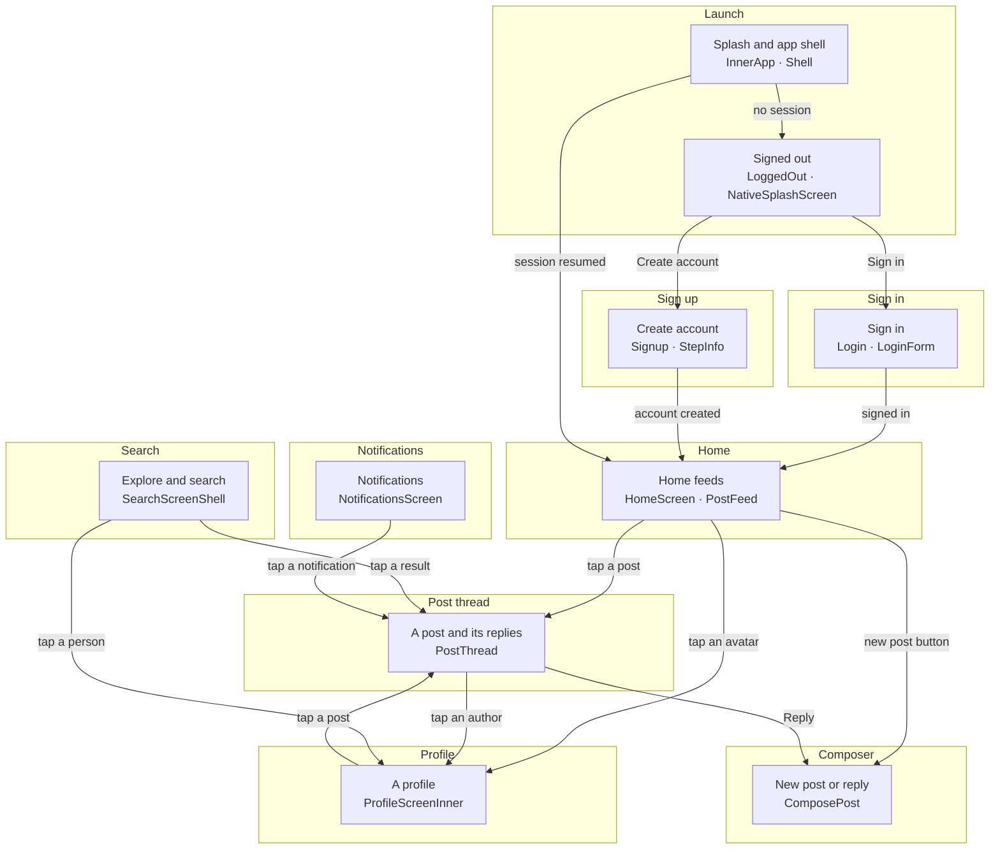
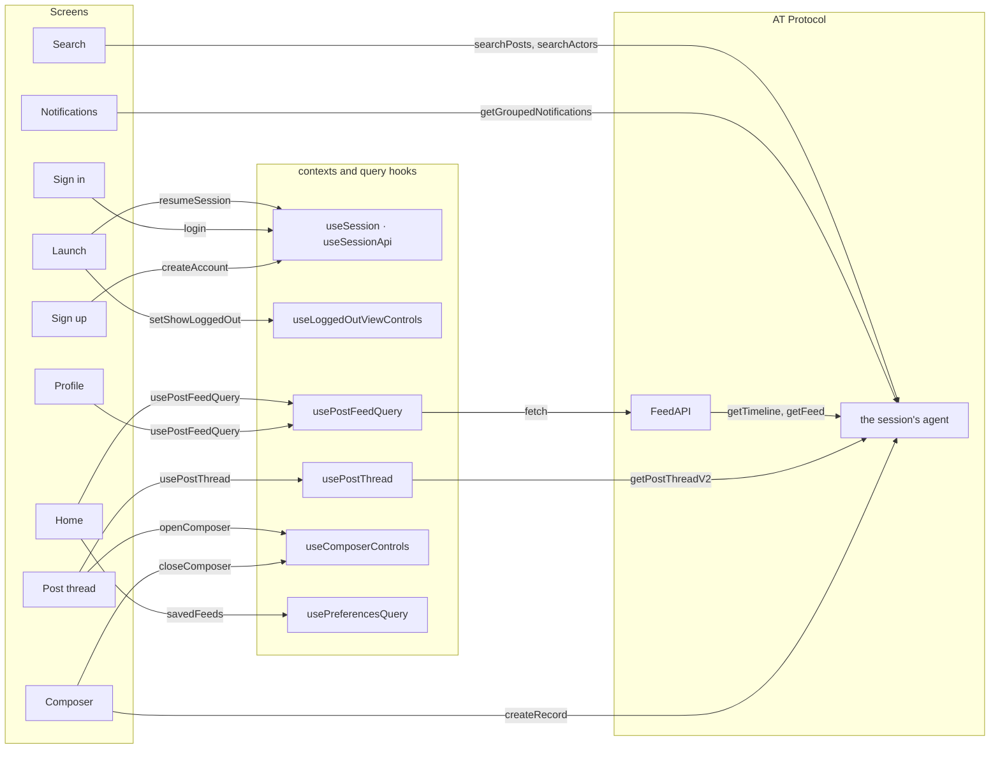

## Screens · how the user moves

`App` restores the persisted state and the last session, then renders `Shell`. Signed out, the shell shows `LoggedOut`: a splash with **Create account** and **Sign in**. Signed in, it shows a bottom-tab navigator (Home, Search, Messages, Notifications, Profile) where every tab is its own native stack; post threads, profiles and feeds are pushed onto whichever tab you are in, and the composer opens over everything from the floating button or a reply.

- `───▷` opens
- `▭` tap to open its module

## Services · what the screens share

Session state lives in a context (`SessionStateContext`, with its API in `SessionApiContext`); everything the server returns goes through TanStack Query hooks in `state/queries/`, keyed per feed, thread or profile and cached between screens. Feeds are fetched through `FeedAPI` implementations, one per kind of feed. Shell state — the composer, the drawer, the signed-out view — sits in small context stores in `state/shell/`.

- `───▷` calls, labelled with the method or what it reads
- `▭` tap to open its module
