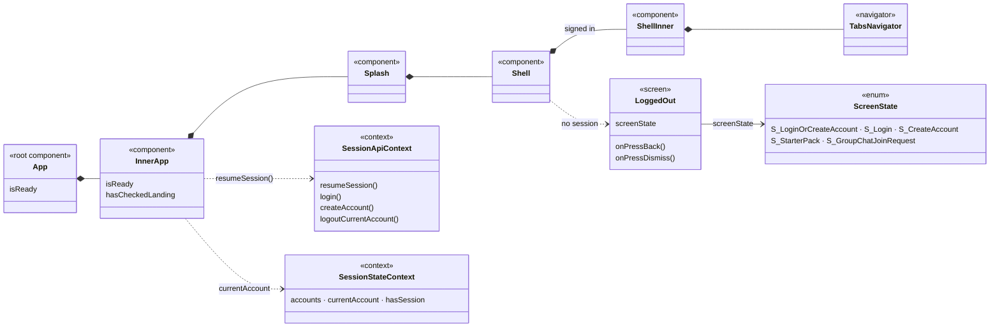
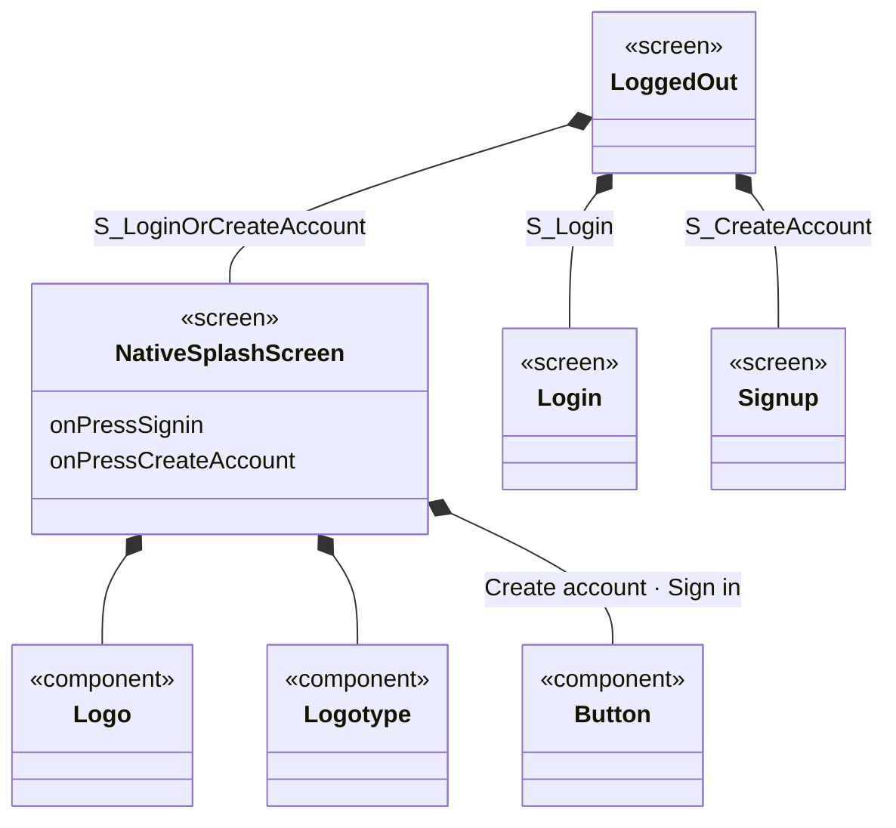
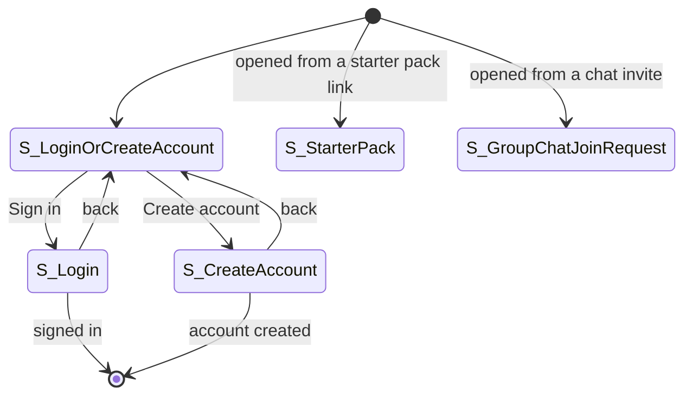
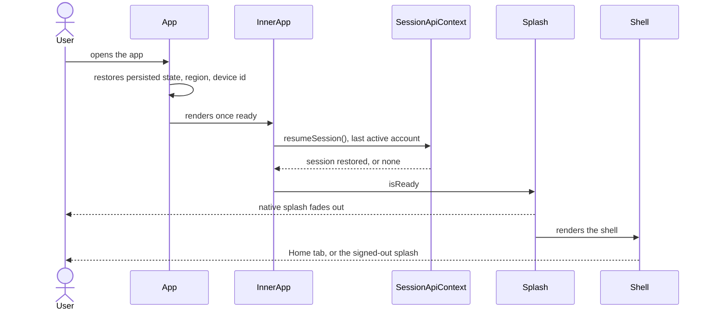

## What it does {#what}

`App` first restores the persisted state (`initPersistedState`), resolves the region (`Geo.resolve`) and sets up a device id, and renders nothing until all three are done. `InnerApp` then reads the last active account and calls `resumeSession` for it; a failed resume is logged and the app carries on signed out. Until the session check and the landing check are done, `Splash` keeps the native splash (logo and wordmark) on screen. Below it sits a deep tree of providers — theme, query client, composer, messages, moderation options, the signed-out view, the selected feed, unread notifications and more — and at the bottom `Shell`. Signed in, `Shell` renders `ShellInner`: the tab navigator plus the composer, dialogs and lightbox that can open over any tab. Without a session, `LoggedOut` takes over with a state machine of five screens — the splash (`NativeSplashScreen`, with **Create account** and **Sign in**), sign in, create account, a starter pack landing and a group-chat join request. When a session expires later, a toast says so and the signed-out view returns.

## Logic · class diagram {#classes}

Two gates — persisted state, then session — before the shell decides between the app and the signed-out view.

- `◆──` contains
- `──▷` holds
- `┄┄▷` uses

## Screen · component composition {#widgets}

The signed-out splash: full-bleed art, the logo, and two buttons.

- `◆──` contains

## Signed-out view · state machine {#states}

## Cold start · sequence {#sequence}

## Key files {#files}

- `src/App.tsx` · startup, providers, session restore
- `src/Splash.tsx` · native splash until ready
- `src/view/shell/index.tsx` · shell, dialogs, composer over the tabs
- `src/Navigation.tsx` · tab navigator and every route
- `src/view/com/auth/LoggedOut.tsx` · signed-out screens
- `src/view/com/auth/NativeSplashScreen.tsx` · Create account / Sign in splash
- `src/state/session/` · accounts, session API, agents
