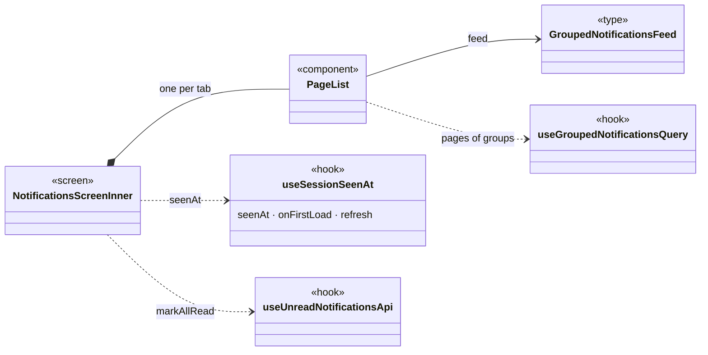
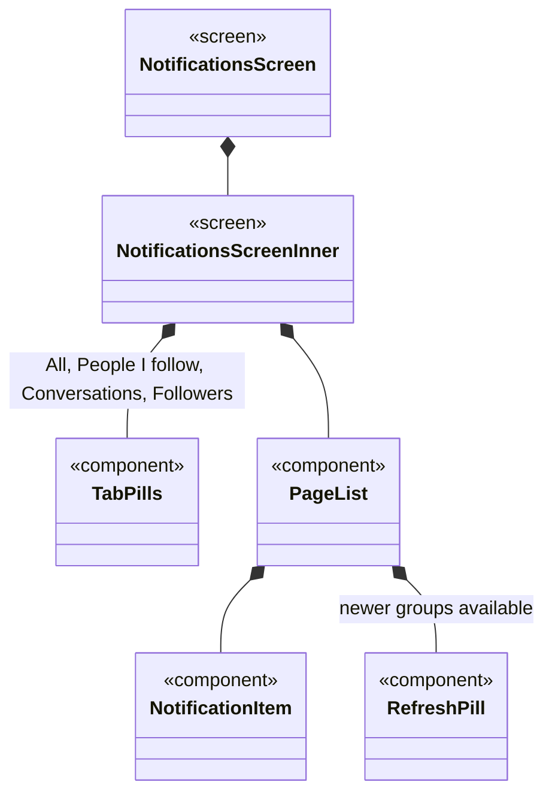
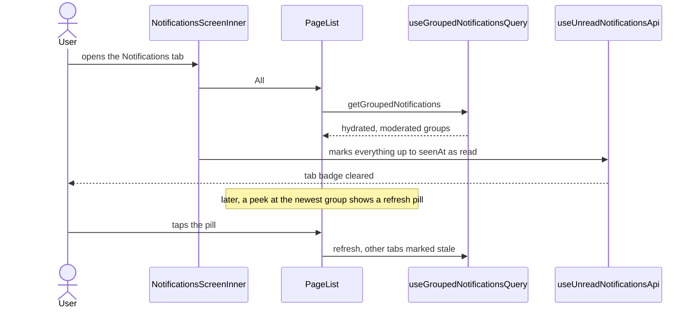

## What it does {#what}

`NotificationsScreen` renders `NotificationsScreenInner`: a header, tab pills and a pager with four feeds of the server's grouped notifications — **All**, **People I follow**, **Conversations** and **Followers**. Each tab's `PageList` reads `useGroupedNotificationsQuery` for its feed: pages of `getGroupedNotifications`, hydrated against each page's related posts and profiles, moderated, and never refreshed on their own — the screen decides when. To know whether a tab has something new without loading it, it peeks at just the newest group (`limit: 1`) and shows a refresh pill. Refreshing **All** brings the other tabs along and the other way round; tabs refreshed while out of view are marked stale and reload when opened. What's been seen is tracked per session (`useSessionSeenAt`): loading **All** marks its items as seen and calls `updateSeen` on the server through `useUnreadNotificationsApi`, which also drives the badge on the tab bar. Each row is a `NotificationItem` that groups the actors behind a like, repost, follow, reply, mention or quote.

## Logic · class diagram {#classes}

- `◆──` contains
- `──▷` holds
- `┄┄▷` uses

## Screen · component composition {#widgets}

- `◆──` contains

## Open notifications · sequence {#sequence}

## Key files {#files}

- `src/screens/Notifications/index.tsx` · screen, tabs, refresh and seen logic
- `src/screens/Notifications/components/` · page list, tab pills, notification rows
- `src/state/queries/notifications/grouped/` · grouped query, hydration, moderation
- `src/state/queries/notifications/unread.tsx` · unread count and mark-as-read
