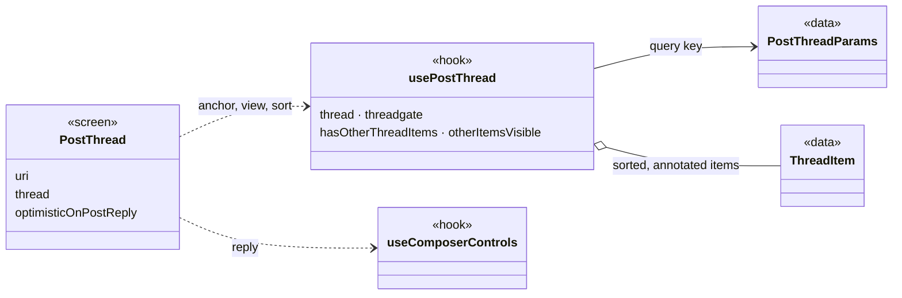
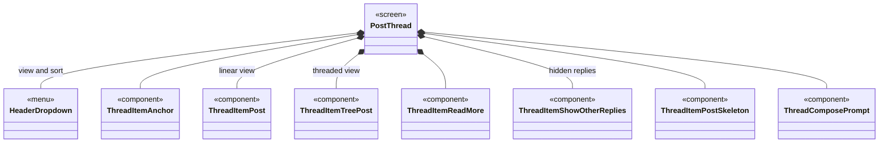
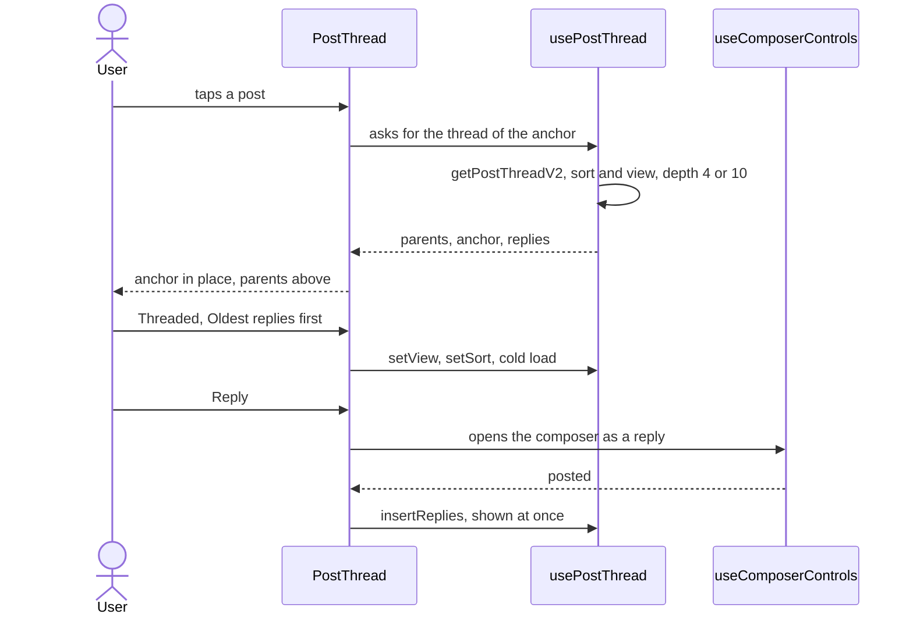

## What it does {#what}

Tapping a post anywhere pushes `PostThread` with its URI. `usePostThread` calls `getPostThreadV2` for that anchor with the chosen `sort` and `view` and a reply depth that depends on the view: 10 levels deep in the **linear** view, 4 in the **threaded** tree (6 on desktop web). A second query, `getPostThreadOtherV2`, fetches the replies hidden by the author or by your moderation settings, shown only when you ask for them. The response is sorted and annotated into thread items: parents above the anchor, the anchor itself (`ThreadItemAnchor`), then replies as `ThreadItemPost` (linear) or `ThreadItemTreePost` (threaded), with "read more" rows where a branch goes deeper, and skeletons while loading. The header menu switches between **Linear** and **Threaded** and sorts by **Top**, **Oldest** or **Newest** replies first; a change is treated like a cold load, keeping the anchor in place while parents load. Signed out, posts from accounts that hide from logged-out viewers become placeholders. Replying opens the composer; a successful reply is inserted into the thread right away (`insertReplies`), before the server echoes it back.

## Logic · class diagram {#classes}

- `──▷` holds
- `◇──` list of
- `┄┄▷` uses

## Screen · component composition {#widgets}

- `◆──` contains

## Open a thread, reply · sequence {#sequence}

## Key files {#files}

- `src/screens/PostThread/index.tsx` · thread screen and its list
- `src/screens/PostThread/components/` · anchor, posts, tree, read more, header menu
- `src/state/queries/usePostThread/` · thread queries, sorting, optimistic replies
