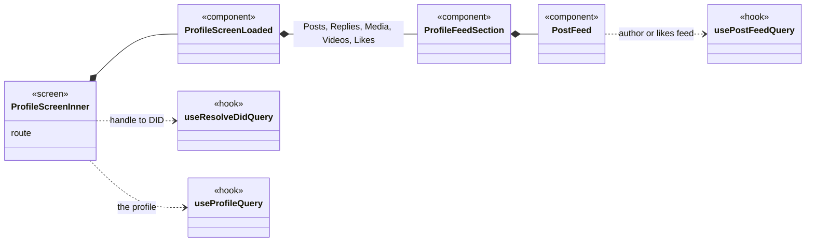
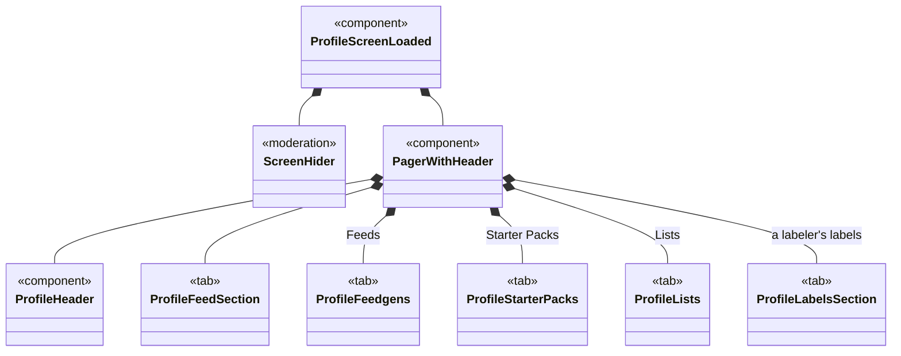
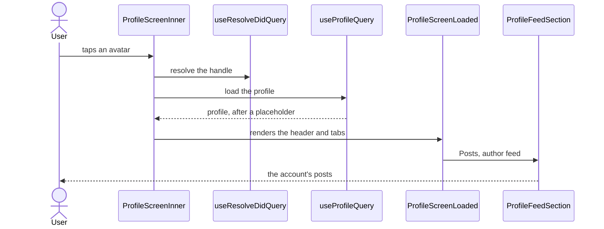

## What it does {#what}

Profiles open by handle or DID: `ProfileScreenInner` resolves the handle to a DID (`useResolveDidQuery`), loads the profile (`useProfileQuery`), and renders `ProfileScreenLoaded` once both are there; a placeholder from a feed item can show at once while the full profile loads. Content that moderation hides is wrapped in a `ScreenHider` you can choose to look past. `ProfileHeader` shows the banner, avatar, names, bio, counts, and **Follow**, **Edit profile** or **Subscribe** for labelers. Below it, `PagerWithHeader` holds only the tabs that apply: **Labels** and **Lists** for a labeler, then **Posts**, **Replies**, **Media**, **Videos**, **Likes** (your own profile), **Feeds**, **Starter Packs** and **Lists** when the account has any. The post tabs are `ProfileFeedSection`s around the same `PostFeed` as Home, with an `author|…` or `likes|…` feed descriptor, so they page and cache the same way. A floating button opens the composer, prefilled with a mention when you're on someone else's profile.

## Logic · class diagram {#classes}

- `◆──` contains
- `┄┄▷` uses

## Screen · component composition {#widgets}

- `◆──` contains

## Open a profile · sequence {#sequence}

## Key files {#files}

- `src/view/screens/Profile.tsx` · profile screen, tabs that apply
- `src/screens/Profile/Header/` · header, follow and edit
- `src/screens/Profile/Sections/` · feed tab
- `src/view/com/pager/PagerWithHeader.tsx` · pager under a collapsing header
- `src/state/queries/profile.ts` · profile query and mutations
