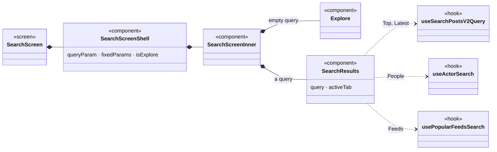
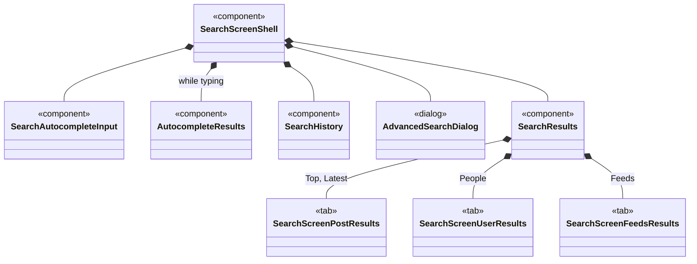
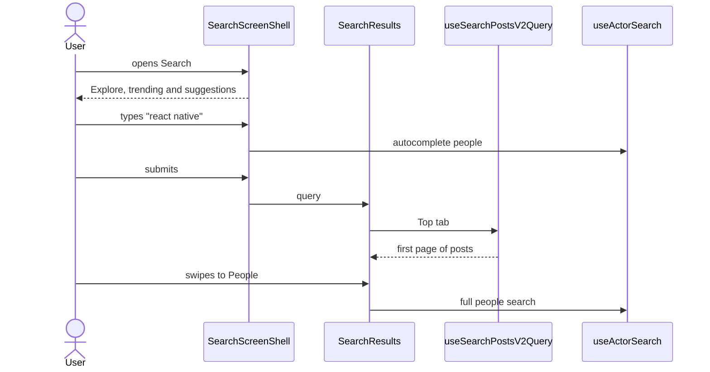

## What it does {#what}

`SearchScreen` is the Search tab's root and renders `SearchScreenShell`, the same shell that also serves profile search and hashtag pages. With an empty box it shows `Explore`: trending topics, trending videos, suggested accounts by interest, feed previews and starter packs. Typing shows autocomplete results for people (`useActorSearch`) and your search history, which is stored on the device; submitting runs the search and shows `SearchResults`, a pager with five tabs — **Top** and **Latest** posts (`useSearchPostsV2Query`), **People** (`useActorSearch`), **Feeds** (`usePopularFeedsSearch`) and **Starter Packs**. The People and Feeds tabs only appear when no post-only filter (such as a language) is set. An advanced-search dialog builds filters into the query (`from:`, `since:`, language), and a language admonition suggests one when the query's language is detected. Results are paged and cached like every other query.

## Logic · class diagram {#classes}

- `◆──` contains
- `┄┄▷` uses

## Screen · component composition {#widgets}

- `◆──` contains

## Search for a topic · sequence {#sequence}

## Key files {#files}

- `src/screens/Search/Shell.tsx` · search shell, input, autocomplete, history
- `src/screens/Search/SearchResults.tsx` · the five result tabs
- `src/screens/Search/Explore.tsx` · Explore modules
- `src/screens/Search/modules/` · trending, suggested accounts, feed previews
- `src/state/queries/search-posts-v2.ts` · post search
- `src/state/queries/actor-search.ts` · people search
