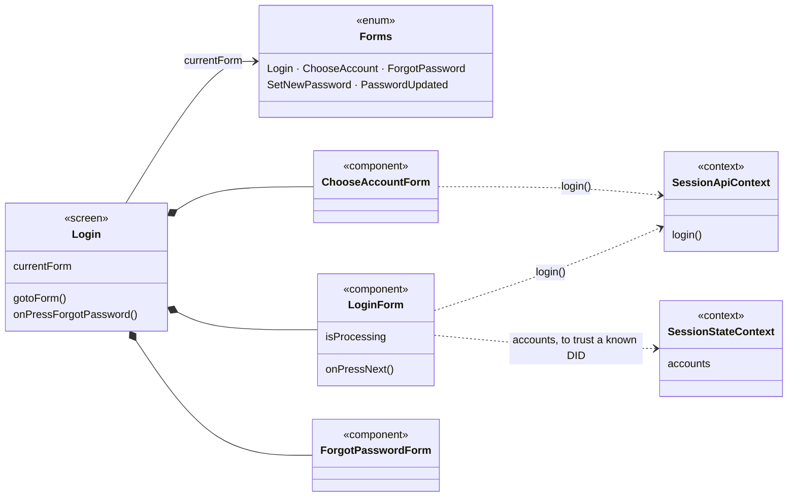
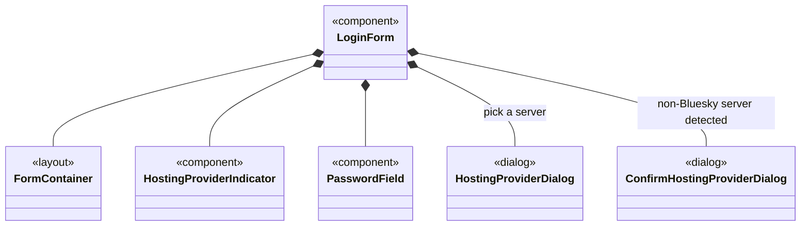
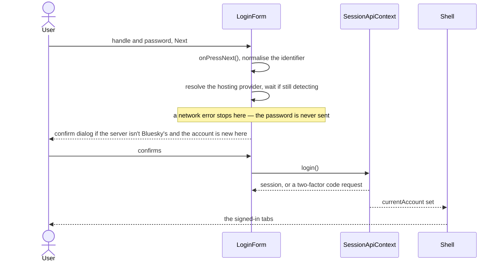

## What it does {#what}

`Login` is one screen with five forms that slide in order: **choose account** (when accounts were used on this device before), **sign in**, **forgot password**, **set new password** and **password updated**. `LoginForm` takes a handle or email and a password, with an indicator of the hosting provider. On **Next** it trims and lower-cases the identifier, adds the provider's domain when you typed a bare name, then asks `useHostingProvider` which server the account lives on — waiting for an autodetection still in flight. A network error stops the sign-in rather than guessing where to send the password. If detection lands on a server that isn't Bluesky's, wasn't chosen by hand, and isn't an account already signed in on this device, a dialog asks you to confirm the server first, so a look-alike handle can't capture the password. Then `login()` on the session API signs in; a server that asks for a two-factor code shows the code field. The form stays in its processing state on success while the app switches to the signed-in shell.

## Logic · class diagram {#classes}

- `◆──` contains
- `──▷` holds
- `┄┄▷` uses

## Screen · component composition {#widgets}

- `◆──` contains

## Sign in · sequence {#sequence}

The password is only sent once the server is known — and confirmed when it isn't Bluesky's.

## Key files {#files}

- `src/screens/Login/index.tsx` · the five forms and their order
- `src/screens/Login/LoginForm.tsx` · sign-in form, provider check, confirmation
- `src/screens/Login/ChooseAccountForm.tsx` · accounts used on this device
- `src/screens/Login/ForgotPasswordForm.tsx` · reset email
- `src/state/session/` · `login()` and the agents
