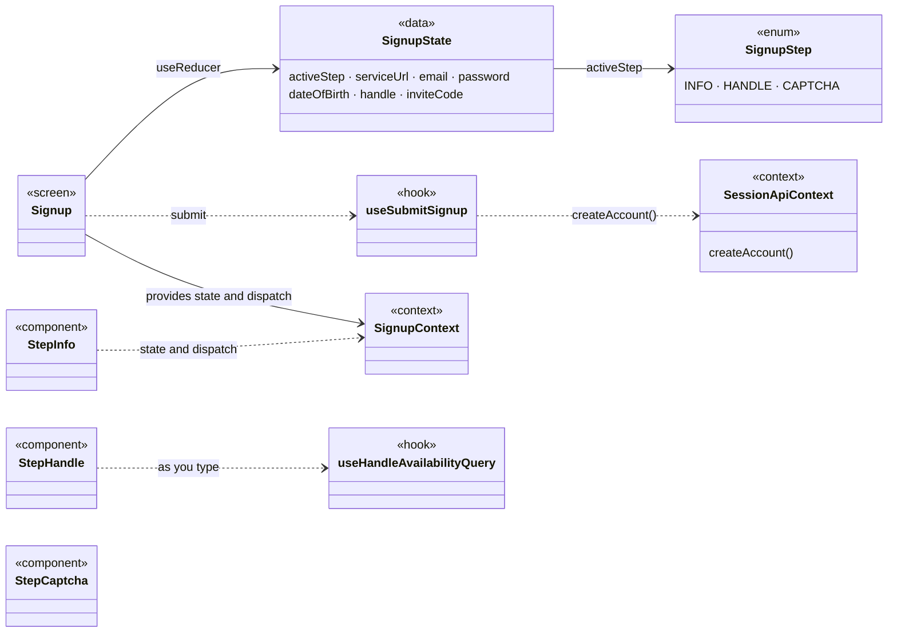
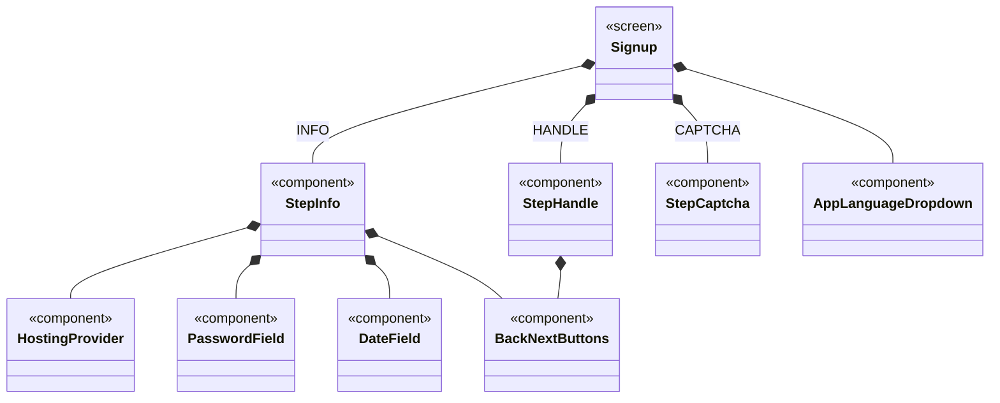
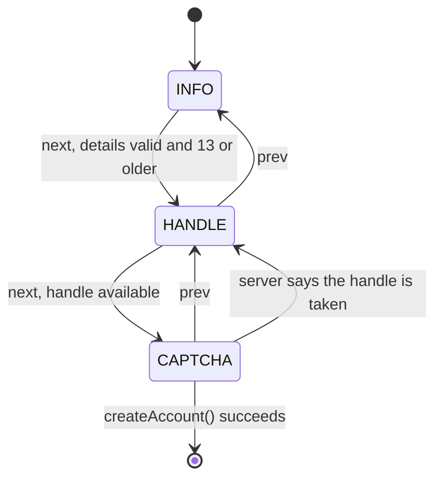
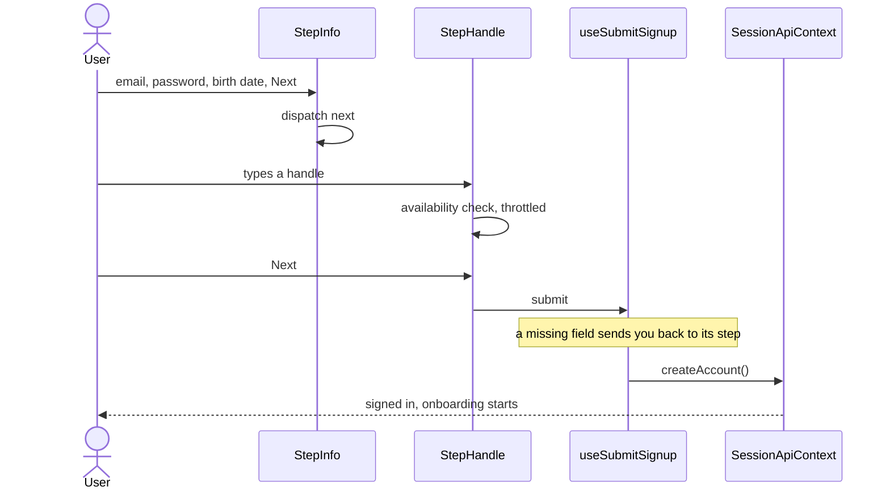

## What it does {#what}

`Signup` holds the whole flow in one `useReducer` (`SignupState`): the server and its description, email, password, date of birth, invite code, handle, the active step and errors. There are three steps, `SignupStep.INFO`, `HANDLE` and `CAPTCHA`; **next** and **prev** move one step and set the slide direction. `StepInfo` asks for the hosting provider (Bluesky by default), email, password and birth date, and blocks anyone under 13 (`MIN_ACCESS_AGE`); `StepHandle` checks the handle's availability as you type (throttled) and lists the requirements, up to 18 characters on a Bluesky domain; `StepCaptcha` shows the server's captcha in a web view when the server requires phone verification. `useSubmitSignup` validates again before submitting — a missing email, password, handle, birth date or captcha code sends you back to that step with its error — then calls `createAccount()` on the session API. Errors from the server map back to a step too: a taken or invalid handle returns to the handle step.

## Logic · class diagram {#classes}

- `──▷` holds
- `┄┄▷` uses

## Screen · component composition {#widgets}

- `◆──` contains

## Steps · state machine {#states}

## Create an account · sequence {#sequence}

## Key files {#files}

- `src/screens/Signup/index.tsx` · signup screen and steps
- `src/screens/Signup/state.ts` · reducer, steps, submit
- `src/screens/Signup/StepInfo/` · details step
- `src/screens/Signup/StepHandle/` · handle step
- `src/screens/Signup/StepCaptcha/` · captcha step
