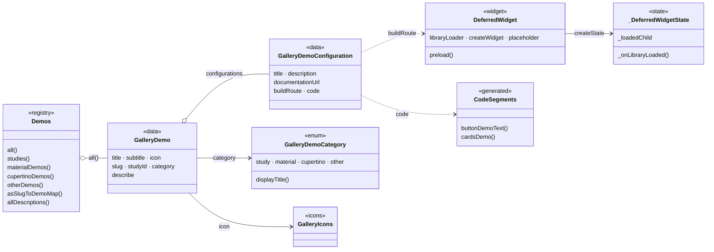
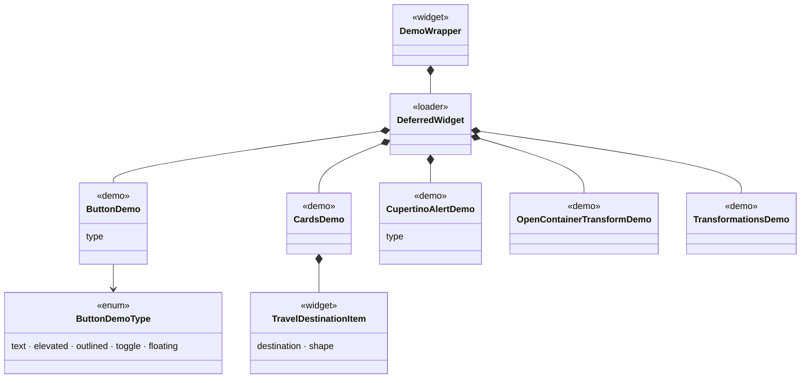
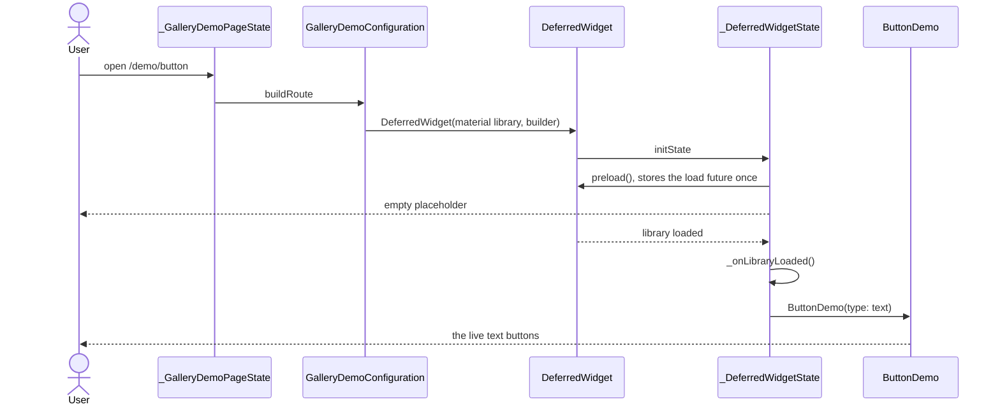

## What it does {#what}

`Demos` is the app's table of contents: six studies, 24 Material demos, 13 Cupertino demos and 5 reference demos (colors, typography, motion, 2D transformations, two-pane), 81 configurations in all. Each `GalleryDemo` has a title, subtitle, icon, URL slug and category; each of its configurations has a title, a description, an API documentation URL, a `buildRoute` that builds the live widget and a `code` builder. The demo libraries are `deferred` imports, so `buildRoute` wraps the widget in a `DeferredWidget` that loads the library once, caches the future for everyone, and shows an empty placeholder until it arrives. The source shown in the code panel comes from `CodeSegments`, a 50,000-line file generated from the demo files at build time: one highlighted `TextSpan` builder per configuration (64 of them). One demo class usually serves several configurations through a type enum — `ButtonDemo(type: ButtonDemoType.text)` and four siblings share one file.

## Logic · class diagram {#classes}

A demo is data; the widget it shows is created lazily, after its library loads.

- `──▷` holds
- `◇──` list of
- `┄┄▷` uses

## Screen · a few of the demos {#widgets}

Every demo is an ordinary widget with its own `Scaffold`; enums pick the variant a configuration shows.

- `◆──` contains
- `──▷` reads model

## Load a demo the first time · sequence {#sequence}

Only the first demo from a library pays for loading it; the future is shared.

## Key files {#files}

- `lib/data/demos.dart` · demo registry and configurations
- `lib/deferred_widget.dart` · deferred library loading
- `lib/codeviewer/code_segments.dart` · generated highlighted sources
- `lib/demos/material/` · 24 Material demos
- `lib/demos/cupertino/` · 13 Cupertino demos
- `lib/demos/reference/` · colors, typography, motion, transformations
- `lib/data/icons.dart` · demo icons
