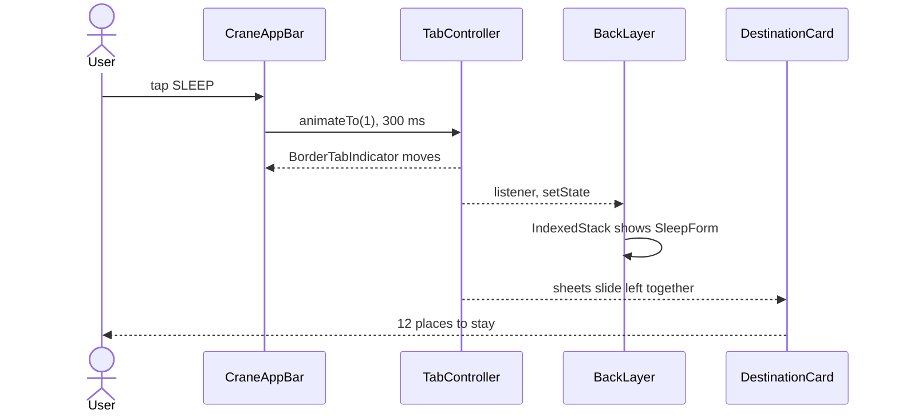

## What it does {#what}

Crane is a single-route `MaterialApp` at `/crane` whose screen is a backdrop with three tabs in the app bar: **FLY**, **SLEEP** and **EAT**. Each tab has a search form in the back layer — Fly asks for travelers, origin, destination and dates; Sleep for travelers, dates and location; Eat for diners, date, time and location — shown in an `IndexedStack`, so only the selected form is focusable. In front of it sit three sheets of destination cards (14 flights, 12 places to stay, 11 restaurants) side by side: switching tabs animates the tab controller over 300 ms and slides all three sheets sideways together, with a 5 % gap between them, and the middle Sleep sheet sits 60 pt higher than the other two. Each card shows a photo, the destination and a subtitle such as the number of stops and flight time, the number of available properties, or the number of restaurants. The forms are display-only: no search is run. On desktop the cards form a 4-column grid; the selected tab survives state restoration.

## Logic · class diagram {#classes}

The destination lists are static data, read once per sheet; the tab controller drives everything that moves.

```mermaid
classDiagram
  direction LR
  class CraneApp {
    <<app>>
    defaultRoute
  }
  class CraneAppBar {
    <<widget>>
    tabController · tabHandler
  }
  class BackLayer {
    <<widget>>
    backLayerItems · tabController
  }
  class BackLayerItem {
    <<widget>>
    index
  }
  class FlyForm { <<form>> }
  class SleepForm { <<form>> }
  class EatForm { <<form>> }
  class HeaderForm {
    <<widget>>
    fields
  }
  class HeaderFormField {
    <<data>>
    index · iconData · title
    textController
  }
  class Destination {
    <<data>>
    id · destination · imageAspectRatio
    subtitle()
  }
  class FlyDestination {
    <<data>>
    stops · duration
  }
  class SleepDestination {
    <<data>>
    total
  }
  class EatDestination {
    <<data>>
    total
  }
  CraneApp *-- CraneAppBar
  CraneApp *-- BackLayer
  BackLayer o-- BackLayerItem : one shown, IndexedStack
  BackLayerItem <|-- FlyForm
  BackLayerItem <|-- SleepForm
  BackLayerItem <|-- EatForm
  FlyForm *-- HeaderForm
  HeaderForm o-- HeaderFormField : fields
  Destination <|-- FlyDestination
  Destination <|-- SleepDestination
  Destination <|-- EatDestination
```

- `◆──` contains
- `◇──` list of
- `──▷|` extends

## Screen · widget composition {#widgets}

The front sheets are plain card lists; the back forms are rows of icon text fields.

```mermaid
classDiagram
  direction TB
  class CraneAppBar { <<widget>> }
  class BorderTabIndicator { <<decoration>> }
  class FlyForm { <<form>> }
  class HeaderForm { <<widget>> }
  class _HeaderTextField {
    <<widget>>
    field
  }
  class DestinationCard {
    <<widget>>
    destination
  }
  class _DestinationImage {
    <<widget>>
    destination
  }
  class HighlightFocus { <<focus ring>> }
  CraneAppBar --> BorderTabIndicator : selected tab
  FlyForm *-- HeaderForm
  HeaderForm *-- _HeaderTextField : 4
  DestinationCard *-- HighlightFocus
  DestinationCard *-- _DestinationImage
```

- `◆──` contains
- `──▷` reads model

## Switch from Fly to Sleep · sequence {#sequence}

One tab controller moves the indicator, the form and the three sheets in step.

## Key files {#files}

- `lib/studies/crane/app.dart` · Crane app and its three forms
- `lib/studies/crane/backdrop.dart` · app bar, tabs, sliding sheets
- `lib/studies/crane/backlayer.dart` · form switcher
- `lib/studies/crane/fly_form.dart` · flight search fields
- `lib/studies/crane/header_form.dart` · icon text fields
- `lib/studies/crane/item_cards.dart` · destination card
- `lib/studies/crane/model/` · destinations and their data
