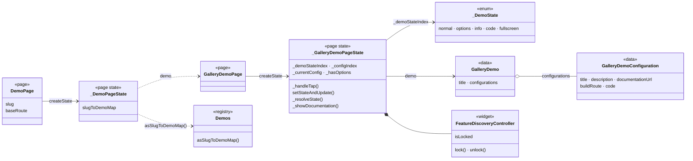
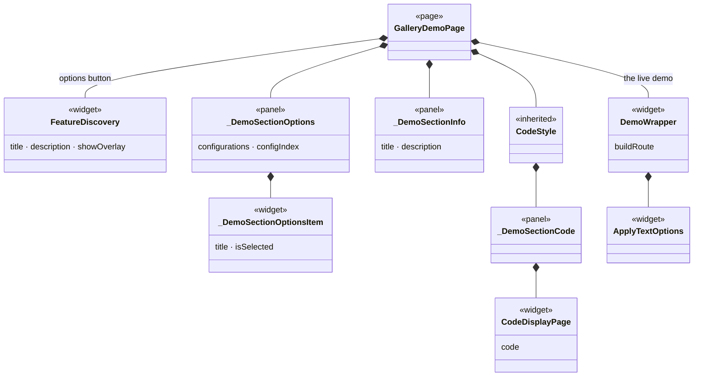
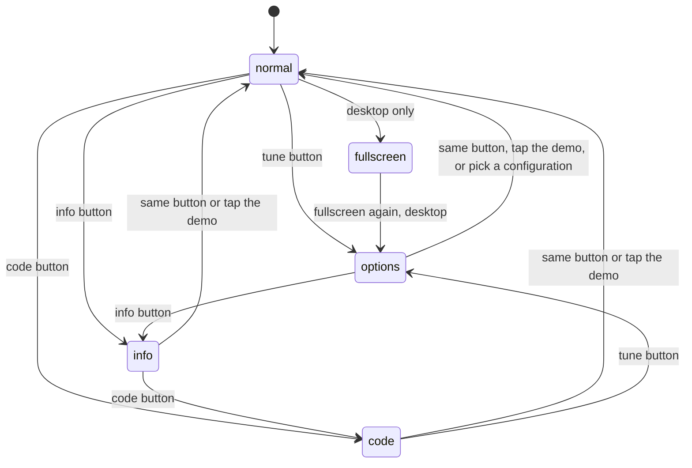
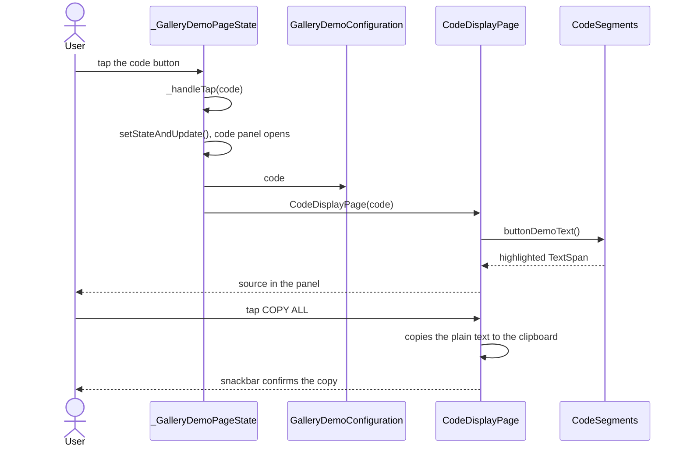

## What it does {#what}

`/demo/<slug>` looks the slug up in the demos registry (an unknown slug pops back to home) and shows the demo's current configuration live, under its own Material theme. The app bar has up to five buttons: **options** (only when the demo has more than one configuration), **info**, **code**, **documentation** (opens the API page in the browser, or shows the URL in a dialog if it can't) and, on desktop, **fullscreen**. On a phone the chosen panel grows above the demo over 200 ms and pushes it down; tapping the same button again, or tapping the demo, closes it, and picking a configuration in options switches the demo and closes the panel. The code panel shows the configuration's syntax-highlighted source in Roboto Mono on a dark background with a **COPY ALL** button that puts the plain text on the clipboard and confirms with a snackbar. The selected panel and configuration survive state restoration. The first time any demo with options opens on a phone, a feature-discovery overlay rings the options button and explains it; that flag is saved on the device, so it never shows again.

## Logic · class diagram {#classes}

The route widget only resolves the slug; the stateful page keeps the panel and configuration as restorable integers.

- `──▷` holds
- `◇──` list of
- `◆──` contains
- `┄┄▷` uses

## Screen · widget composition {#widgets}

On a phone the page is a non-scrolling list — panel, then demo — so the panel's growth slides the demo down.

- `◆──` contains

## Panels · state machine {#states}

Each button toggles its own panel; on a phone everything leads back to the plain demo.

## Read a demo's code · sequence {#sequence}

The code is not read from files at run time: each configuration carries a generated `TextSpan` builder.

## Key files {#files}

- `lib/pages/demo.dart` · demo page, panels, code page
- `lib/feature_discovery/` · first-run options overlay
- `lib/codeviewer/` · code style and display types
- `lib/themes/material_demo_theme_data.dart` · theme around demos
