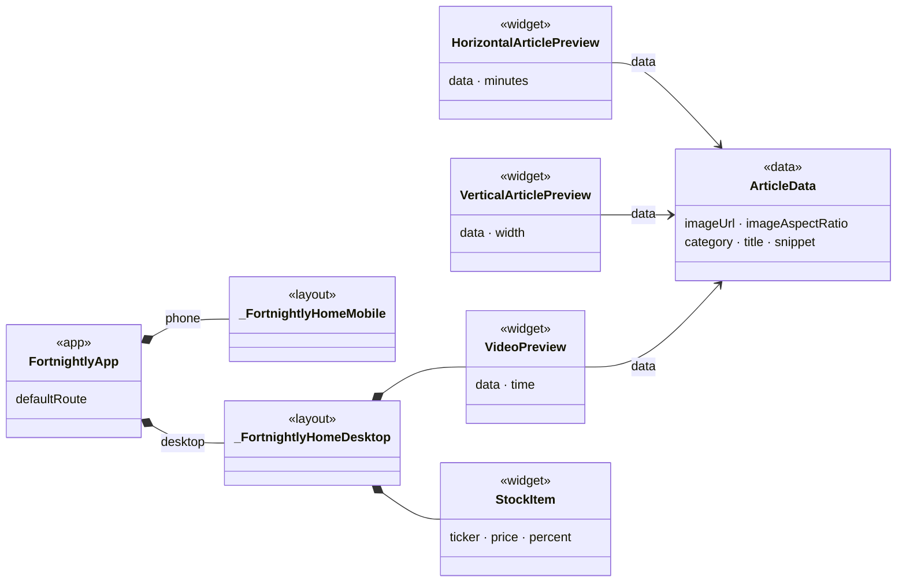
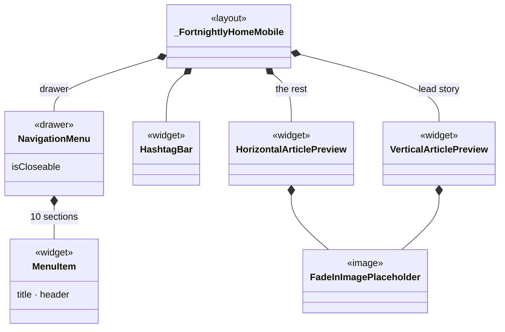
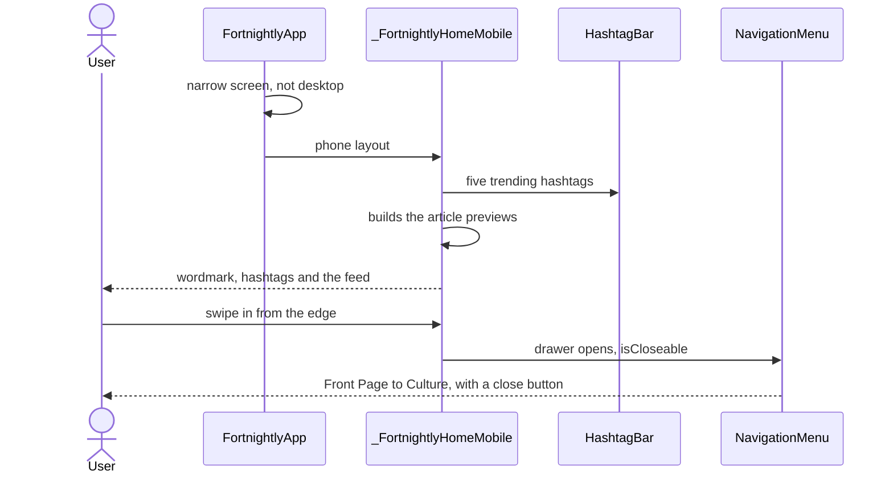

## What it does {#what}

Fortnightly is a single-route `MaterialApp` at `/fortnightly` that shows how one set of content adapts from a phone to a wide screen. On a phone it is a `Scaffold` with the Fortnightly wordmark in the app bar, a search button that does nothing, and a drawer with the section menu — Front Page, World, US, Politics, Business, Tech, Science, Sports, Travel, Culture. The body is a horizontal bar of five trending hashtags followed by the article feed: one large vertical preview, then horizontal previews separated by thin dividers and a thicker section divider. On desktop the same pieces become three columns — the menu, the article feed and a column of stock tickers and video previews — under the hashtag bar. All content is static: `ArticleData` objects with an image, a category, a title and an optional snippet, built in code each time the feed is built.

## Logic · class diagram {#classes}

No state at all: top-level builder functions return the lists of widgets, and the app picks a layout by screen width.

- `◆──` contains
- `──▷` reads model

## Screen · widget composition {#widgets}

The phone feed is one `ListView`: hashtags first, then the previews in order.

- `◆──` contains

## Open the section menu · sequence {#sequence}

The only interaction is the drawer; everything else is layout.

## Key files {#files}

- `lib/studies/fortnightly/app.dart` · app and its phone and desktop layouts
- `lib/studies/fortnightly/shared.dart` · articles, previews, menu, stocks, theme
