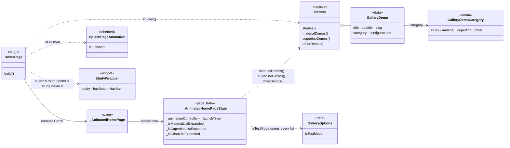
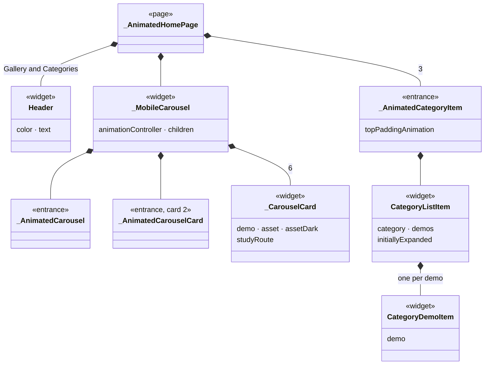
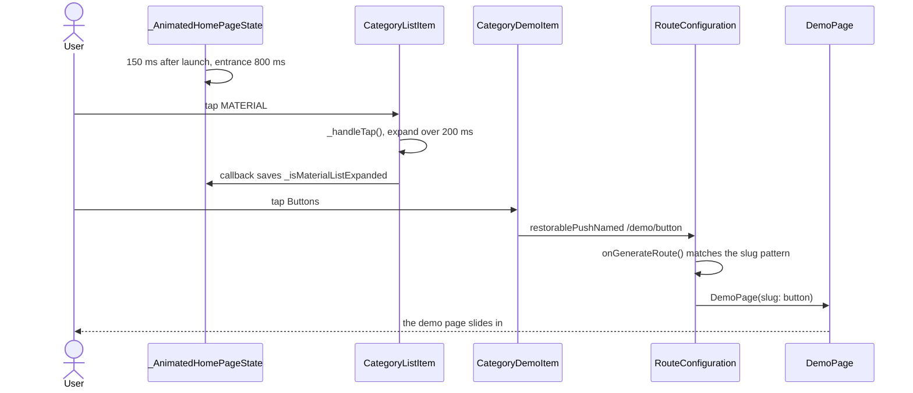

## What it does {#what}

The phone layout is one `ListView`: a **Gallery** header, a carousel of six study cards (Reply, Shrine, Rally, Crane, Fortnightly, Starter app), a **Categories** header and three expandable lists — Material (24 demos), Cupertino (13) and Reference (5). The carousel is a `PageView` sized so each 296 pt card plus its margins fills one page; cards shrink by 30 % per page of distance from the centre, eased out. 150 ms into launch the page plays an 800 ms entrance: the carousel slides in, the second card animates separately, and the three categories follow 0.00, 0.05 and 0.10 of the way through. Each card shows its light or dark artwork and colours, and tapping it pops to `/` and pushes the study's route. Tapping a category header expands its list over 200 ms; which lists are open, and the carousel page, are saved with state restoration. Tapping a demo pushes `/demo/<slug>`. On desktop the same content becomes a snapping horizontal carousel with arrow buttons and three side-by-side category columns, plus the About, Feedback and attribution links.

## Logic · class diagram {#classes}

`HomePage` is stateless: it builds the six cards from the studies registry and hands them to the animated mobile page.

- `──▷` holds
- `◇──` list of
- `┄┄▷` uses

## Screen · widget composition {#widgets}

Everything below the headers is wrapped in an entrance animation driven by one controller.

- `◆──` contains

## Open a demo from a category · sequence {#sequence}

Expanding a list and opening a demo are both local: the only shared state is the route name.

## Key files {#files}

- `lib/pages/home.dart` · home page, carousels, study wrapper
- `lib/pages/category_list_item.dart` · expandable category and demo rows
- `lib/routes.dart` · route patterns and study routes
- `lib/data/demos.dart` · studies and demo lists
