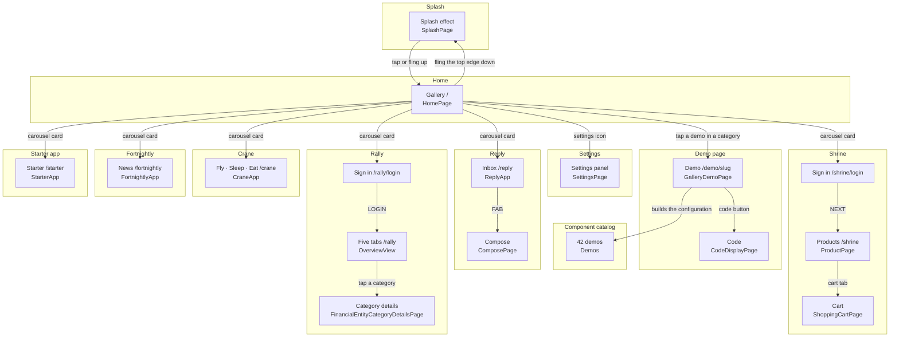
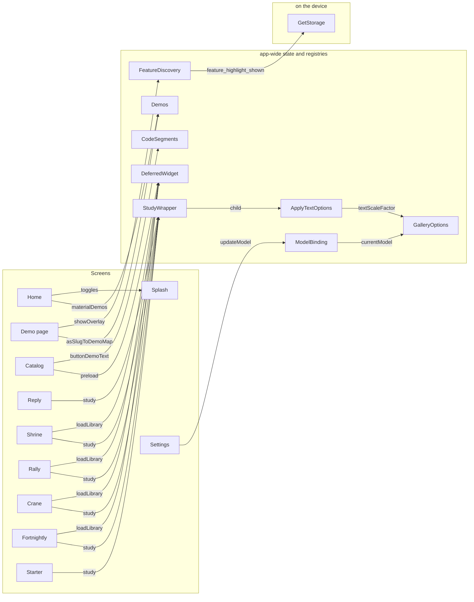

## Screens · how the user moves

`MaterialApp.onGenerateRoute` matches each route name against a list of regular expressions: `/demo/<slug>` opens one component demo, each study has its own prefix (`/reply`, `/shrine`, `/rally`, `/crane`, `/fortnightly`, `/starter`), and everything else falls through to `/`, the home screen inside the splash and settings layers. Every study is a separate `MaterialApp` with its own routes and theme, wrapped in a floating **Back** button that pops straight to `/`.

- `───▷` opens
- `▭` tap to open its module

## Services · what the screens share

There is no service layer: the Gallery's shared state is one immutable `GalleryOptions` value held by an InheritedWidget (`ModelBinding`) above the root `MaterialApp`, and every screen and study reads it. Demos and their code come from static registries compiled into the app, most of them behind deferred imports; only the first-run tooltip flag is written to disk.

- `───▷` calls or holds, labelled with the method or field
- `▭` tap to open its module
