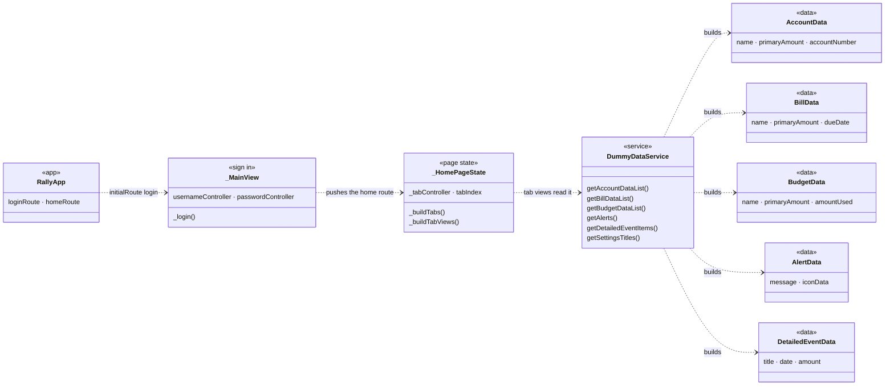
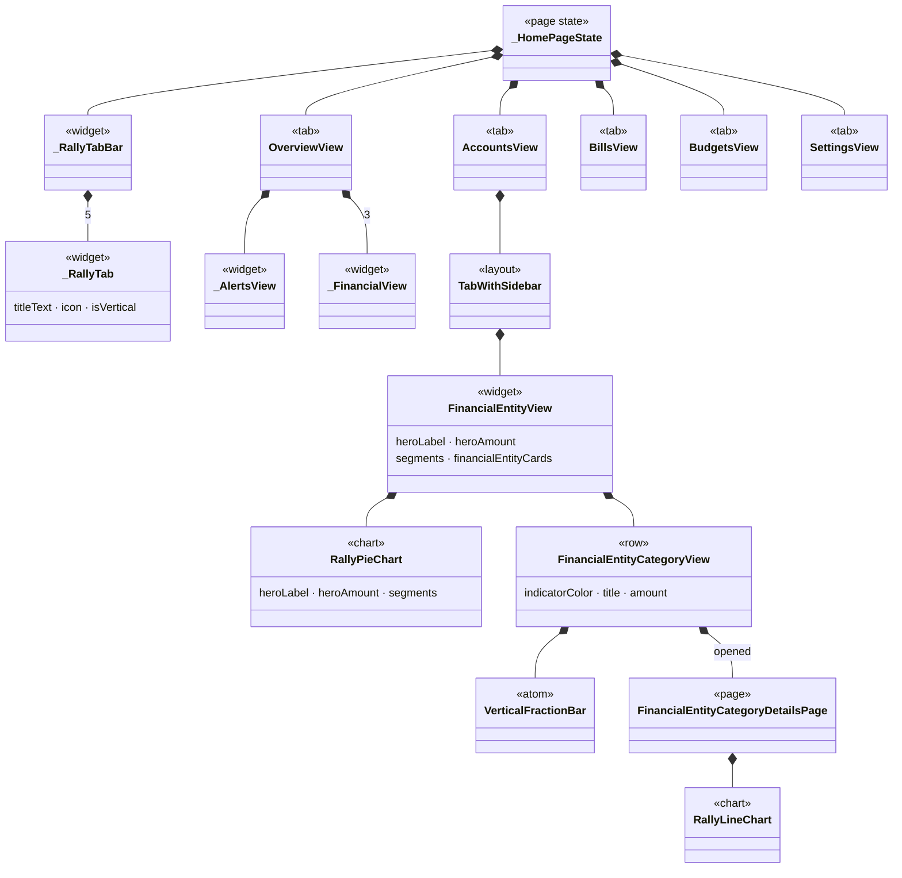
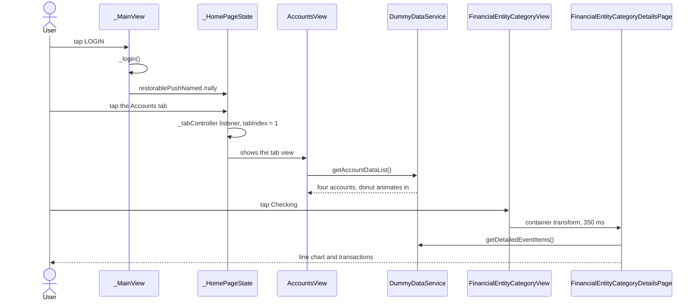

## What it does {#what}

Rally is a dark-themed `MaterialApp` that opens on `/rally/login`: username and password fields, a **LOGIN** button and a fingerprint button, both of which simply push `/rally` (pages change with a scaled shared-axis transition). The home is a five-tab bar — Overview, Accounts, Bills, Budgets, Settings — where only the selected tab shows its title, growing in over 200 ms. Overview shows the first alert and three cards (accounts, bills, budgets) with their totals; Accounts, Bills and Budgets each show an animated donut chart of their items with a coloured bar per row. All numbers come from `DummyDataService`: four accounts (Checking $2,215.13, Home Savings $8,678.88, Car Savings $987.48, Vacation $253), four bills and four budgets. Tapping a row expands it with a 350 ms container transform into a detail page with a line chart and a list of transactions. In Settings every item signs you out back to the login screen. The selected tab survives state restoration; on desktop the tab bar turns vertical and swipes go up and down.

## Logic · class diagram {#classes}

The screens are stateless views over static lists; only the tab index is state.

- `┄┄▷` uses · opens

## Screen · widget composition {#widgets}

Accounts, Bills and Budgets share one layout: a donut chart over a list of coloured rows.

- `◆──` contains

## Sign in and open an account · sequence {#sequence}

Nothing is fetched: every view builds its numbers from the dummy service on each build.

## Key files {#files}

- `lib/studies/rally/app.dart` · Rally app, routes, dark theme
- `lib/studies/rally/login.dart` · sign-in screen
- `lib/studies/rally/home.dart` · five-tab home
- `lib/studies/rally/tabs/` · overview, accounts, bills, budgets, settings
- `lib/studies/rally/finance.dart` · rows, details page, model builders
- `lib/studies/rally/charts/` · donut, line chart, fraction bar
- `lib/studies/rally/data.dart` · dummy data service
