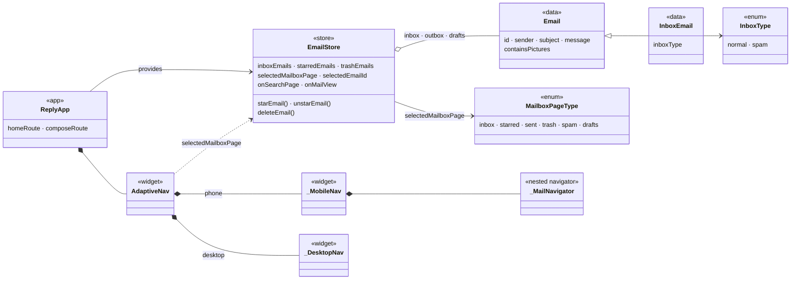
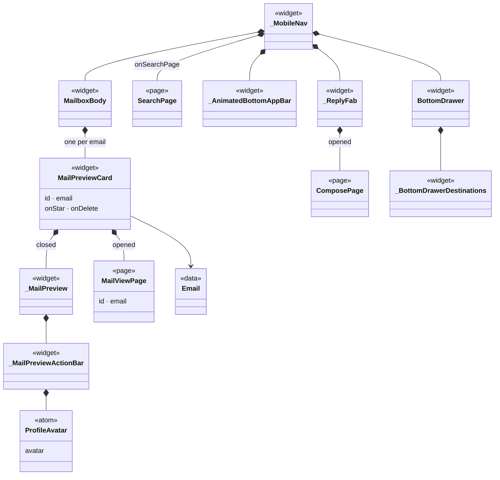
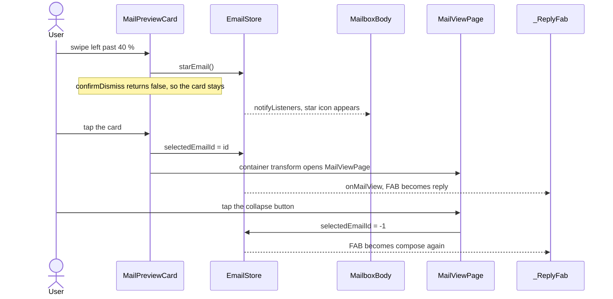

## What it does {#what}

Reply is its own `MaterialApp` at `/reply`, sharing one `EmailStore` (a `ChangeNotifier` provided with Provider) between every screen. The store holds 15 built-in emails split into inbox, outbox and drafts, and derives six mailboxes from them — Inbox, Starred, Sent, Trash, Spam and Drafts — by filtering on starred and trashed ids; emails 7 and 8 start in the trash. On a phone the mailbox sits above an animated bottom app bar: tapping the Reply logo pulls up a bottom drawer to 40 % with the mailbox list and folders, and picking one sets `selectedMailboxPage`. Swiping a card right past 80 % moves it to the trash; swiping left past 40 % stars it in place (and on the Starred mailbox removes it). Tapping a card expands it into the full mail view with a container transform, and sets `selectedEmailId`, which turns the FAB into a reply button. The search icon swaps the mailbox for `SearchPage` with a fade-through, and the FAB opens `ComposePage` the same way. On desktop the same store drives a navigation rail with a folder list and keeps the open mail inside a nested navigator.

## Logic · class diagram {#classes}

One store is the single source of truth; every widget selects the part it needs and rebuilds on `notifyListeners`.

- `──▷` holds
- `◇──` list of
- `◆──` contains
- `──▷|` extends
- `┄┄▷` uses

## Screen · widget composition {#widgets}

The phone layout keeps the app bar, drawer and FAB fixed and swaps only the body.

- `◆──` contains
- `──▷` reads model

## Star an email, then read it · sequence {#sequence}

Swipes and taps only write to the store; the lists rebuild themselves.

## Key files {#files}

- `lib/studies/reply/app.dart` · Reply app, theme, store restoration
- `lib/studies/reply/adaptive_nav.dart` · phone and desktop navigation, drawer, FAB
- `lib/studies/reply/model/` · emails and the store
- `lib/studies/reply/mailbox_body.dart` · list of mail cards
- `lib/studies/reply/mail_card_preview.dart` · swipeable mail card
- `lib/studies/reply/mail_view_page.dart` · full email
- `lib/studies/reply/search_page.dart` · search history
- `lib/studies/reply/compose_page.dart` · new email
