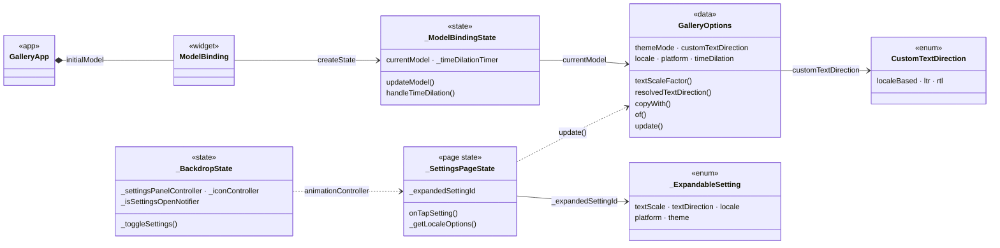
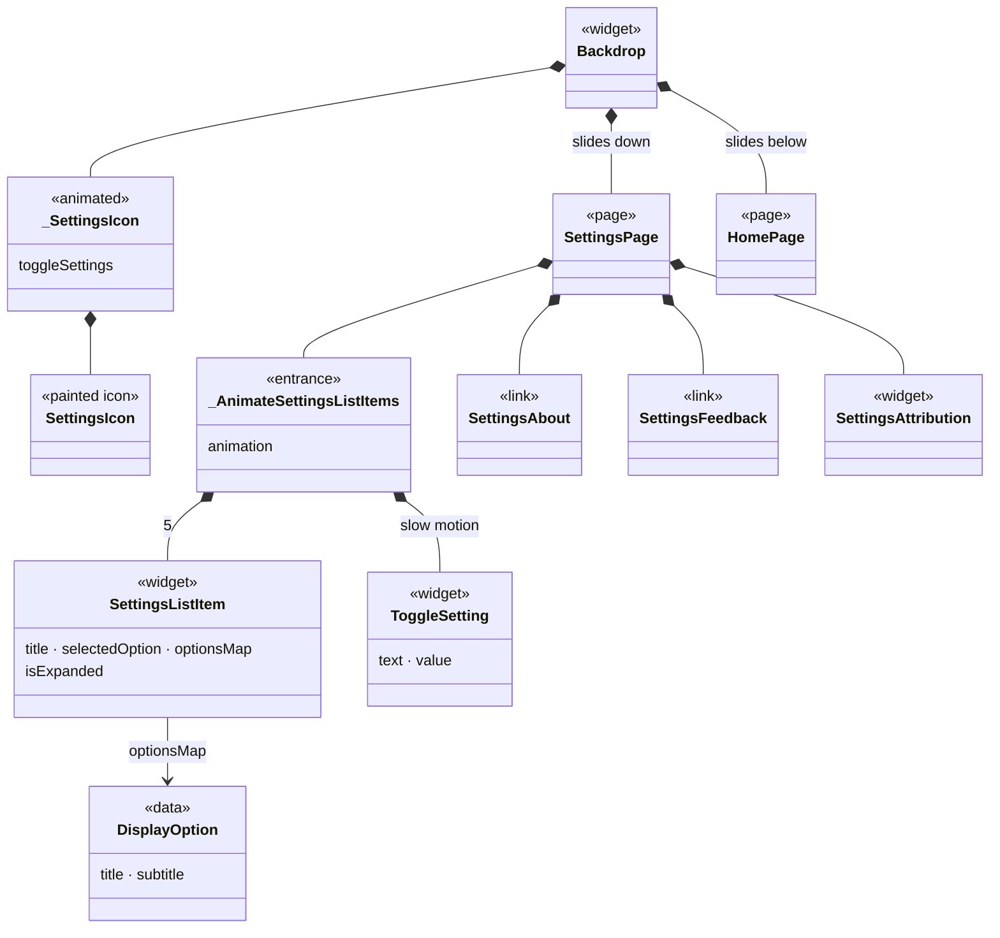
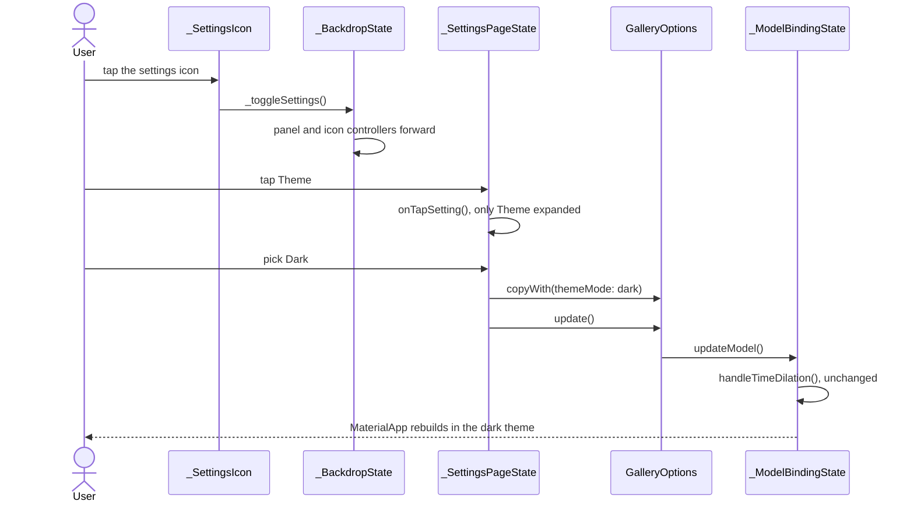

## What it does {#what}

The settings icon in the top corner morphs into a close icon over 500 ms while `Backdrop` slides the settings page down from the top and pushes the home page down until only its 64 pt header shows; on a phone the panel takes 600 ms, and over its last 60 % the setting rows spread apart by 4 pt each. There are five expandable options and one switch: **Text scaling** (system, 0.8, 1.0, 2.0, 3.0), **Text direction** (locale-based, LTR, RTL — Arabic, Farsi, Hebrew, Pashto and Urdu count as RTL), **Language** (system first, then every supported locale sorted by its native name), **Platform mechanics** (Android, iOS, macOS, Linux, Windows), **Theme** (system, dark, light) and **Slow motion**, which sets `timeDilation` to 5 after a 150 ms delay so you see the UI start to react first. Only one option is expanded at a time, and closing the panel collapses it. Every choice builds a new `GalleryOptions` with `copyWith` and hands it to `ModelBinding`, which rebuilds the whole app, studies included. Escape closes the panel on desktop, where it is a 560 pt high floating card instead.

## Logic · class diagram {#classes}

The options are one immutable value; changing a setting replaces it, and the InheritedWidget above `MaterialApp` rebuilds everything below.

- `──▷` holds
- `◆──` contains
- `┄┄▷` uses

## Screen · widget composition {#widgets}

Five generic option lists and one switch, each built from a map of value → label.

- `◆──` contains
- `──▷` reads model

## Switch to the dark theme · sequence {#sequence}

A setting never touches a widget: it swaps the model and lets the tree rebuild.

## Key files {#files}

- `lib/pages/settings.dart` · settings page and links
- `lib/pages/settings_list_item.dart` · expandable option list, switch
- `lib/pages/backdrop.dart` · settings and home layers, icon
- `lib/pages/settings_icon/` · painted morphing icon
- `lib/data/gallery_options.dart` · options model and binding
