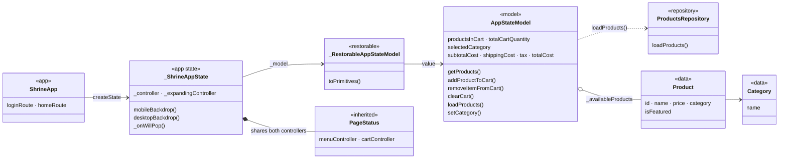
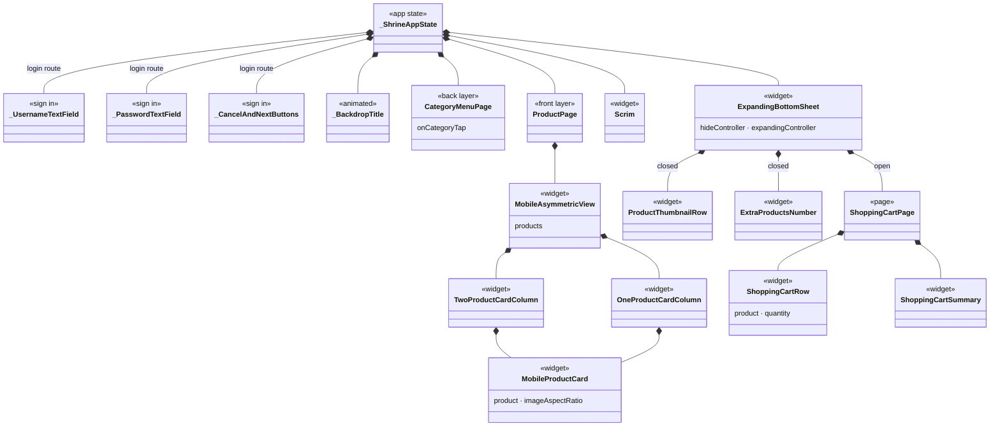
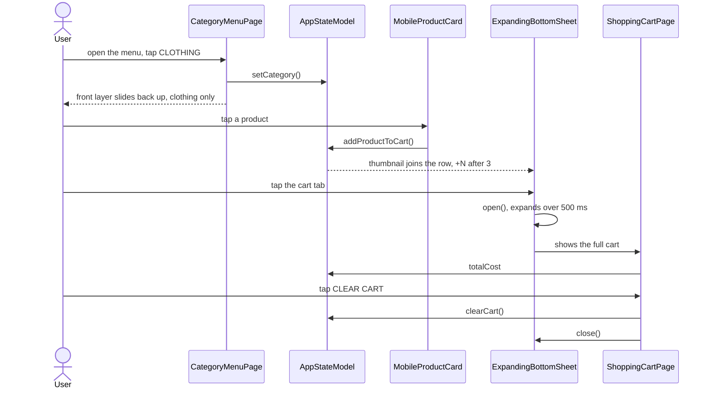

## What it does {#what}

Shrine is its own `MaterialApp` that opens on `/shrine/login`: a logo, username and password fields with cut corners, **CANCEL** (leaves the study through the root navigator) and **NEXT** (pushes `/shrine`; no check is made). The home is a backdrop: the front layer is the product grid, the back layer the category menu — All, Accessories, Clothing, Home — and tapping the title or menu icon slides the front layer down over 450 ms. Picking a category calls `setCategory` and closes the menu. The 38 products are laid out in an asymmetric, alternating one-and-two-card column pattern on a phone and balanced columns on desktop. Tapping a product adds one to the cart. The cart starts as a small tab in the corner showing up to 3 thumbnails and a **+N** count for the rest; tapping it expands it over 500 ms into the full cart, with a scrim behind, while the backdrop hides. The cart sums each line, adds $7 shipping per item and 6 % tax on the subtotal; **CLEAR CART** empties it and collapses the sheet, and back closes the cart before it leaves the study. The cart's contents and both animation positions are saved with state restoration.

## Logic · class diagram {#classes}

The app state is a scoped model, restored as a whole; the two animation controllers are owned by the app state and shared through an InheritedWidget.

- `──▷` holds
- `◇──` list of
- `◆──` contains
- `┄┄▷` uses

## Screen · widget composition {#widgets}

Three layers on one screen — backdrop, scrim, expanding cart — all driven by the two controllers.

- `◆──` contains

## Add to the cart and check out · sequence {#sequence}

The grid, the corner tab and the cart all listen to the same model.

## Key files {#files}

- `lib/studies/shrine/app.dart` · Shrine app, controllers, restoration
- `lib/studies/shrine/login.dart` · sign-in screen
- `lib/studies/shrine/backdrop.dart` · front and back layers
- `lib/studies/shrine/category_menu_page.dart` · category menu
- `lib/studies/shrine/expanding_bottom_sheet.dart` · corner cart that expands
- `lib/studies/shrine/shopping_cart.dart` · cart page and totals
- `lib/studies/shrine/model/` · app state, products, categories
- `lib/studies/shrine/supplemental/` · product grids and cards
