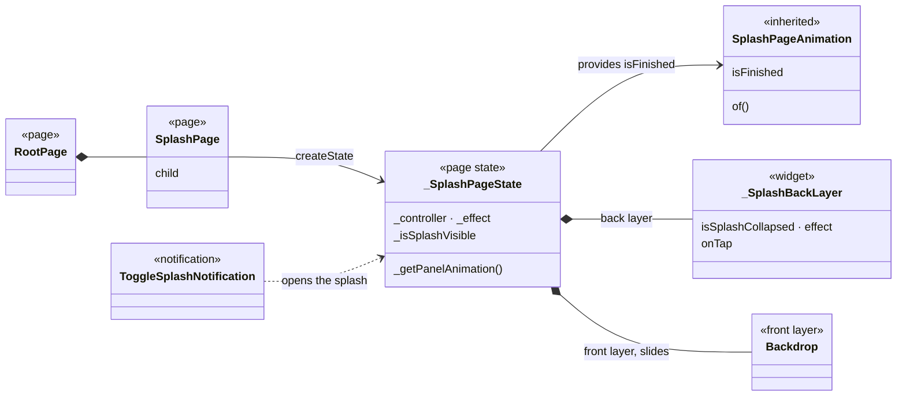
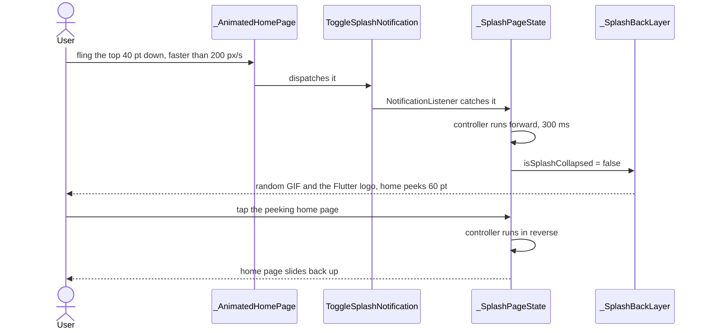

## What it does {#what}

On a phone the splash is a back layer: the home page normally covers it completely. Flinging the top 40 pt of the home page downward (faster than 200 px/s) sends a `ToggleSplashNotification`, and the home page slides down over 300 ms (`easeInOut`) until only 60 pt of it peeks at the bottom. Behind it plays one of ten looping GIFs, picked at random when the page is created (`splash_effect_1.gif` to `splash_effect_10.gif`, on a `#030303` background), with the Flutter logo centred on top. Tapping the peeking home page, or flinging it up faster than 200 px/s, slides it back. On desktop the home page stays 210 pt down with rounded 40 pt top corners and a clickable logo above it; on a foldable the two layers sit side by side in a `TwoPane`. `SplashPageAnimation` tells the home page whether the splash has finished, so its entrance animation starts only once.

## Logic · class diagram {#classes}

One animation controller moves the front layer; the back layer only decides which picture to show.

- `──▷` holds
- `◆──` contains
- `┄┄▷` uses

## Pull down the splash · sequence {#sequence}

The home page never calls the splash directly: it bubbles a notification up the tree.

## Key files {#files}

- `lib/pages/splash.dart` · splash layers and animation
- `lib/main.dart` · `RootPage`: splash around the backdrop
- `lib/constants.dart` · animation durations
