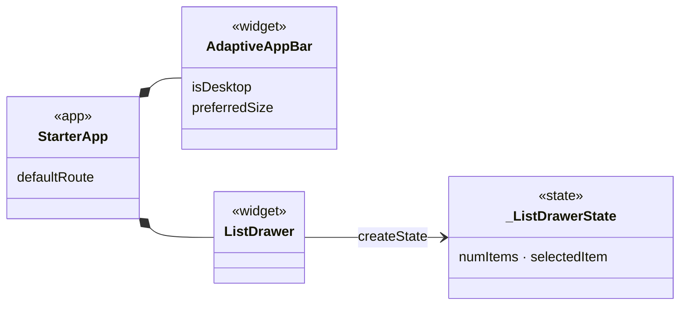
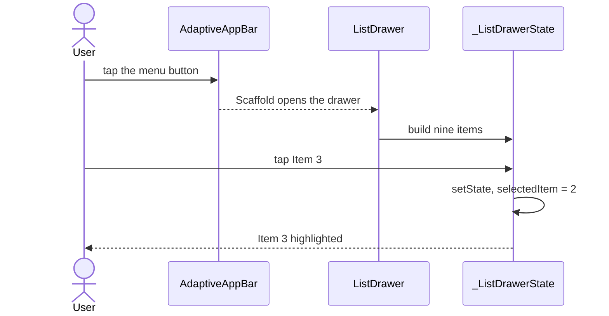

## What it does {#what}

The Starter app is a single-route `MaterialApp` at `/starter` with its own purple colour scheme, meant as a starting point for a responsive app. On a phone it shows an app bar with share, favourite and search buttons, a drawer, a headline, subtitle and body text, and a round **+** button; on desktop the drawer stays open as a side list, the app bar is 128 pt tall and the button becomes an extended **+ BUTTON**. The drawer has a title, a subtitle and nine items; tapping one highlights it (`selectedItem`), and that is the app's only state. The buttons have no actions.

## Logic · class diagram {#classes}

Three widgets and one integer of state.

- `◆──` contains
- `──▷` holds

## Pick a drawer item · sequence {#sequence}

The drawer keeps its own selection; nothing else changes.

## Key files {#files}

- `lib/studies/starter/app.dart` · Starter app and colour scheme
- `lib/studies/starter/home.dart` · home, adaptive app bar, drawer
