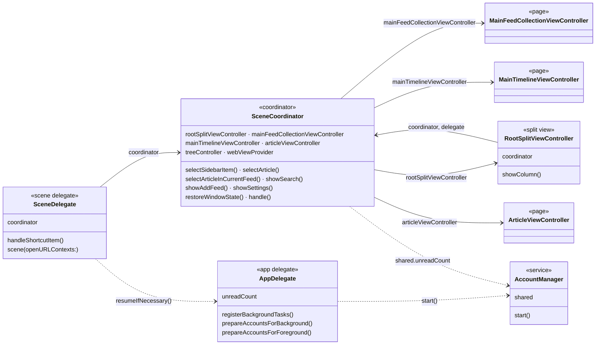
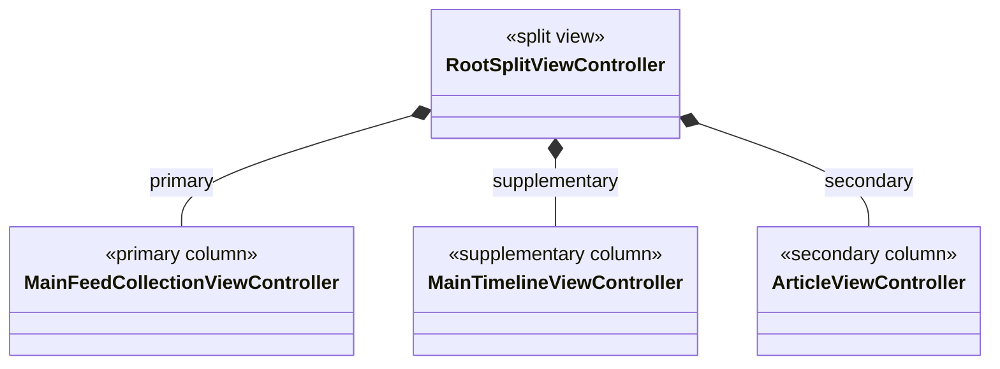
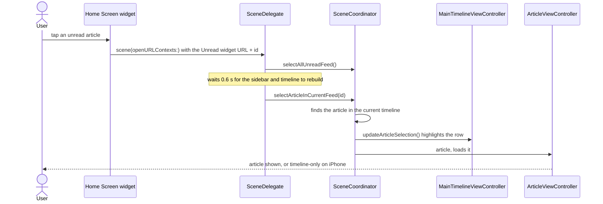

## What it does {#what}

`AppDelegate` starts `AccountManager` before anything else, registers background refresh tasks and notification handling, and imports the default feeds on first run. Each window scene gets its own `SceneDelegate`, which builds one `SceneCoordinator` and hands it the `RootSplitViewController` — a `UISplitViewController` with three columns: the feed sidebar (primary), the article timeline (supplementary) and the reading view (secondary). On iPhone the columns collapse into a single navigation stack instead. A cold launch restores the previous selection unless an external action — a notification tap, a Home Screen quick action, a Siri shortcut, a widget tap, or a `feed:`/`feeds:`/`netnewswire://theme` URL — is pending, in which case that action's navigation wins and selection restoration is skipped so the two don't race. Widget taps for the Today, Starred and Unread smart feeds open that feed and, after a fixed 0.6 s to let the sidebar rebuild, select the specific article by ID.

## Logic · class diagram {#classes}

`SceneCoordinator` is the one object every screen talks to: it owns the three visible view controllers and the sidebar's tree, and is the only thing that knows how to navigate between them.

- `──▷` holds
- `┄┄▷` uses

## Screen · widget composition {#widgets}

One split view, three columns; the coordinator decides which columns show at once from the current `displayMode`.

- `◆──` contains

## Open an article from a Home Screen widget · sequence {#sequence}

A widget tap always carries the smart feed's URL plus the article's ID as a query item.

## Key files {#files}

- `iOS/AppDelegate.swift` · app launch, background refresh, notifications
- `iOS/SceneDelegate.swift` · per-window scene, deep-link URL handling
- `iOS/SceneCoordinator.swift` · navigation, selection, search, sidebar state (~2,800 lines)
- `iOS/RootSplitViewController.swift` · the 3-column `UISplitViewController`
