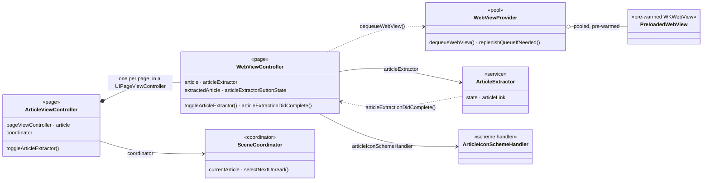
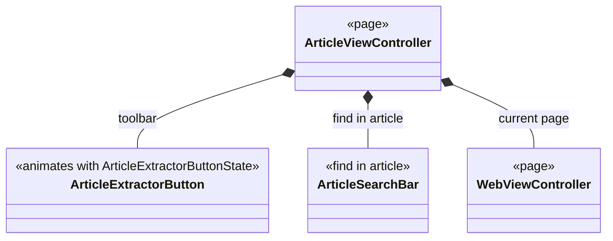
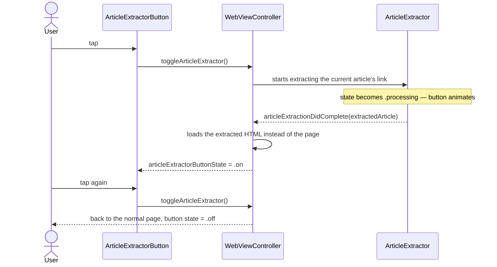

## What it does {#what}

`ArticleViewController` hosts a `UIPageViewController` of `WebViewController`s, one per article, so swiping left/right between unread articles is a page transition rather than a reload. Each `WebViewController` renders the article through a `PreloadedWebView` — a `WKWebView` kept pre-warmed in a small pool (`WebViewProvider`) because a fresh `WKWebView` flashes white on its first load in dark mode; the pool is flushed and refilled whenever the app returns to the foreground, since a backgrounded web view can silently lose its content process. Tapping the Reader-view button calls `toggleArticleExtractor()`, which starts an `ArticleExtractor` fetching a simplified, ad-free version of the page; while it's `.processing` the button animates, and on success the extracted HTML replaces the normal rendering until toggled off. `ArticleSearchBar`'s "find in article" scope searches the loaded page's text directly (not the article list) via `FindInArticleActivity`. An article's favicon loads through a custom `WKURLSchemeHandler` (`ArticleIconSchemeHandler`) rather than a network request, since it's already cached locally.

## Logic · class diagram {#classes}

The page controller and the extractor are the two moving parts; everything else renders a `WKWebView` one way or another.

- `──▷` holds
- `◇──` list of
- `┄┄▷` uses

## Screen · widget composition {#widgets}

- `◆──` contains

## Turn on Reader view · sequence {#sequence}

## Key files {#files}

- `iOS/Article/ArticleViewController.swift` · the page controller, toolbar, extractor button
- `iOS/Article/WebViewController.swift` · one article's `WKWebView` and extractor state
- `iOS/Article/WebViewProvider.swift` · the pre-warmed `WKWebView` pool
- `iOS/Article/PreloadedWebView.swift` · the pooled `WKWebView` subclass
- `iOS/Article/ArticleIconSchemeHandler.swift` · favicon loading via a custom URL scheme
- `Shared/Article Extractor/ArticleExtractor.swift` · the Reader-view fetch
- `iOS/Article/ArticleSearchBar.swift`, `FindInArticleActivity.swift` · find in article
