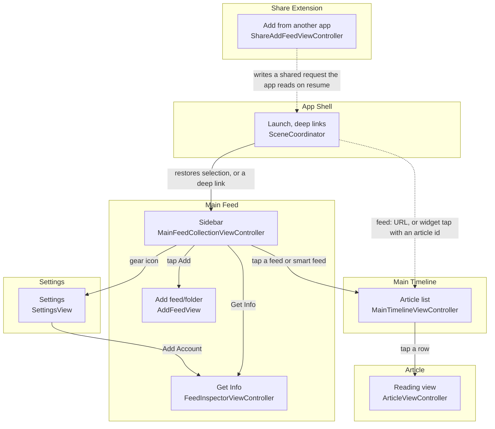
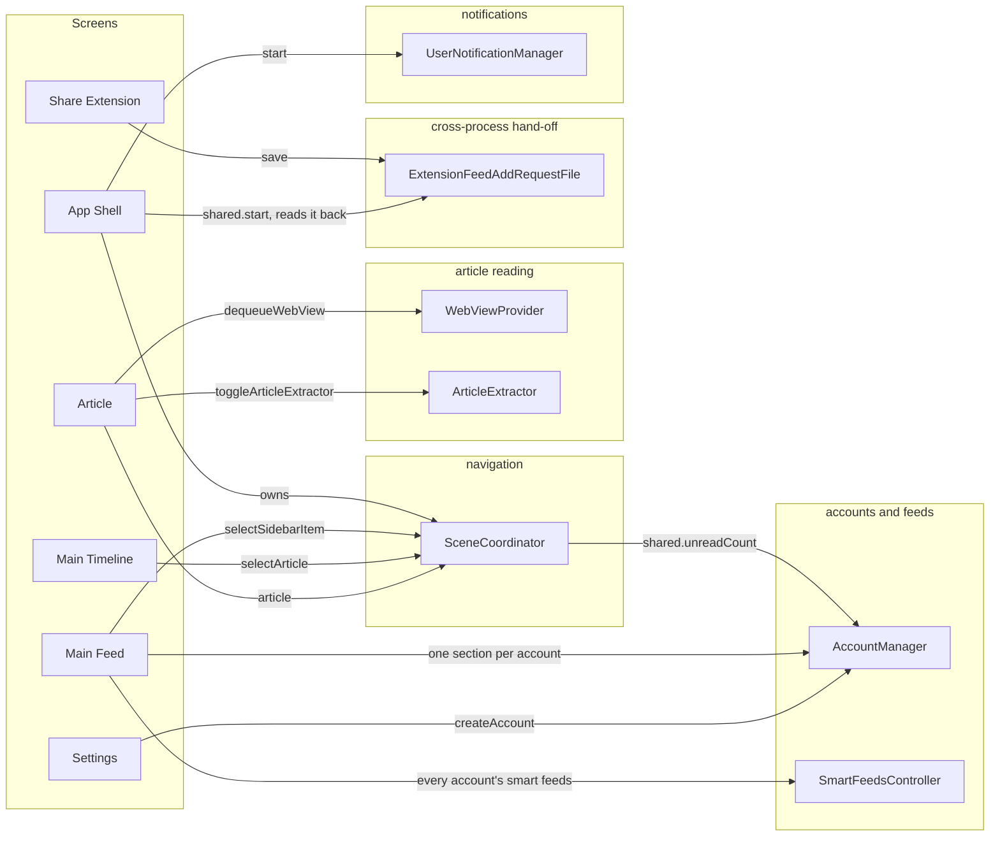

## Screens · how the user moves

The app opens straight into the 3-column split view the App Shell owns — sidebar, timeline, article — restoring the last selection unless a notification, widget, Siri shortcut or `feed:`/`netnewswire://` URL is pending, in which case that wins instead. On iPhone the three columns collapse into one navigation stack, so the same moves become pushes.

- `───▷` opens
- `┈┈▷` a hand-off through shared state, not a direct call
- `▭` tap to open its module

## Services · what the screens talk through

Only `SceneCoordinator` is shared by every screen — it's the sole owner of the three visible view controllers and the only thing that knows how to navigate between them. Everything below it is reached by exactly the modules that need it: the article reader needs a pooled `WKWebView` and a reader-mode extractor; the share extension and the Siri "Add Feed" shortcut can't call `AccountManager` directly (separate processes), so they both leave a request in `ExtensionFeedAddRequestFile` for the main app to pick up.

- `───▷` calls, labelled with the method
- `▭` tap to open its module
