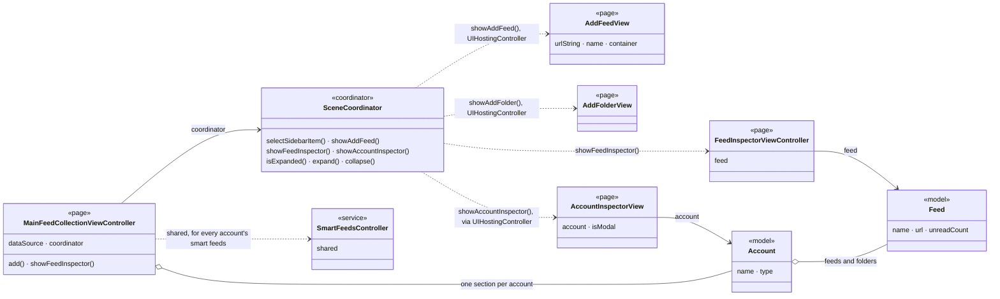
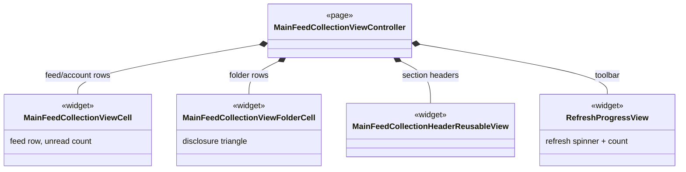
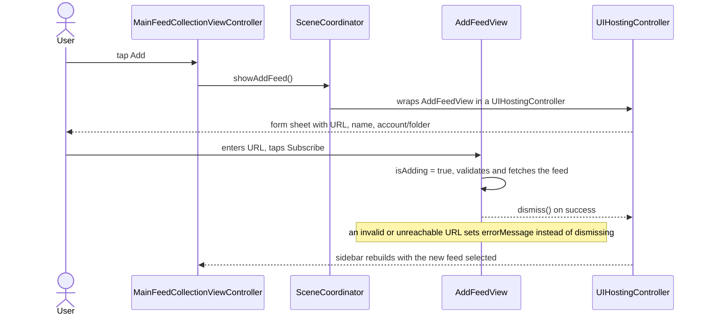

## What it does {#what}

`MainFeedCollectionViewController` renders the sidebar as a `UICollectionViewDiffableDataSource` over a `TreeController`: one section per account, each holding its smart feeds (Today, All Unread, Starred) and the account's feeds and folders, indented by nesting. Folders carry a disclosure triangle (`MainFeedCollectionViewFolderCell`); a feed or container row shows an unread count once it has one (`UILabel+UnreadCount`). Pull-to-refresh and the toolbar refresh button both drive `RefreshProgressView`, a small inline spinner-and-count view. Tapping a row calls `coordinator.selectSidebarItem()`, which is how every other screen finds out what's selected. "Add Feed" and "Add Folder" are SwiftUI sheets (`AddFeedView`, `AddFolderView`) hosted from UIKit with `UIHostingController`; adding a feed accepts a URL typed in, pasted, or carried over from a `feed:` deep link, defaulting the account/folder to whichever one the Settings "Default add location" points at. "Get Info" on a feed or account opens a form-sheet inspector — `FeedInspectorViewController` (a `UITableViewController`, built from a storyboard) for a feed, or the SwiftUI `AccountInspectorView`/`AccountNotificationInspectorView` for an account.

## Logic · class diagram {#classes}

The view controller owns the diffable data source and a `TreeController`'s snapshot of expanded/collapsed containers; it asks the coordinator for everything about selection and navigation.

- `──▷` holds
- `◇──` list of
- `┄┄▷` uses

## Screen · widget composition {#widgets}

- `◆──` contains

## Add a feed by URL · sequence {#sequence}

## Key files {#files}

- `iOS/MainFeed/MainFeedCollectionViewController.swift` · the sidebar, its diffable data source
- `iOS/MainFeed/Collection View Cells/` · feed, folder and header cells
- `iOS/MainFeed/RefreshProgressView.swift` · the inline refresh spinner
- `iOS/Add/AddFeedView.swift` · subscribe by URL
- `iOS/Add/AddFolderView.swift` · new folder
- `iOS/Inspector/FeedInspectorViewController.swift` · feed "Get Info"
- `iOS/Inspector/AccountInspectorView.swift` · account "Get Info"
