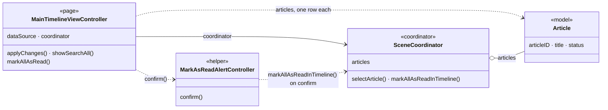
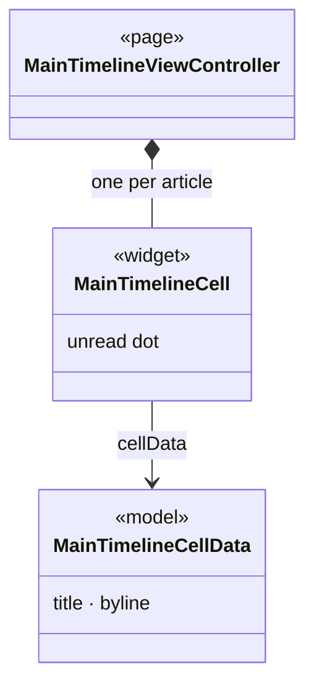
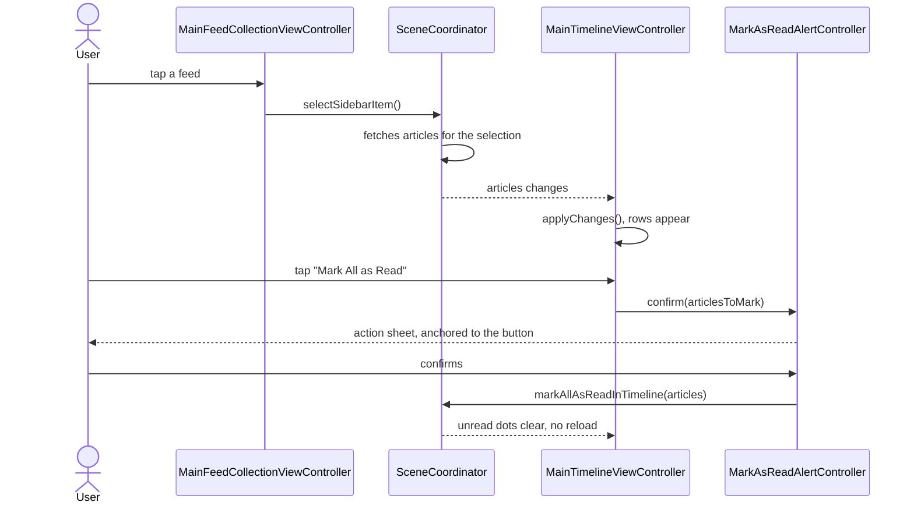

## What it does {#what}

`MainTimelineViewController` reads `coordinator.articles` — whatever the sidebar selection resolved to — and feeds it to a `UICollectionViewDiffableDataSource<Int, Article>` of `MainTimelineCell` rows. A built-in `UISearchController` has two scopes: search this feed, or search everywhere; `showSearchAll()` (reached from the sidebar's search button, a keyboard shortcut, or a Home Screen quick action) activates it straight into the "everywhere" scope. Swiping a row, or a toolbar button, calls `markAllAsRead(_:)`; when more than one article would be marked, `MarkAsReadAlertController` first shows an action-sheet confirmation anchored to wherever the user tapped (a `CGRect`, a `UIView` or a `UIBarButtonItem` — three source types, one alert). Selecting a row calls `coordinator.selectArticle()`, which is how the Article module finds out what to show; it doesn't select the row back the other way. Marking as read updates the row's unread dot without a full reload, since `applyChanges` only runs on real additions/removals.

## Logic · class diagram {#classes}

The view controller is a thin diffable-data-source wrapper; every actual read/unread and selection decision is the coordinator's.

- `──▷` holds
- `◇──` list of
- `┄┄▷` uses

## Screen · widget composition {#widgets}

- `◆──` contains
- `──▷` reads model

## Select a feed and mark its articles read · sequence {#sequence}

## Key files {#files}

- `iOS/MainTimeline/MainTimelineViewController.swift` · article list, search, mark as read
- `iOS/MainTimeline/MarkAsReadAlertController.swift` · the confirmation action sheet
- `iOS/MainTimeline/Cell/MainTimelineCell.swift` · one article row
