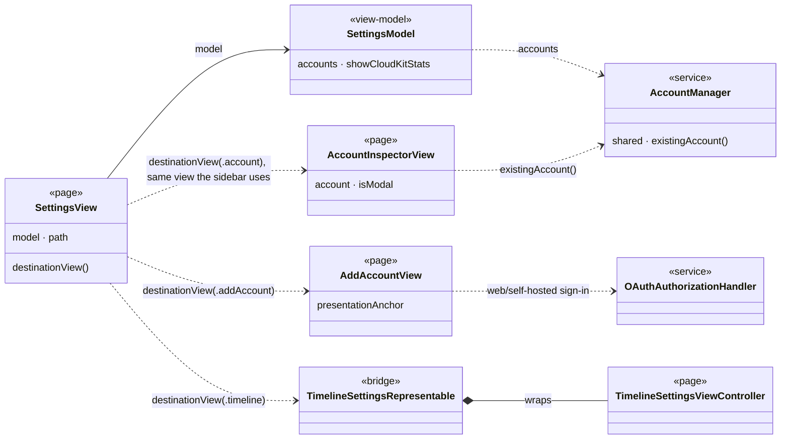
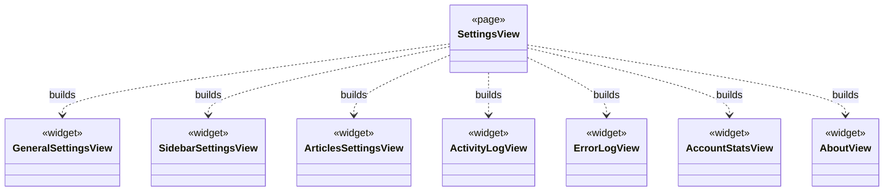
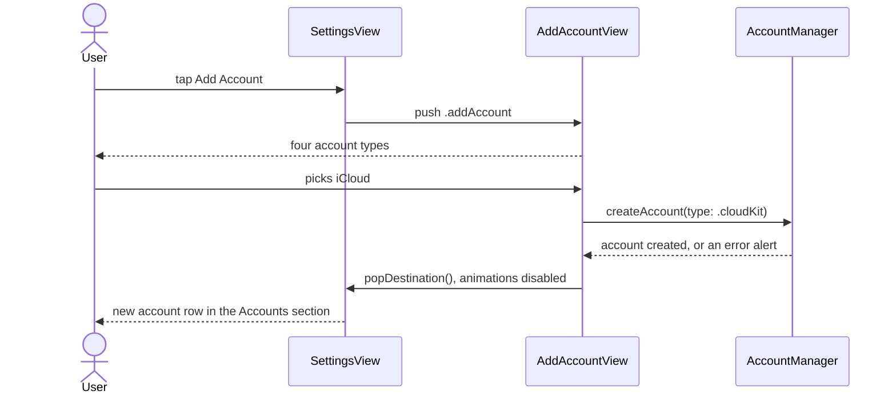

## What it does {#what}

`SettingsView` is a single `List` split into sections — accounts, feeds (OPML import/export), appearance, troubleshooting, help, about — each row either an action (opens System Settings, opens a help URL in `SafariView`) or a `navigationRow` that pushes a `SettingsDestination` case onto a value-based `NavigationStack`. Tapping an existing account or "Add Account" both resolve to the same `AccountInspectorView`/account-type screens used from the sidebar's "Get Info", so an account only has one settings UI no matter how you reach it. "Add Account" offers four types — on My iPhone (local), iCloud, a web service (Feedly, Feedbin, NewsBlur, Bazqux, etc. — each OAuth or credentials-based) and self-hosted (FreshRSS). OAuth sign-in runs through `OAuthAuthorizationHandler`, a delegate-based wrapper around the account type's own authorization operation. Timeline settings is the one screen that's still UIKit (`TimelineSettingsViewController`, a `UICollectionViewController`) bridged into the SwiftUI stack with a `UIViewControllerRepresentable`. Importing an OPML file replaces the chosen account's feeds and folders; exporting writes the account's current tree to a file the system share sheet hands off.

## Logic · class diagram {#classes}

Every destination row carries a `SettingsDestination` case; `destinationView(_:)` is the one place that maps a case to the screen that handles it.

- `──▷` holds
- `┄┄▷` uses

## Screen · widget composition {#widgets}

- `┄┄▷` builds

## Add an iCloud account · sequence {#sequence}

## Key files {#files}

- `iOS/Settings/SettingsView.swift` · the settings list, `SettingsDestination` routing
- `iOS/Settings/AddAccountView.swift` · the four account types
- `iOS/Account/` · per-type setup screens (local, iCloud, credentials)
- `iOS/AccountStats/AccountStatsView.swift` · per-account article/feed counts
- `iOS/Settings/TimelineSettingsViewController.swift` · the one UIKit settings screen
- `iOS/Settings/ArticleThemesView.swift`, `ArticleThemeImporter.swift` · installed article themes
