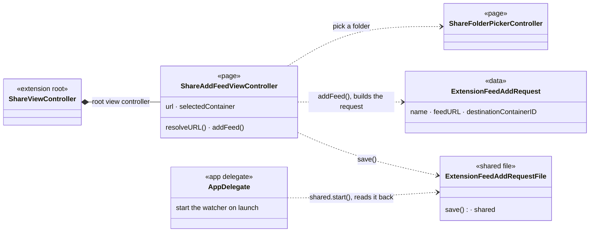
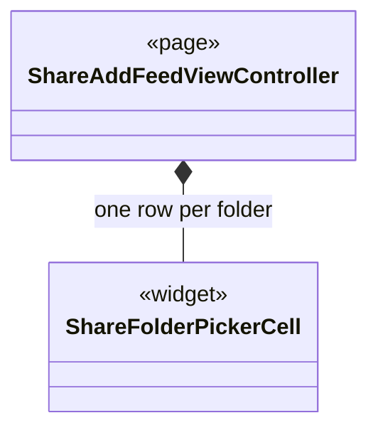
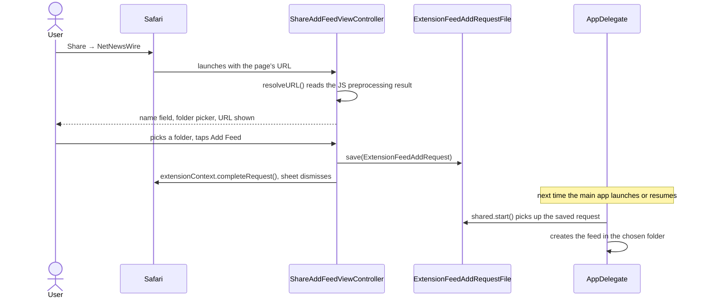

## What it does {#what}

The share extension is its own process (`NSExtensionPrincipalClass` in its `Info.plist`), so it can't call into `AccountManager` directly — it only shares an App Group container with the main app. `ShareViewController` is a bare `UINavigationController` hosting one screen, `ShareAddFeedViewController`, a grouped table with three sections: the feed's name (editable), a folder picker across every account's containers, and the URL being added. `resolveURL()` finds the shared link by trying, in order, Safari's JavaScript preprocessing result, a plain URL attachment, then plain text that parses as a URL — whichever the host app actually handed it. Tapping "Add Feed" doesn't add anything itself: it writes an `ExtensionFeedAddRequest` (name, URL, destination container ID) to a shared file via `ExtensionFeedAddRequestFile.save()` and completes the extension. The main app's `AppDelegate` starts `ExtensionFeedAddRequestFile.shared` watching that same file on launch and resume, and is what actually creates the feed — the same hand-off a Siri "Add Feed" shortcut (`AddFeedAppIntent`) uses to reach the main app without it being in the foreground.

## Logic · class diagram {#classes}

- `◆──` contains
- `┄┄▷` uses

## Screen · widget composition {#widgets}

- `◆──` contains

## Add a feed from Safari's share sheet · sequence {#sequence}

## Key files {#files}

- `iOS/ShareExtension/ShareViewController.swift` · the extension root and its one screen
- `iOS/ShareExtension/ShareFolderPickerController.swift` · the folder picker
- `iOS/ShareExtension/ShareFolderPickerCell.swift` · one folder row
