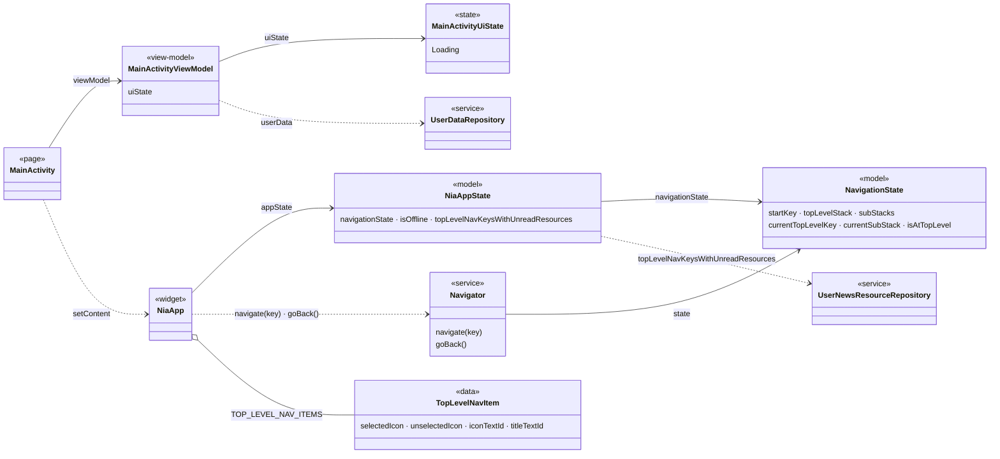
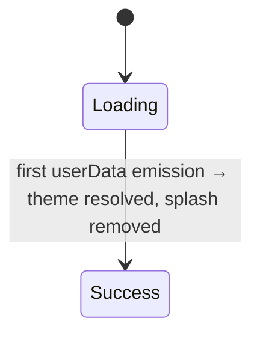
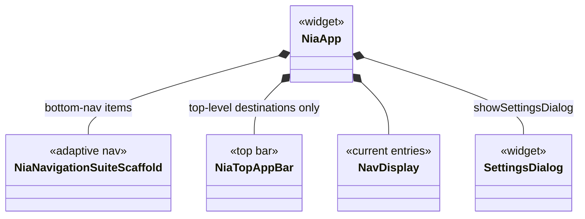
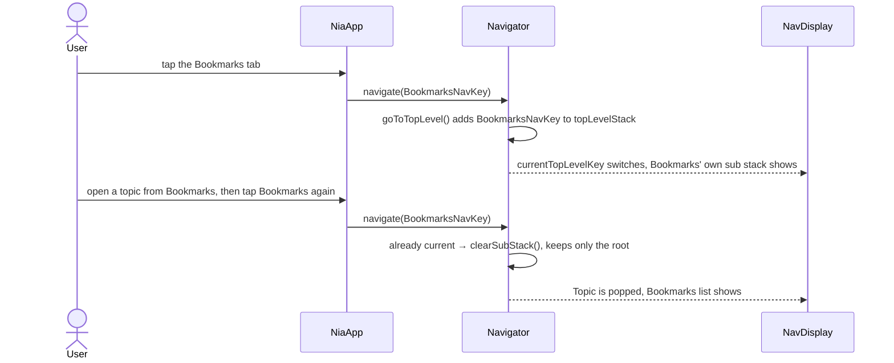

## What it does {#what}

`MainActivity` installs the splash screen before `super.onCreate`, and keeps it up
(`setKeepOnScreenCondition`) until `MainActivityViewModel.uiState` leaves `Loading` for `Success`
— the first `userData` emission decides the real theme (brand, dark mode, dynamic color) before a
single themed pixel is drawn, and that `themeSettings` is then tracked as its own `mutableStateOf`
so a system dark-mode change recomposes independently of the view-model. `NiaApp` builds three
bottom-nav items — For You, Bookmarks, Interests — each with its **own** back stack
(`NavigationState.subStacks`); tapping a different tab only ever switches which sub-stack
`NavDisplay` shows, tapping the **current** tab again clears that tab's stack back to its root,
and Search/Topic/Settings push onto whichever tab's stack was active when they opened. A tab's
icon gets a small notification dot while it has unread news (`topLevelNavKeysWithUnreadResources`,
recomputed from both the For You feed and the bookmarks list). On a wide screen, Interests and
Topic render side by side instead of one pushing over the other (`ListDetailSceneStrategy`).

## Logic · class diagram {#classes}

`Navigator` is the only thing that mutates `NavigationState`; everything else only reads it.

- `──▷` holds
- `◇──` list of
- `┄┄▷` uses

## … · state machine {#main-activity-state}

`MainActivityUiState` only moves one way — the splash screen is the visible proxy for `Loading`.

## Screen · widget composition {#widgets}

`NiaNavigationSuiteScaffold` picks bottom nav, rail or drawer for the window size; `NavDisplay`
renders whichever tab's current entry that leaves on screen.

- `◆──` contains

## Switch tabs, then reopen the current one · sequence {#sequence}

Three different taps on the same bottom bar, three different `Navigator` branches.

## Key files {#files}

- `app/.../MainActivity.kt` · splash hold, theme resolution, `setContent`
- `app/.../MainActivityViewModel.kt` · `MainActivityUiState`
- `app/.../ui/NiaApp.kt` · nav suite scaffold, top app bar, `NavDisplay`
- `app/.../ui/NiaAppState.kt` · offline state, unread-tab tracking
- `app/.../navigation/TopLevelNavItem.kt` · the 3 bottom-nav items
- `core/navigation/.../Navigator.kt` · `navigate()`/`goBack()` branching
- `core/navigation/.../NavigationState.kt` · the per-tab back stacks
