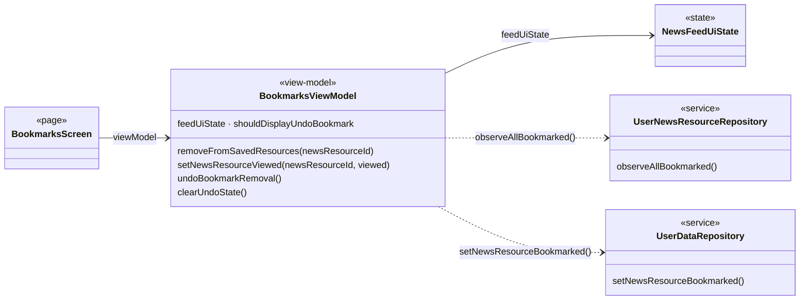
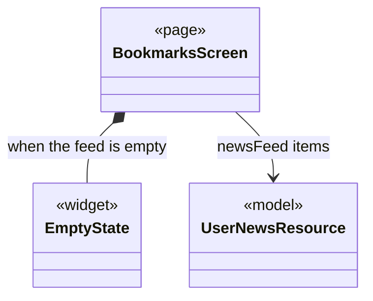
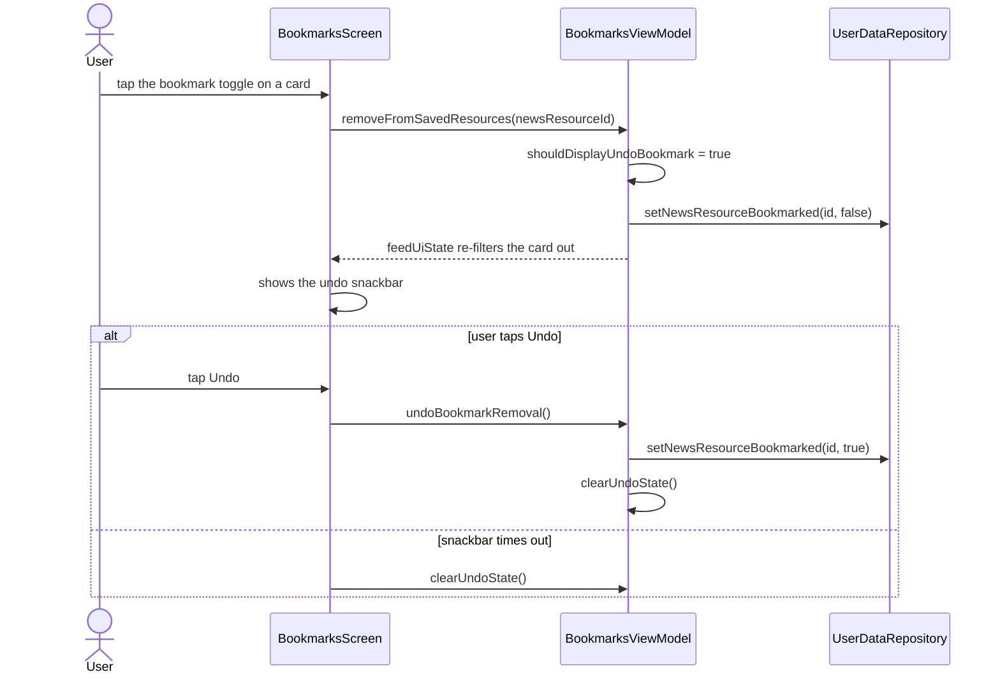

## What it does {#what}

The grid lists only news resources you've bookmarked (`observeAllBookmarked()`), reusing the same
`newsFeed()` composable as the For You module. Un-bookmarking a card doesn't remove it from the
list right away: the view-model flips `shouldDisplayUndoBookmark` and remembers the id, the screen
shows a snackbar with an **Undo** action, and only once the snackbar is dismissed without being
undone does `clearUndoState()` run — the underlying `setNewsResourceBookmarked(id, false)` already
happened, so the list re-filters itself out on the next `observeAllBookmarked()` emission. An empty
list shows a dedicated illustration and caption instead of a blank grid.

## Logic · class diagram {#classes}

No onboarding here — one repository pair feeds one state, plus two plain `mutableStateOf` fields
for the undo snackbar.

- `──▷` holds
- `┄┄▷` uses

## Screen · widget composition {#widgets}

A staggered grid of the same cards as For You, or one `EmptyState` in their place.

- `◆──` contains
- `──▷` reads model

## Un-bookmark, then undo · sequence {#sequence}

The snackbar is the only thing standing between "removed" and "still there."

## Key files {#files}

- `feature/bookmarks/impl/.../BookmarksScreen.kt` · the grid, undo snackbar, empty state
- `feature/bookmarks/impl/.../BookmarksViewModel.kt` · feed state + undo-bookmark bookkeeping
- `feature/bookmarks/impl/.../navigation/BookmarksEntryProvider.kt` · wires the nav key to the screen
- `feature/bookmarks/api/.../navigation/BookmarksNavKey.kt` · the top-level nav key
