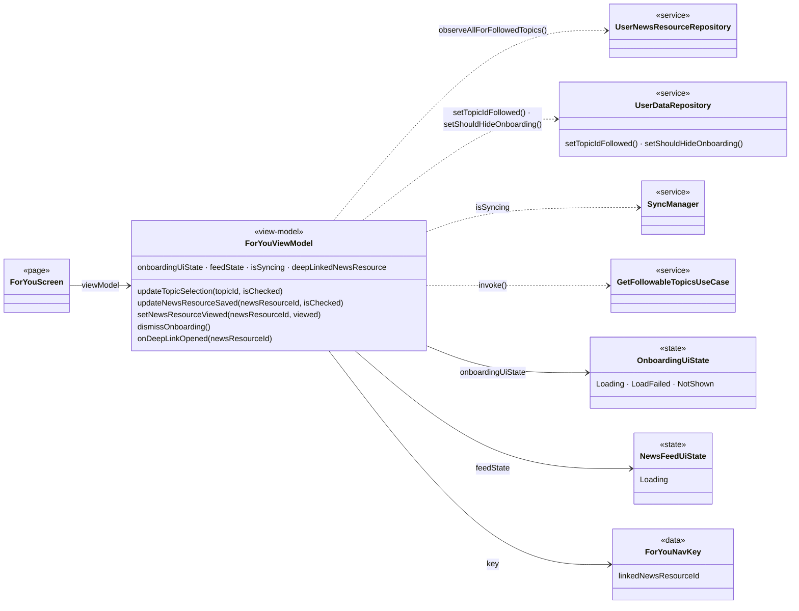
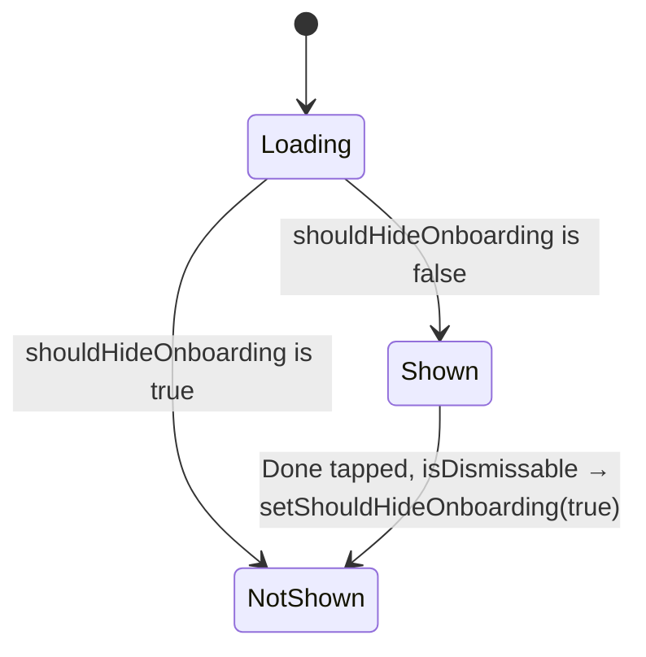
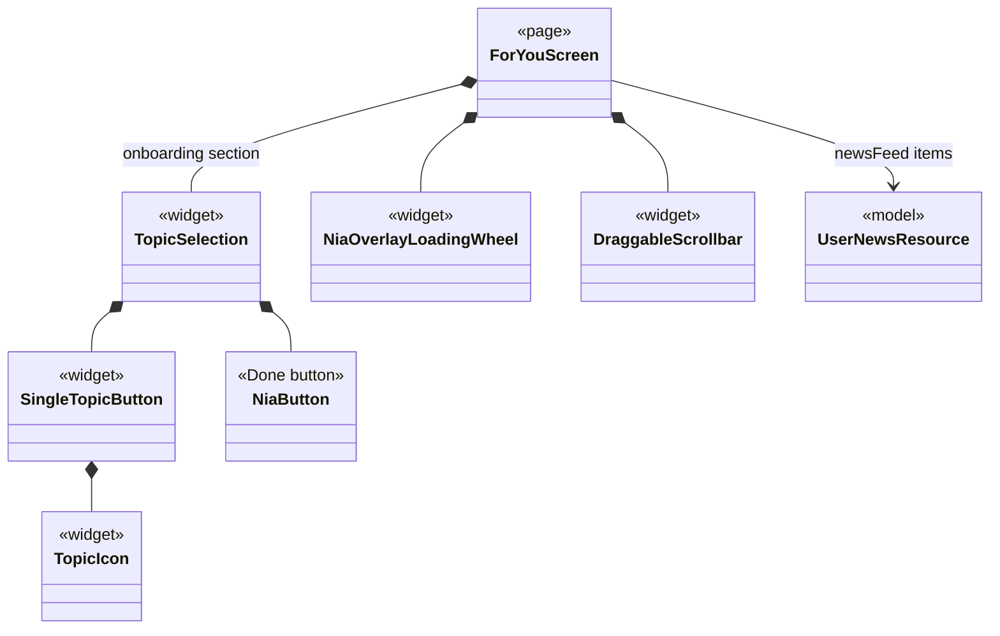
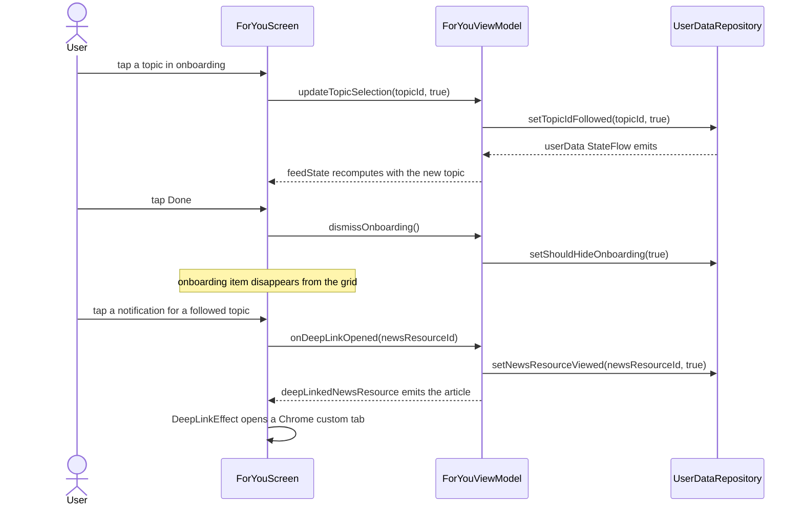

## What it does {#what}

The first time the app runs (`shouldHideOnboarding` is false in the saved `UserData`), the feed's
top item is a topic-picking grid: a 3-row horizontal `LazyHorizontalGrid` of every followable
topic, each a toggle button. **Done** only enables once at least one topic is followed
(`isDismissable`); tapping it calls `setShouldHideOnboarding(true)` and the onboarding item
disappears for good. Below it, a `LazyVerticalStaggeredGrid` lists news from the topics you
follow, each card toggle-able as bookmarked. A top loading wheel slides in while syncing or while
either the onboarding or the feed is still loading, and a deep-linked article (`linkedNewsResourceId`
on the nav key, or a notification's `DEEP_LINK_NEWS_RESOURCE_ID_KEY`) opens straight into a Chrome
custom tab and is marked viewed. On API 33+, the screen asks once for the notification permission
if it hasn't been denied before.

## Logic · class diagram {#classes}

The screen is pure Compose state fed by one view-model; onboarding and the feed are two
independent `StateFlow`s combined only for layout.

- `──▷` holds
- `┄┄▷` uses

## … · state machine {#onboarding-state}

`OnboardingUiState` starts `Loading` until `userData` and the followable-topics list both arrive;
after that it never goes back to `Loading`.

## Screen · widget composition {#widgets}

One scrollable grid holds both sections; the loading wheel and scrollbar float above it.

- `◆──` contains
- `──▷` reads model

## Follow a topic, then open a deep-linked article · sequence {#sequence}

Both paths run through the same repositories; only the destination differs.

## Key files {#files}

- `feature/foryou/impl/.../ForYouScreen.kt` · the grid, onboarding section, deep-link effect
- `feature/foryou/impl/.../ForYouViewModel.kt` · onboarding + feed state, topic/bookmark toggles
- `feature/foryou/impl/.../OnboardingUiState.kt` · the onboarding state machine
- `feature/foryou/impl/.../navigation/ForYouEntryProvider.kt` · wires the nav key to the screen
- `feature/foryou/api/.../navigation/ForYouNavKey.kt` · the top-level nav key, carries a deep link id
- `core/ui/.../NewsFeed.kt` · `NewsFeedUiState` and the shared `newsFeed()` grid items
