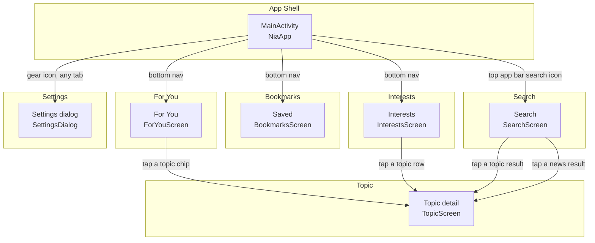
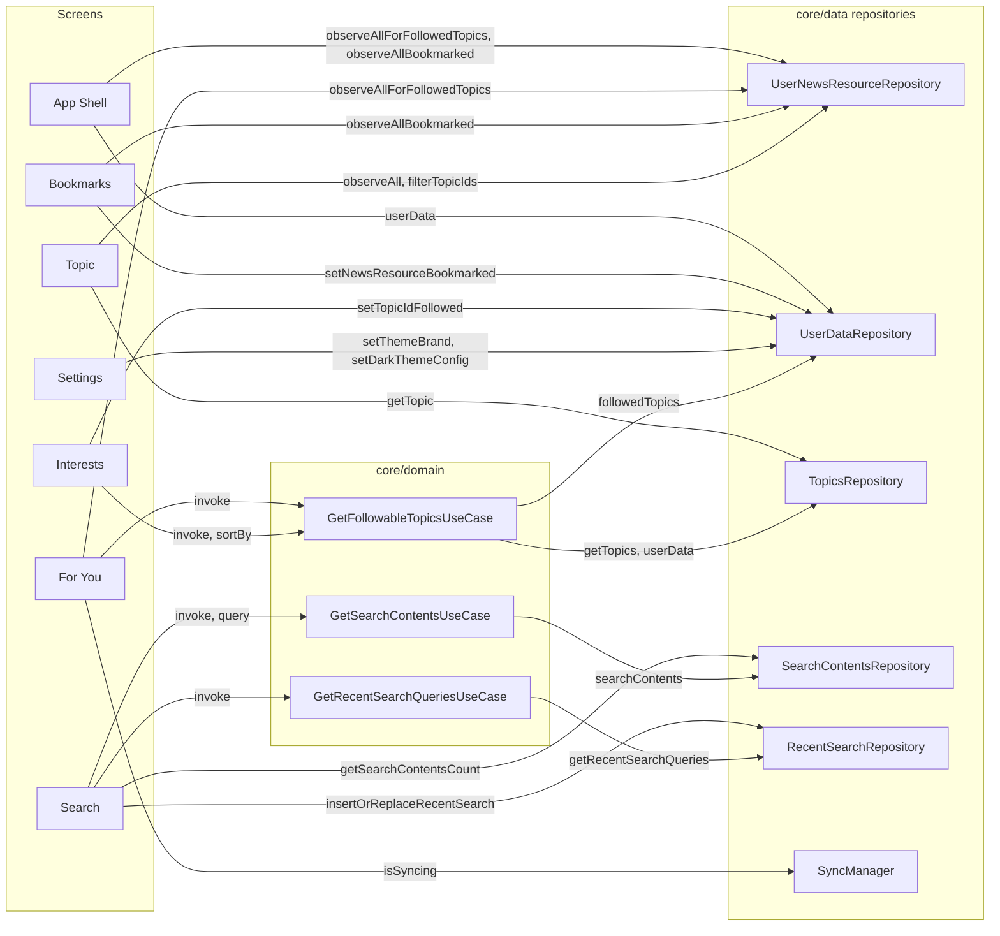
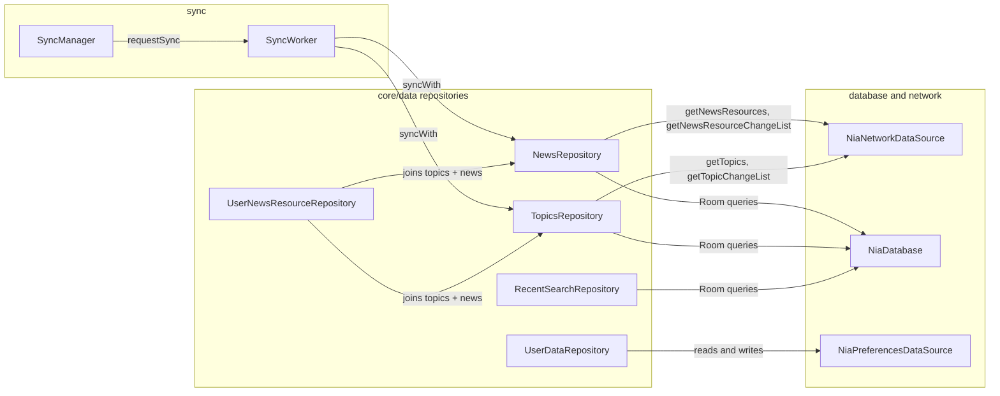

## Screens · how the user moves

Every screen is a `NavKey` on one of three per-tab back stacks (`NavigationState.subStacks`), not
a single shared stack — switching bottom-nav tabs only swaps which sub-stack `NavDisplay` shows,
and each tab remembers where you left it. Settings opens as a dialog over any of them, not a
destination.

- `───▷` opens
- `▭` tap to open its module

## Services · what the screens call {#services}

Screens never touch the network or the database: they call a repository, or a use case in
`core/domain` that combines repositories.

- `───▷` calls, labelled with the method

## Data · offline first {#data}

Every repository reads `Flow`s backed by the Room database. A separate `SyncManager`/`SyncWorker`
pulls from the network and writes into that same database, so screens update when a sync lands.

- `───▷` calls, labelled with the method
