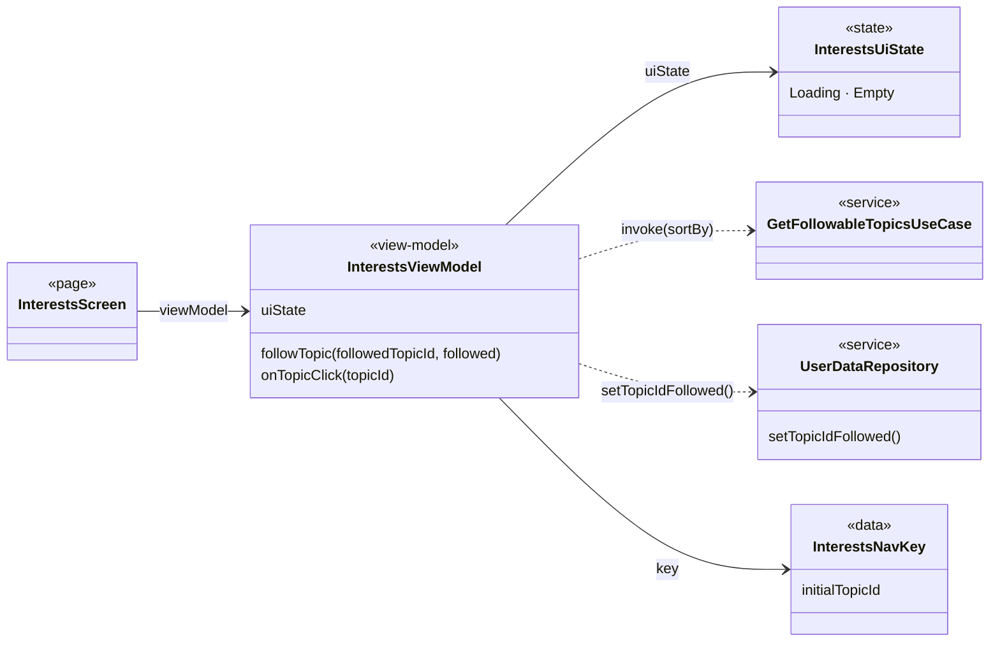
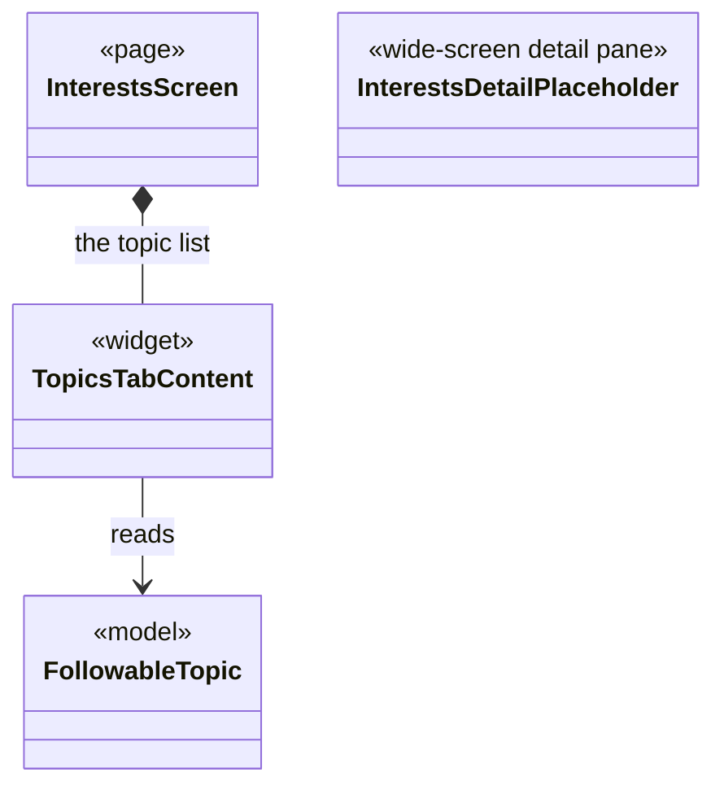
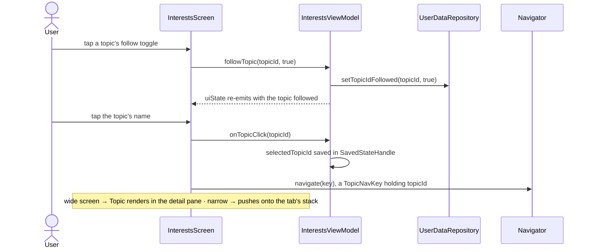

## What it does {#what}

A single tab lists every topic (`GetFollowableTopicsUseCase`, sorted by name) with a toggle for
whether you follow it; toggling calls `setTopicIdFollowed` straight through to
`UserDataRepository`, no local state. Tapping a topic name (not the toggle) opens the Topic
module. On a wide screen, the Interests list is the **list pane** of a two-pane layout
(`ListDetailSceneStrategy`) — the Topic module then renders as its **detail pane** alongside it,
and before any topic is picked the detail pane shows `InterestsDetailPlaceholder`, a plain "pick a
topic" card, instead of being empty. On a narrow screen there's no detail pane: tapping a topic
pushes it onto the current tab's back stack instead.

## Logic · class diagram {#classes}

The selected topic id (only meaningful for the two-pane layout) rides in `SavedStateHandle`
alongside the nav key's own `initialTopicId`.

- `──▷` holds
- `┄┄▷` uses

## Screen · widget composition {#widgets}

`TabContent` is the same list row builder the Topic module reuses for "topics you might also
follow."

- `◆──` contains
- `──▷` reads model

## Follow a topic, then open it · sequence {#sequence}

## Key files {#files}

- `feature/interests/impl/.../InterestsScreen.kt` · the topic list, list-detail wiring
- `feature/interests/impl/.../InterestsViewModel.kt` · `InterestsUiState`, follow/select actions
- `feature/interests/impl/.../TabContent.kt` · the shared topic-row list, reused by Topic
- `feature/interests/impl/.../InterestsDetailPlaceholder.kt` · the wide-screen empty detail pane
- `feature/interests/impl/.../navigation/InterestsEntryProvider.kt` · the list-pane nav wiring
- `feature/interests/api/.../navigation/InterestsNavKey.kt` · the top-level nav key
