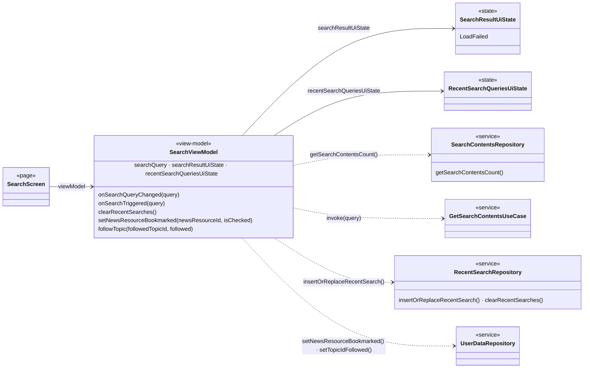
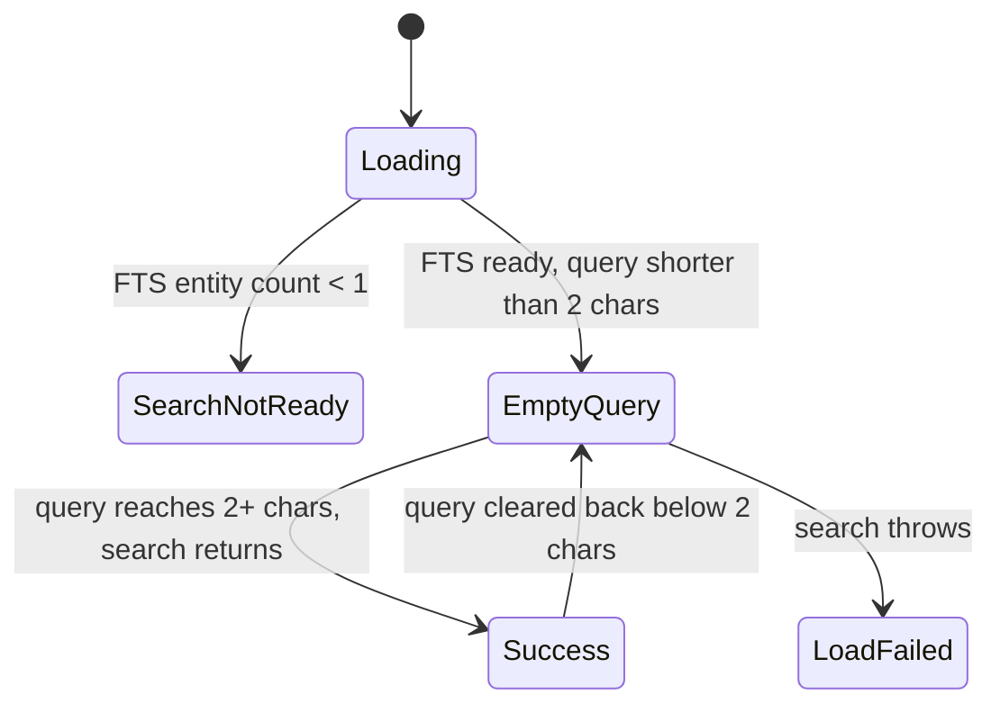
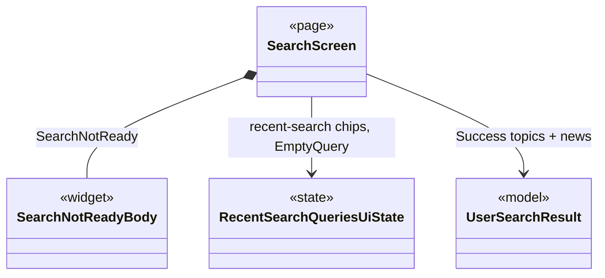
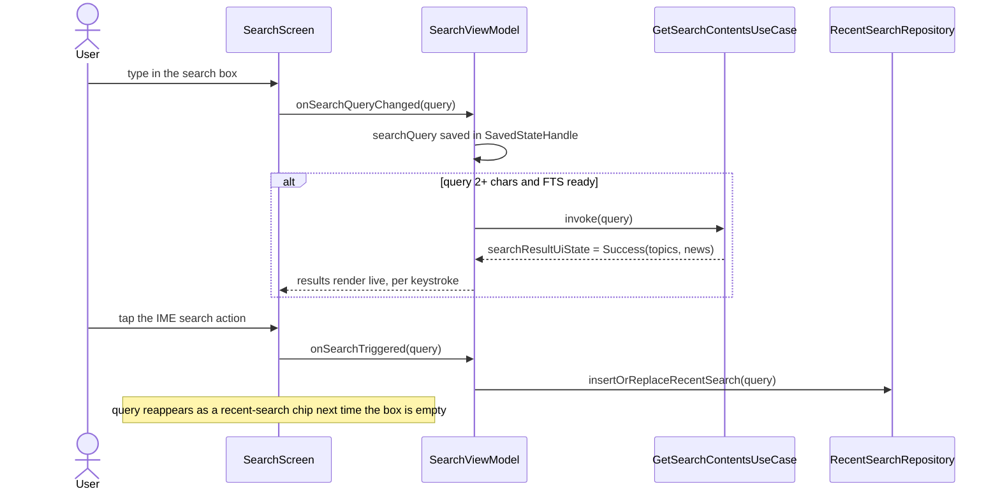

## What it does {#what}

Opened from the search icon in the top app bar (`navigator.navigate(SearchNavKey)`), not a bottom
tab. The result state is gated two ways before a query ever runs a search: `SearchNotReady` while
the full-text-search table hasn't been populated yet (fewer than 1 indexed item), then
`EmptyQuery` while the typed query is under 2 characters — only past both does typing actually
search topics and news live, one `FullTextSearch` query per keystroke via
`GetSearchContentsUseCase`. A separate `RecentSearchQueriesUiState` lists up to the most recent
searches as tappable chips while the query box is otherwise empty; explicitly triggering a search
(the IME's search action, not just typing) saves it to that list, and a trash icon clears the
whole history.

## Logic · class diagram {#classes}

Two sibling states again, like Topic's header/news split — here it's the live results against the
recent-query history.

- `──▷` holds
- `┄┄▷` uses

## … · state machine {#result-state}

`SearchResultUiState` only ever reaches `Success`/`LoadFailed` once the FTS table is populated
*and* the query clears the 2-character minimum.

## Screen · widget composition {#widgets}

Recent-search chips show only while there's no live result to display yet.

- `◆──` contains
- `──▷` reads model

## Type a query, then search it · sequence {#sequence}

## Key files {#files}

- `feature/search/impl/.../SearchScreen.kt` · search box, recent chips, results
- `feature/search/impl/.../SearchViewModel.kt` · query state, `SearchResultUiState`
- `feature/search/impl/.../SearchResultUiState.kt` · the result state machine
- `feature/search/impl/.../RecentSearchQueriesUiState.kt` · recent-search chip state
- `feature/search/impl/.../navigation/SearchEntryProvider.kt` · wires the nav key to the screen
- `feature/search/api/.../navigation/SearchNavKey.kt` · the nav key, opened from the top app bar
