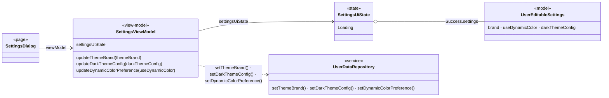
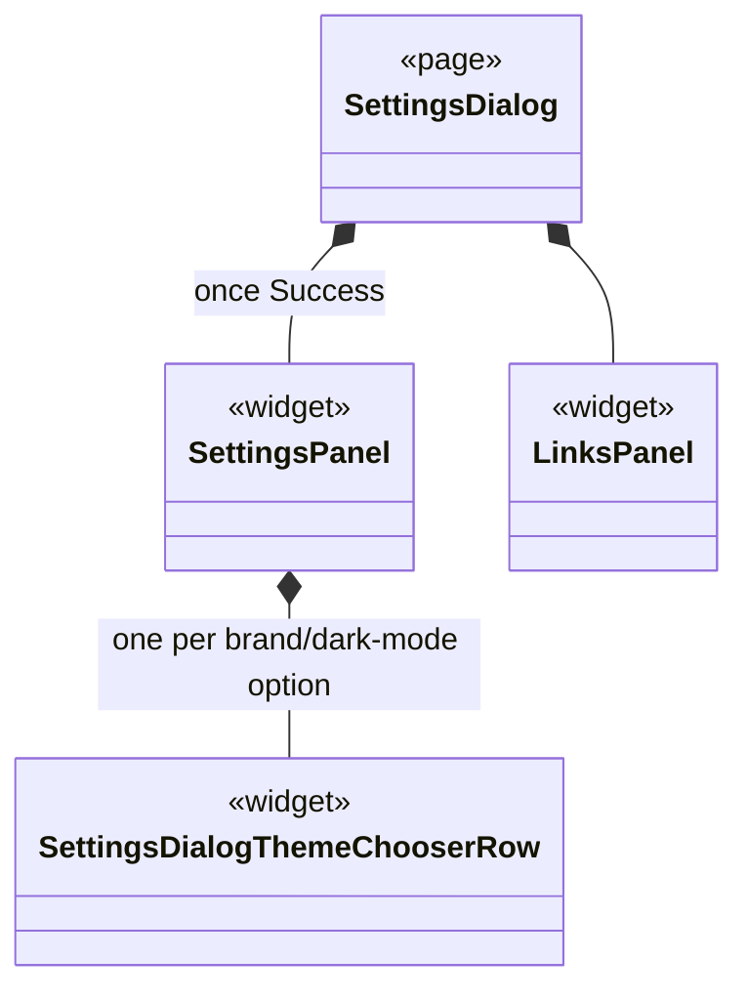

## What it does {#what}

Settings is a `Dialog`, not a navigation destination — `NiaApp` just flips a local
`showSettingsDialog` boolean when the top app bar's gear icon is tapped, so there's no back-stack
entry to undo. Each row commits straight through `UserDataRepository` the moment you tap it (a
radio button for the theme brand — Default or Android — a radio group for dark mode — Follow
System, Light, Dark — and a dynamic-color switch, hidden on the Android brand since that theme
doesn't use it and only offered on Android 12+ where the platform API exists). Until the first
`userData` emission arrives the dialog shows a loading indicator in place of the controls; after
that it never goes back. A `LinksPanel` at the bottom opens the privacy policy, licenses and the
GitHub repo.

## Logic · class diagram {#classes}

The simplest view-model in the app: one repository, one settings struct, three setters.

`settingsUiState` starts `Loading` and becomes `Success(settings)` on the first `userData`
emission; it has no other state to reach.

- `──▷` holds
- `◇──` list of
- `┄┄▷` uses

## Screen · widget composition {#widgets}

Three `SettingsPanel` sections (brand, dark mode, dynamic color) share one row widget; the links
panel is unrelated to any state.

- `◆──` contains

## Key files {#files}

- `feature/settings/impl/.../SettingsDialog.kt` · the dialog, theme rows, links panel
- `feature/settings/impl/.../SettingsViewModel.kt` · `SettingsUiState`, the three setters
