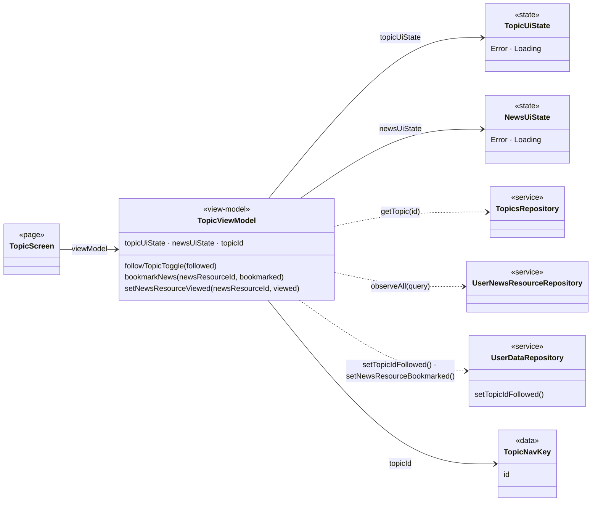
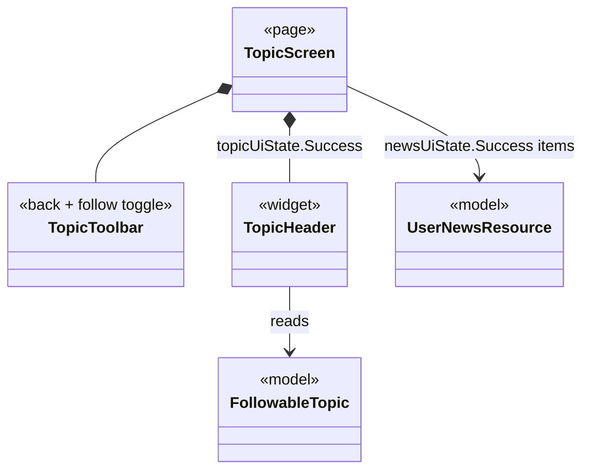
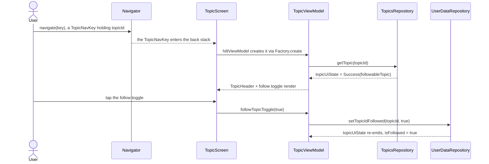

## What it does {#what}

Reached from For You, Interests or Search with just a topic id (`TopicNavKey(id)`), the screen
combines two independent streams into two separate sealed states: `TopicUiState` (the topic's
name, description, image and whether you follow it) and `NewsUiState` (the news written about it,
each with its own bookmark state) — each can be `Loading`, `Error` or `Success` on its own clock,
so the header can appear before the news list finishes loading. `TopicToolbar` shows a back
arrow and, once the topic has loaded, a follow toggle right there in the app bar; toggling it
calls straight through to `UserDataRepository`, same as everywhere else in the app.

## Logic · class diagram {#classes}

Two sibling `combine()` flows, each wrapped in `asResult()` so loading/error show up as states
instead of being handled ad hoc.

- `──▷` holds
- `┄┄▷` uses

## Screen · widget composition {#widgets}

The toolbar, header and news list are three independent sections the same list; a header or news
item is only drawn once its own state is `Success`.

- `◆──` contains
- `──▷` reads model

## Open a topic and follow it · sequence {#sequence}

## Key files {#files}

- `feature/topic/impl/.../TopicScreen.kt` · toolbar, header, news list
- `feature/topic/impl/.../TopicViewModel.kt` · `TopicUiState`, `NewsUiState`, follow/bookmark actions
- `feature/topic/impl/.../navigation/TopicEntryProvider.kt` · wires the nav key to the screen
- `feature/topic/api/.../navigation/TopicNavKey.kt` · the nav key and `navigateToTopic()`
