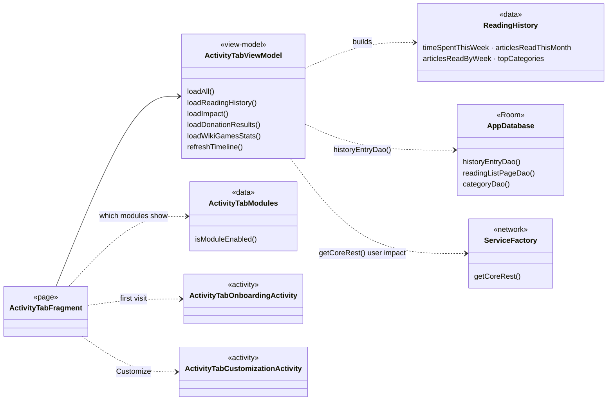
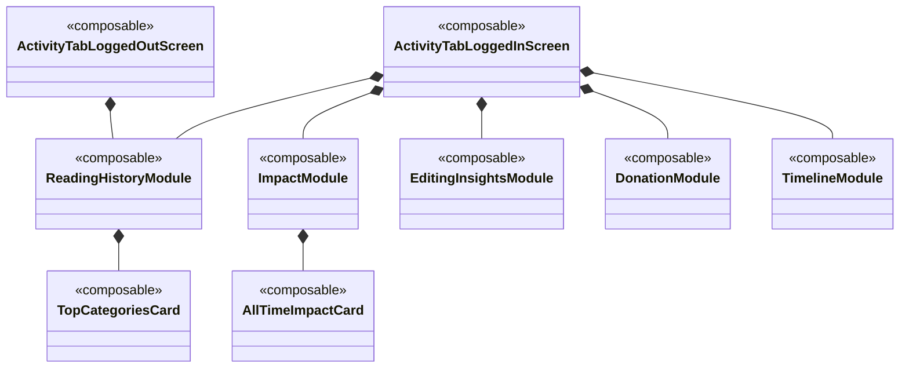
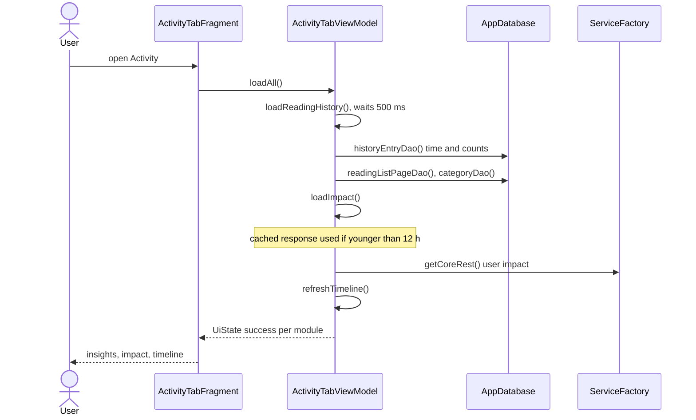

## What it does {#what}

`ActivityTabFragment` shows a Compose screen built from modules, each with its own `UiState` (loading, success, error). `loadAll()` always loads the reading history and the Year in Review entry; everything else needs an account, so logged out the tab stops there and shows a login prompt. Reading history is read straight from Room, after a 500 ms pause for the loading state: time spent reading in the last 7 days, distinct articles read in the last 30 days and in each of the last 4 weeks, when you last read, articles saved in the last 30 days (with the 4 newest), and this month's top categories. Logged in, it also loads donation results, Wikipedia games stats, your impact — fetched from the Growth user-impact API at most once every 12 hours per wiki and cached in `Prefs`, because that API is rate limited — and a paged timeline of reads and edits. Each module can be hidden from **Customize**, and the first visit shows an onboarding screen.

## Logic · class diagram {#classes}

One view model with a state flow per module; the fragment just collects them into the Compose screen.

- `──▷` holds
- `┄┄▷` uses · opens

## Screen · composition {#widgets}

- `◆──` contains

## Open the Activity tab, logged in · sequence {#sequence}

Reading insights never leave the device; impact is cached for 12 hours.

## Key files {#files}

- `app/src/main/java/org/wikipedia/activitytab/ActivityTabFragment.kt` · Activity tab
- `app/src/main/java/org/wikipedia/activitytab/ActivityTabViewModel.kt` · module states and loading
- `app/src/main/java/org/wikipedia/activitytab/ActivityTabLoggedInScreen.kt` · logged-in screen
- `app/src/main/java/org/wikipedia/activitytab/ReadingHistoryModule.kt` · reading insights
- `app/src/main/java/org/wikipedia/activitytab/ImpactModule.kt` · editing impact
- `app/src/main/java/org/wikipedia/activitytab/timeline/` · paged timeline
