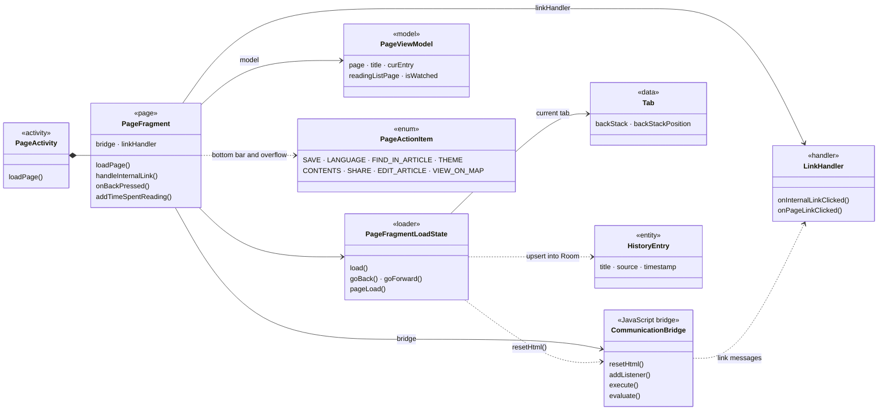
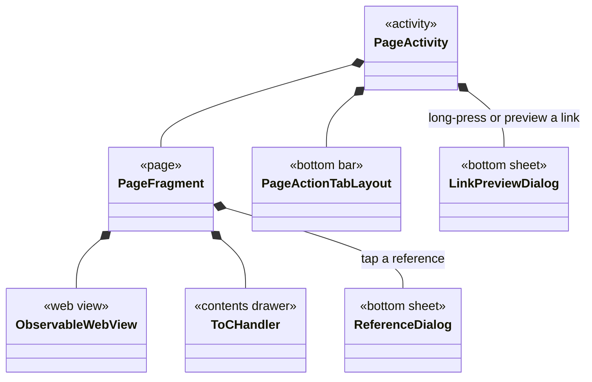
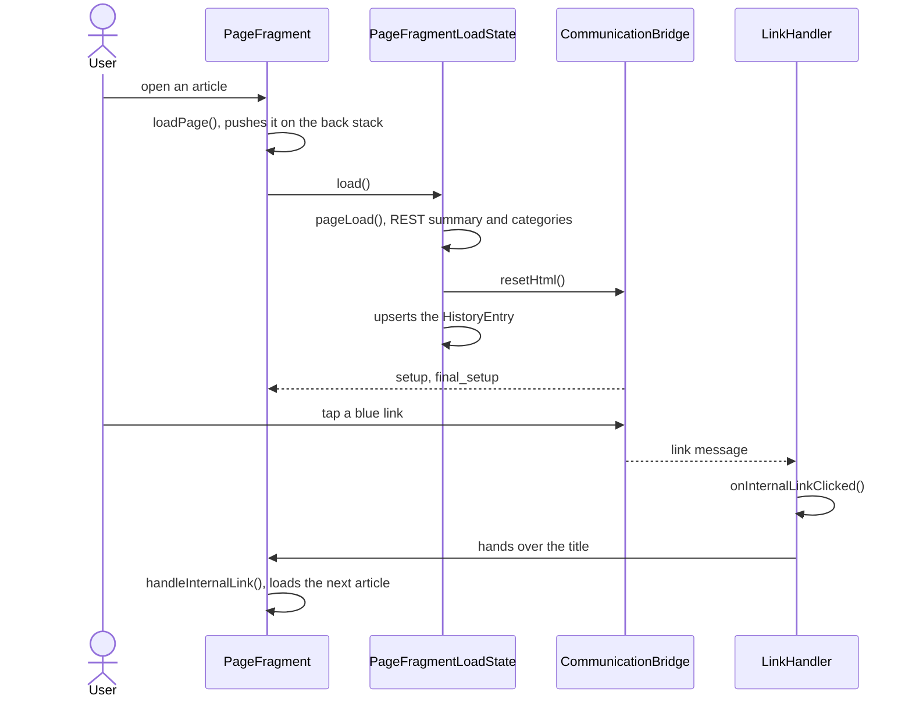

## What it does {#what}

Every article opens in `PageActivity`, which hosts `PageFragment` and keeps browser-like tabs (the toolbar shows their count). `PageFragment.loadPage()` pushes the title onto the current tab's back stack and hands it to `PageFragmentLoadState`, which fetches the page summary from the REST API (and its categories), points the `WebView` at the page's mobile-HTML through `CommunicationBridge.resetHtml()`, and upserts a `HistoryEntry` into Room. The page's JavaScript (the Page Content Service) talks back through the bridge as named messages — `setup`, `final_setup`, `link`, `reference`, `image`, `media`, `pronunciation`, `footer_item` and more; a link to another article goes through `LinkHandler` into `handleInternalLink()`, which opens talk and category pages in their own screens, scrolls to an anchor on the same page, and otherwise loads the new title onto the back stack. Back walks that stack before leaving the activity. A bottom `PageActionTabLayout` holds the most used actions (save, language, find in article, theme, contents, share by default) and the overflow has the rest — watchlist, talk page, edit history, new tab, categories, edit, view on map. Time spent reading is measured with an active timer that pauses in the background and is stored for the history entry (it feeds the Activity tab's reading time).

## Logic · class diagram {#classes}

The fragment owns the bridge and the load state; the load state owns the network and history writes.

- `──▷` holds
- `◆──` contains
- `┄┄▷` uses

## Screen · view composition {#widgets}

- `◆──` contains

## Open an article and follow a link · sequence {#sequence}

The summary comes over HTTP; the HTML is loaded by the WebView itself, and every tap comes back as a bridge message.

## Key files {#files}

- `app/src/main/java/org/wikipedia/page/PageActivity.kt` · article activity, tabs, toolbar
- `app/src/main/java/org/wikipedia/page/PageFragment.kt` · WebView, bridge listeners, links, timers
- `app/src/main/java/org/wikipedia/page/PageFragmentLoadState.kt` · loading and the back stack
- `app/src/main/java/org/wikipedia/bridge/` · JavaScript bridge and actions
- `app/src/main/java/org/wikipedia/page/action/` · bottom action bar items
- `app/src/main/java/org/wikipedia/page/tabs/` · article tabs
- `app/src/main/java/org/wikipedia/page/references/` · reference bottom sheets
