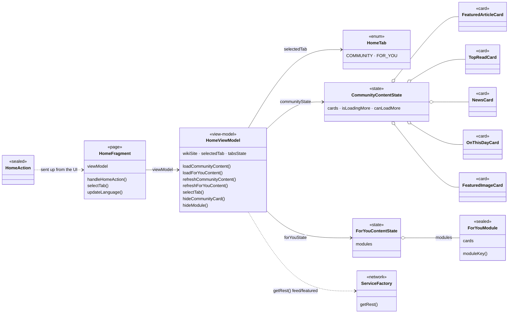
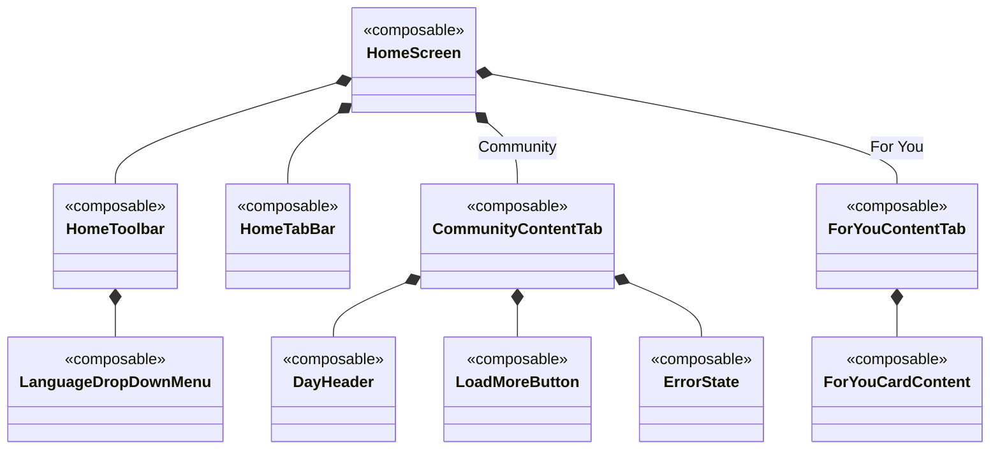
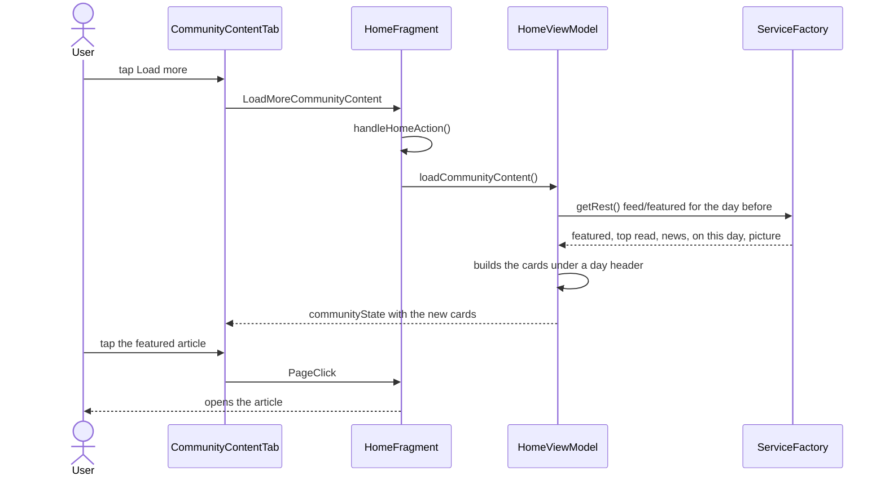

## What it does {#what}

`HomeFragment` sets a Compose `HomeScreen` with a toolbar (language menu, tabs counter, notifications) and two tabs. The tab it opens on comes from the onboarding choice: For You for a personalized preference, otherwise Community. **Community** fetches one day at a time from the REST `feed/featured` endpoint of the selected wiki and turns it into cards under a day header — featured article, top read, did you know, in the news, on this day (the first 2 events) and picture of the day; **Load more** fetches the day before, and a failed day is retried rather than skipped. **For You** loads batches of modules — based on your interests, continue reading, because you read, places near you, discover, random, games and read-aloud — each a horizontal pager of cards; places and discover are added on their own as they become available. Cards and whole modules can be hidden from their overflow menu (with **Undo**), and the hidden ones are remembered. Every interaction is a `HomeAction` sent up to the fragment, which calls the view model or navigates: a card opens the article in `PageActivity`, a news story opens its list, the picture opens the gallery. Pull to refresh reloads the current tab.

## Logic · class diagram {#classes}

Unidirectional flow: state flows down from the view model, actions flow up to the fragment.

- `──▷` holds
- `◇──` list of
- `┄┄▷` uses

## Screen · composition {#widgets}

- `◆──` contains

## Load more of the Community feed · sequence {#sequence}

Each page is one earlier day; the age only advances after a successful fetch.

## Key files {#files}

- `app/src/main/java/org/wikipedia/feed/HomeFragment.kt` · Home tab, actions, navigation
- `app/src/main/java/org/wikipedia/feed/HomeViewModel.kt` · both feeds, hiding, languages
- `app/src/main/java/org/wikipedia/feed/HomeScreen.kt` · toolbar, tabs, language menu
- `app/src/main/java/org/wikipedia/feed/CommunityContentTab.kt` · Community feed
- `app/src/main/java/org/wikipedia/feed/ForYouContentTab.kt` · For You modules
- `app/src/main/java/org/wikipedia/feed/HomeAction.kt` · every UI action
- `app/src/main/java/org/wikipedia/feed/` · card types per feed module
