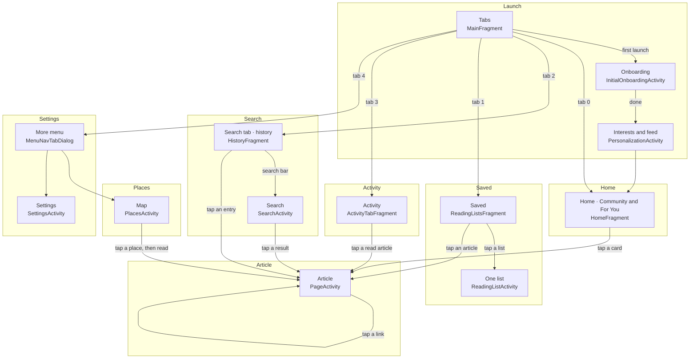
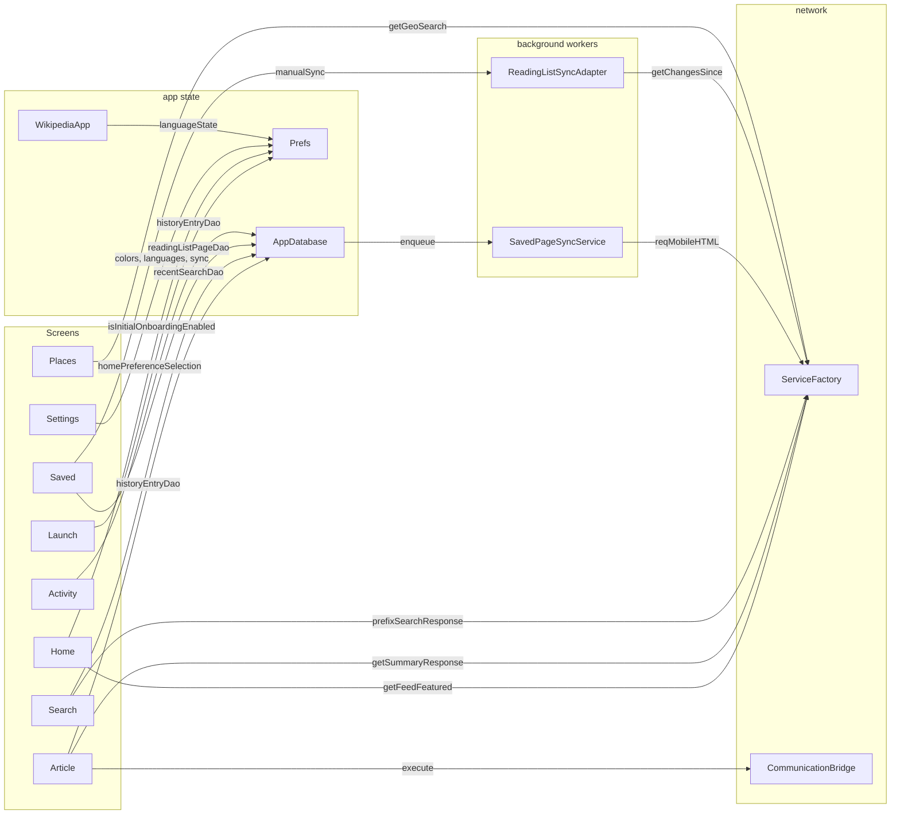

## Screens · how the user moves

`MainActivity` holds `MainFragment`, a bottom navigation over a pager of five tabs — Home, Saved, Search (your history, with a search bar that opens the search screen), Activity and **More**, which is not a page but a bottom sheet with the account, watchlist, games, Places and Settings. On a first launch the onboarding activity runs on top, followed by the personalization screens. Every article opens in `PageActivity`, which keeps its own back stack of pages and browser-like tabs.

- `───▷` opens
- `▭` tap to open its module

## Services · what the screens share

The app's state lives in a Room database (`AppDatabase`: history, reading lists, saved pages, categories) and `Prefs`; network calls go through Retrofit services from `ServiceFactory` (the Action API and the REST API of each wiki). Two WorkManager workers do the background work: one downloads saved pages for offline reading, the other syncs reading lists with the account.

- `───▷` calls, labelled with the method or what it reads
- `▭` tap to open its module
