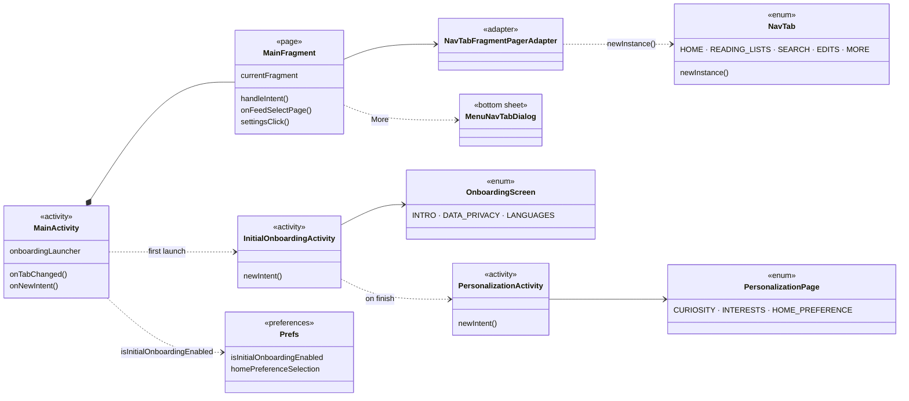
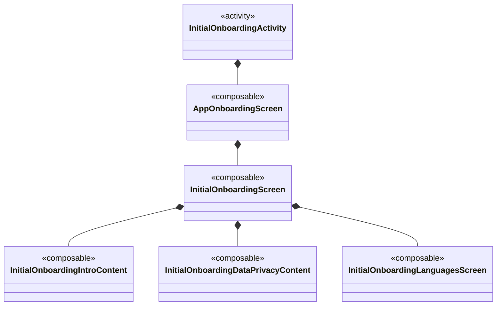
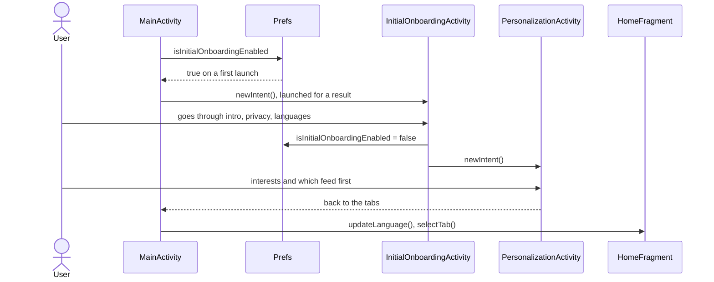

## What it does {#what}

`MainActivity` is the launcher activity. It hosts `MainFragment`, whose `ViewPager2` holds one fragment per `NavTab` — Home, Saved, Search (the reading history), Activity — and a fifth bottom-navigation item, **More**, that opens a bottom sheet instead of a page. Tapping Search again while it is selected opens the search screen. On a first launch (`Prefs.isInitialOnboardingEnabled`, and not opened to preview a shared reading list) the activity starts `InitialOnboardingActivity`: a Compose flow of three screens — intro, data & privacy, and languages (with **Add language**). Finishing it turns the flag off and starts `PersonalizationActivity`, which asks about curiosity, interests and which Home feed to see first. When onboarding returns, the main activity switches the Home tab to the chosen feed (For You for a personalized choice, otherwise Community) and its language. Badges on the tabs mark a new recommended reading list on Saved and the unseen Activity onboarding or Year in Review on Activity; a notification bell sits in the toolbar.

## Logic · class diagram {#classes}

One activity, one fragment of tabs; each tab's fragment is created by its enum value.

- `──▷` holds
- `◆──` contains
- `┄┄▷` uses · opens

## Screen · composition {#widgets}

- `◆──` contains

## First launch · sequence {#sequence}

Onboarding is a separate activity; the main screen only learns the outcome through the activity result.

## Key files {#files}

- `app/src/main/java/org/wikipedia/main/` · main activity and the tabs fragment
- `app/src/main/java/org/wikipedia/navtab/` · tab enum, pager adapter, More sheet
- `app/src/main/java/org/wikipedia/onboarding/` · initial onboarding
- `app/src/main/java/org/wikipedia/feed/personalization/` · interests and feed preference
- `app/src/main/java/org/wikipedia/WikipediaApp.kt` · application, languages, tabs
