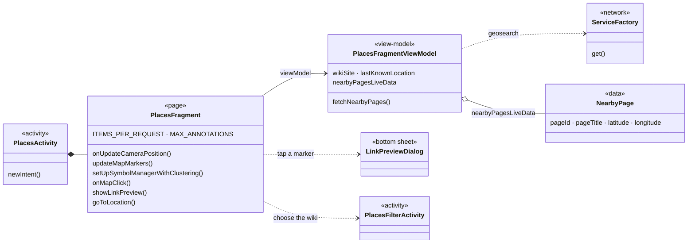
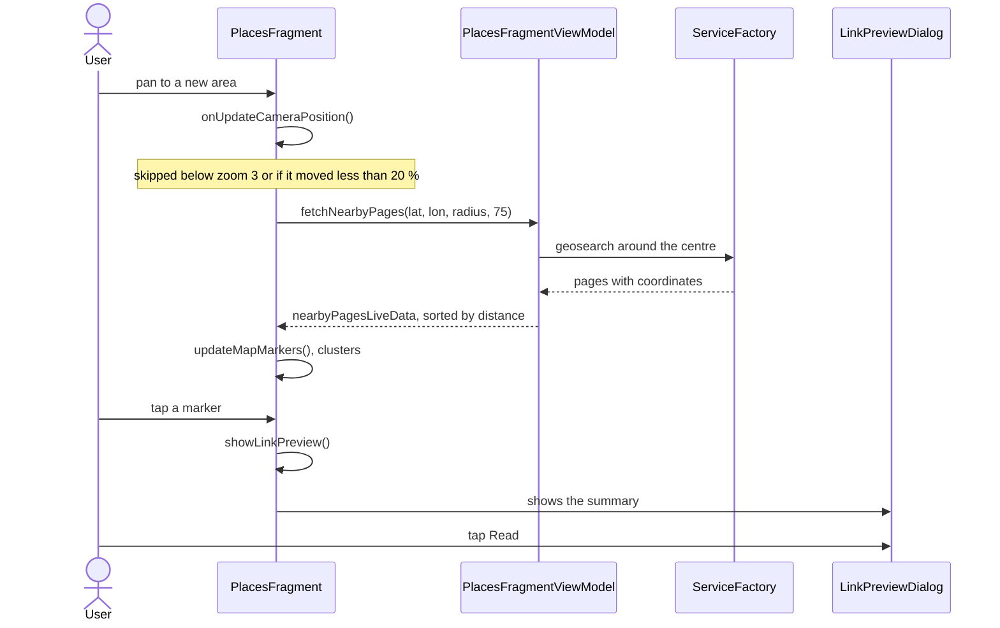

## What it does {#what}

Places opens from the **More** menu (or from a place card or an article's map action) as `PlacesActivity` with `PlacesFragment`. The map is MapLibre: on start it goes to the given location, or yours if location permission is granted, or the last one used, at zoom 15. Every time the camera stops, `onUpdateCameraPosition()` asks for new pages — unless the map is zoomed out past level 3, or it moved less than 20 % of the visible span and changed zoom by less than half a level since the last query. `PlacesFragmentViewModel` calls the wiki's geosearch API for up to 75 pages within the search radius, keeps only those with coordinates and sorts them by distance from you. Markers are drawn by a symbol manager with clustering: nearby markers merge into a numbered circle, and tapping a circle zooms in two levels over one second; at most 250 markers with thumbnails are cached. Tapping a marker magnifies it and opens a link preview with the article's summary and a button to read it. A toggle switches to a list sorted by distance, the search bar searches places by name, and a filter picks which wiki's articles to show.

## Logic · class diagram {#classes}

The fragment owns the map and decides when to fetch; the view model only fetches and sorts.

- `──▷` holds
- `◆──` contains
- `◇──` list of
- `┄┄▷` uses · opens

## Pan the map and open a place · sequence {#sequence}

A fetch happens only when the camera settles somewhere new enough.

## Key files {#files}

- `app/src/main/java/org/wikipedia/places/PlacesFragment.kt` · map, markers, clusters, list
- `app/src/main/java/org/wikipedia/places/PlacesFragmentViewModel.kt` · geosearch
- `app/src/main/java/org/wikipedia/places/PlacesActivity.kt` · activity and intents
- `app/src/main/java/org/wikipedia/places/PlacesFilterActivity.kt` · wiki filter
- `app/src/main/java/org/wikipedia/dataclient/page/NearbyPage.kt` · a place on the map
