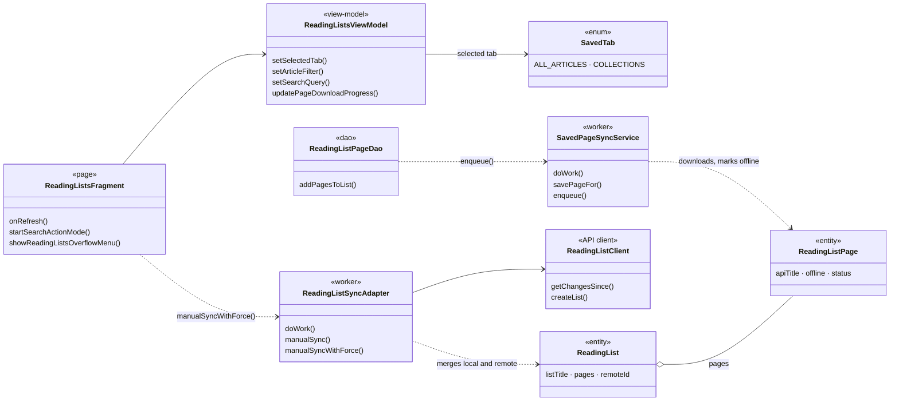
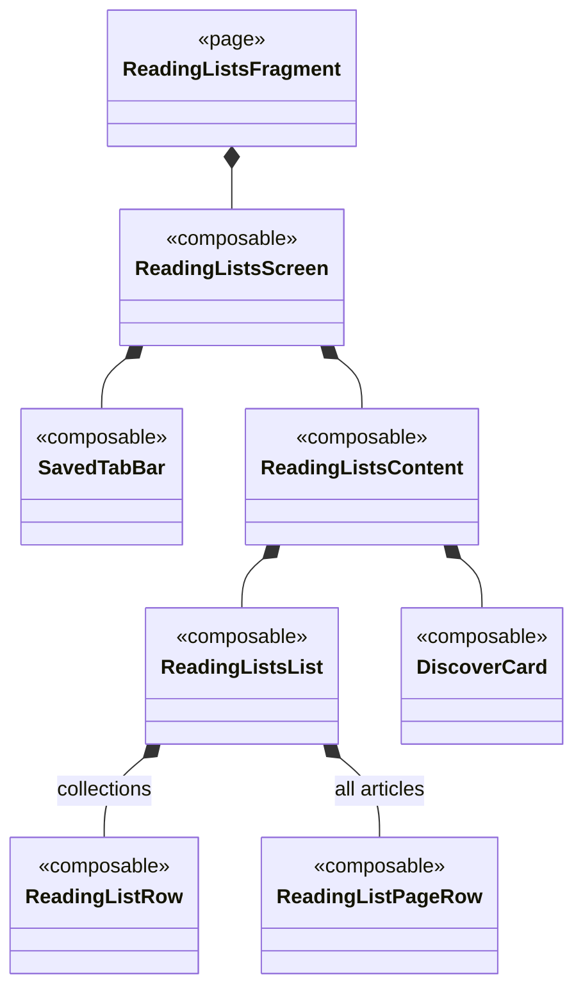
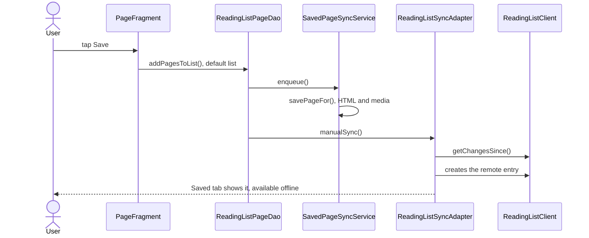

## What it does {#what}

`ReadingListsFragment` hosts the Compose `ReadingListsScreen` with two tabs, **All articles** and **Collections** (your reading lists), a search action mode, sort options and an overflow menu to create, import, select or refresh lists. All articles can be filtered to those not in any collection. Saving an article anywhere inserts a `ReadingListPage` into the default list through `ReadingListPageDao`, which enqueues `SavedPageSyncService`: a WorkManager worker that downloads each waiting page's mobile HTML and media for offline reading, reporting progress back to the rows. When you are logged in (and sync is on and not disabled by remote config), `ReadingListSyncAdapter` — another worker — merges local and remote lists both ways through `ReadingListClient`: it pulls changes since the last sync, applies local deletions, creates or updates remote lists and entries, and stores the new sync time. Pulling down forces a sync; reaching the list limit shows a message. Tapping a list opens `ReadingListActivity`; tapping an article opens it. A **Discover** card can generate a recommended reading list from your interests.

## Logic · class diagram {#classes}

The screen only reads Room through its view model; two workers do all the network work in the background.

- `──▷` holds
- `◇──` list of
- `┄┄▷` uses

## Screen · composition {#widgets}

- `◆──` contains

## Save an article and sync it · sequence {#sequence}

The database insert is the trigger: everything after it runs in workers.

## Key files {#files}

- `app/src/main/java/org/wikipedia/readinglist/ReadingListsFragment.kt` · Saved tab
- `app/src/main/java/org/wikipedia/readinglist/ReadingListsViewModel.kt` · lists, articles, filters
- `app/src/main/java/org/wikipedia/readinglist/compose/` · Saved screen in Compose
- `app/src/main/java/org/wikipedia/readinglist/database/` · list and page entities
- `app/src/main/java/org/wikipedia/readinglist/db/` · DAOs
- `app/src/main/java/org/wikipedia/readinglist/sync/` · account sync worker and API client
- `app/src/main/java/org/wikipedia/savedpages/SavedPageSyncService.kt` · offline downloads
