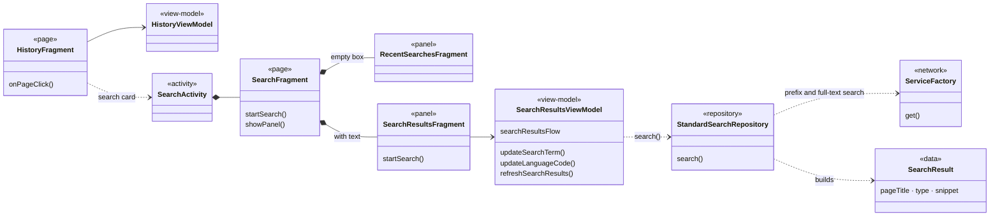
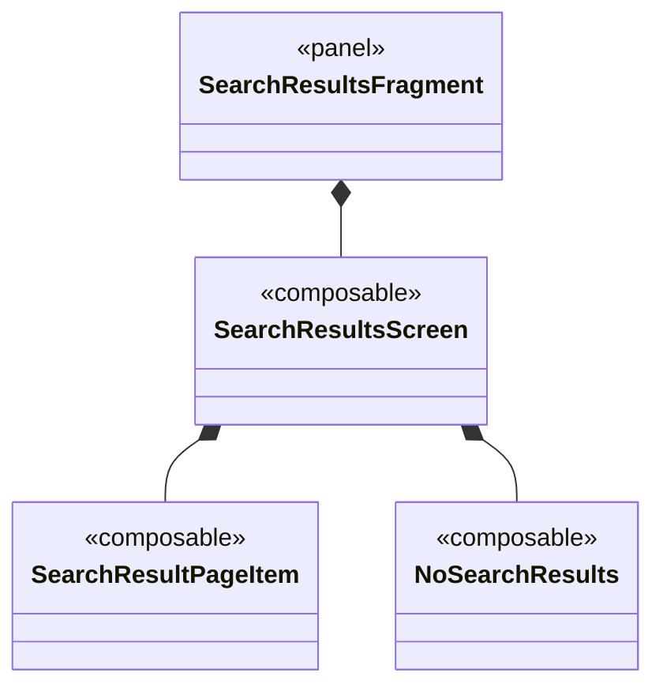
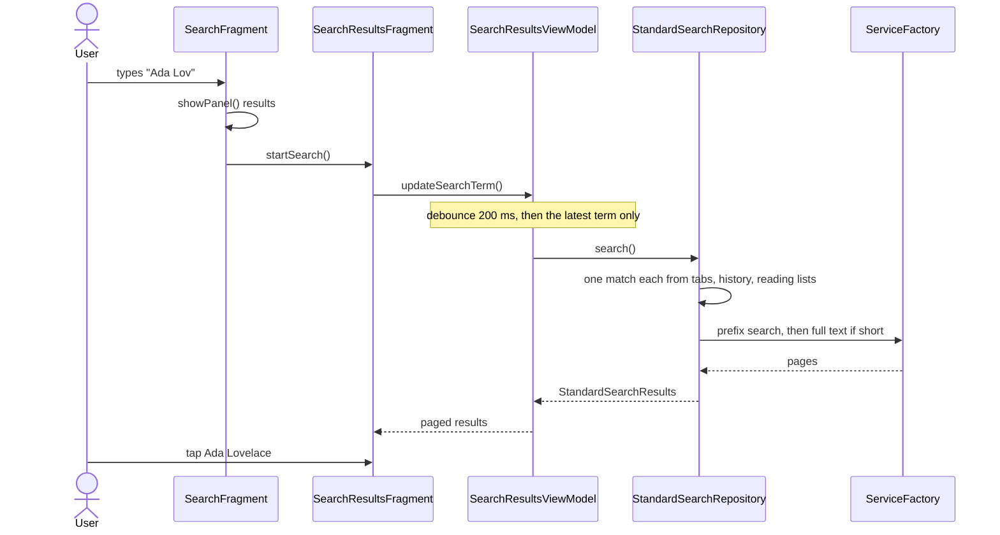

## What it does {#what}

The Search tab is `HistoryFragment`: your reading history grouped by day, with a filter, multi-select to delete, and a search card at the top. Tapping the card (or the tab again) opens `SearchActivity` with `SearchFragment`, which shows one of two panels: `RecentSearchesFragment` (recent queries from Room, plus your languages) while the box is empty, and `SearchResultsFragment` as soon as there is text. Each keystroke updates the search term in `SearchResultsViewModel`, whose results flow is debounced by 200 ms and combined with the selected language, so only the last term is searched; changing the language chip re-runs it. `StandardSearchRepository` first adds up to one match each from your open tabs, your history and your reading lists (for terms of 2 or more characters), then a prefix search, and fills the page with a full-text search when there are fewer results than the batch size; results are paged with Paging 3. Tapping a result saves the query to recent searches and opens the article. Readers in the semantic-search test also get an entry to passage results.

## Logic · class diagram {#classes}

A fragment that swaps two panels, over a view model whose single flow does the debouncing.

- `──▷` holds
- `◆──` contains
- `┄┄▷` uses · opens

## Screen · composition {#widgets}

- `◆──` contains

## Type a query · sequence {#sequence}

The view model never searches on a keystroke: the debounced flow does, once typing pauses.

## Key files {#files}

- `app/src/main/java/org/wikipedia/history/` · Search tab: reading history
- `app/src/main/java/org/wikipedia/search/SearchFragment.kt` · search screen and panels
- `app/src/main/java/org/wikipedia/search/SearchResultsViewModel.kt` · debounced, paged results
- `app/src/main/java/org/wikipedia/search/StandardSearchRepository.kt` · local matches, prefix and full-text search
- `app/src/main/java/org/wikipedia/search/RecentSearchesFragment.kt` · recent searches
- `app/src/main/java/org/wikipedia/search/SearchResultsScreen.kt` · results in Compose
