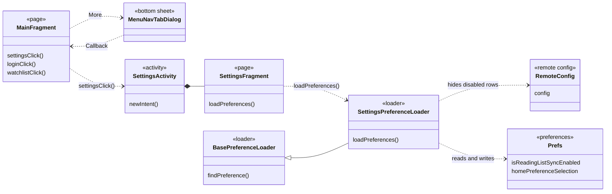
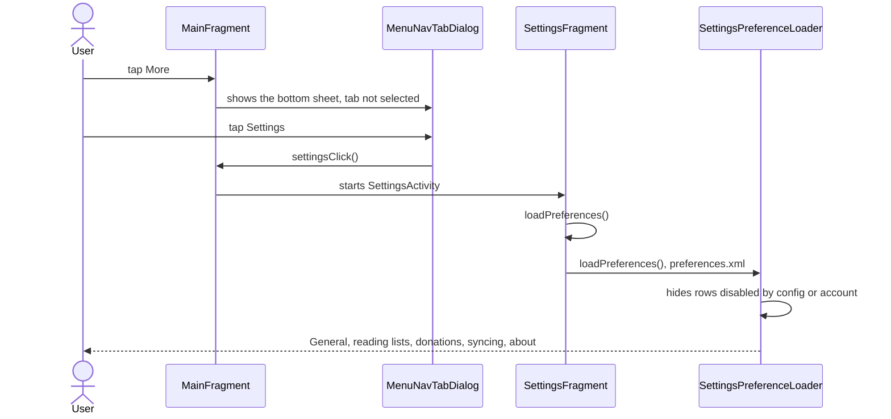

## What it does {#what}

The fifth bottom-navigation item, **More**, never selects a page: `MainFragment` shows `MenuNavTabDialog`, a bottom sheet with your account (or **Log in**), talk page, watchlist, contributions, the games hub, Places, donate and **Settings**, each forwarded to `MainFragment` through its `Callback`. Settings is `SettingsActivity` with `SettingsFragment`, a `PreferenceFragmentCompat` whose `SettingsPreferenceLoader` inflates `preferences.xml` and wires the rows: General (Wikipedia languages, customize the Home feed, Year in Review, link previews, collapse tables, app theme, default editor), recommended reading list, donations (reminders, delete local donation history), semantic search, and syncing (sync reading lists with your account, download reading-list articles); account and about sections follow. Rows that depend on remote configuration or your account state are hidden at load time — for example the whole syncing category when reading-list sync is disabled remotely. Values are stored through `Prefs`, a typed wrapper over shared preferences that the rest of the app reads directly, so a change takes effect the next time a screen reads it.

## Logic · class diagram {#classes}

Preferences are declared in XML; the loader only adds behaviour and visibility.

- `◆──` contains
- `──▷|` extends
- `┄┄▷` uses · opens

## Open Settings from More · sequence {#sequence}

The More item is intercepted before the pager ever moves.

## Key files {#files}

- `app/src/main/java/org/wikipedia/navtab/MenuNavTabDialog.kt` · More bottom sheet
- `app/src/main/java/org/wikipedia/settings/SettingsActivity.kt` · settings activity
- `app/src/main/java/org/wikipedia/settings/SettingsFragment.kt` · preference fragment
- `app/src/main/java/org/wikipedia/settings/SettingsPreferenceLoader.kt` · rows and visibility
- `app/src/main/java/org/wikipedia/settings/Prefs.kt` · every stored preference
- `app/src/main/res/xml/preferences.xml` · settings layout
