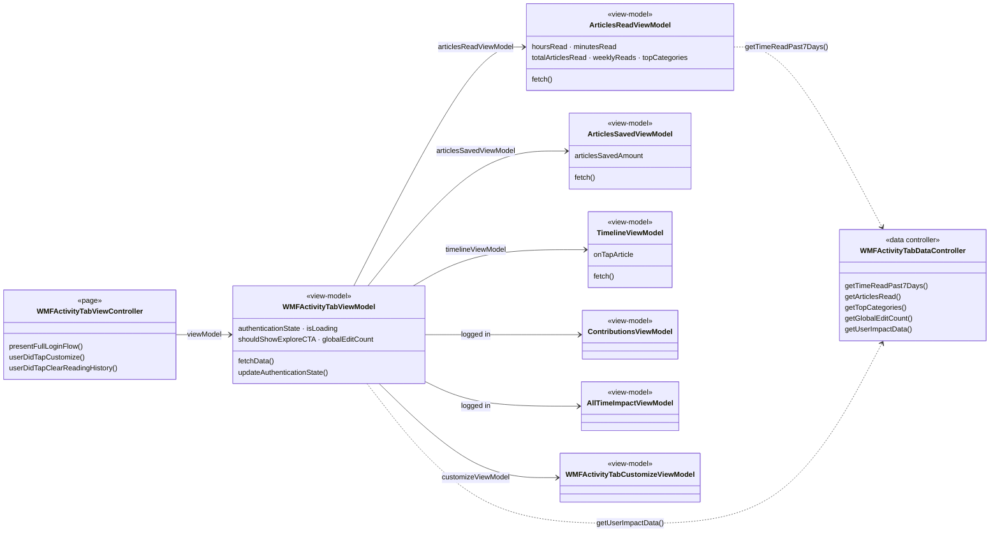
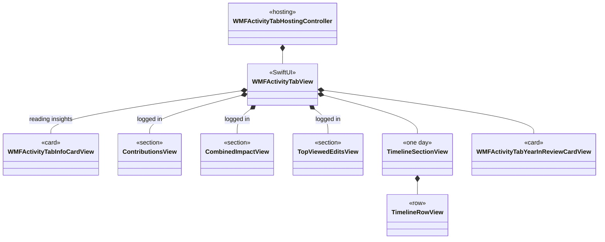
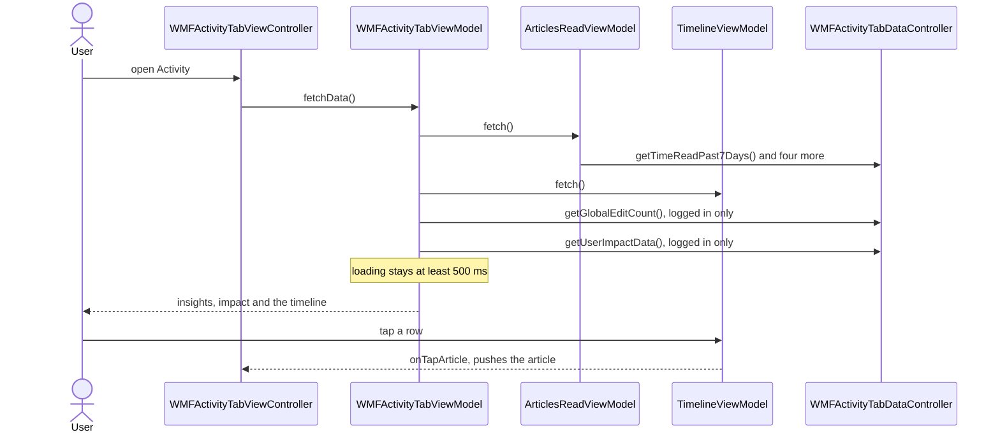

## What it does {#what}

`WMFActivityTabViewController` hosts the SwiftUI `WMFActivityTabView`, all of it computed on the device from your reading history except the editing parts. Each time the tab appears, `fetchData()` loads five things in parallel — reading insights (time read in the last 7 days, total articles read, when you last read, weekly reads this month, top categories), saved-article counts, the timeline, and, only when logged in, your global edit count and user impact — and keeps the loading state up for at least 500 ms so it never flickers. The timeline groups every article you read or edited by day; tapping a row opens the article, and swiping deletes it from history. Logged in, the tab adds your contributions, all-time impact, recent edit activity, article views and most-viewed edits; logged out, it offers login. If you have read and saved nothing and the Explore feed is on, it shows a call to action instead. **Customize** turns each section on or off, the menu can clear the whole reading history, and a Year in Review card appears in its season.

## Logic · class diagram {#classes}

One view model fans out to a small view model per section, each with its own fetch.

- `──▷` holds
- `┄┄▷` uses

## Screen · view composition {#widgets}

- `◆──` contains

## Open the Activity tab · sequence {#sequence}

Five fetches run at once; the editing ones return early when you are logged out.

## Key files {#files}

- `Wikipedia/Code/ActivityTabViewController.swift` · Activity tab, login, customize, clear history
- `WMFComponents/Sources/WMFComponents/Components/Activity Tab/` · views and the tab view model
- `WMFComponents/Sources/WMFComponents/Components/Activity Tab/View Models/` · per-section view models
- `WMFData/Sources/WMFData/Data Controllers/Activity Tab/` · reading and impact data
