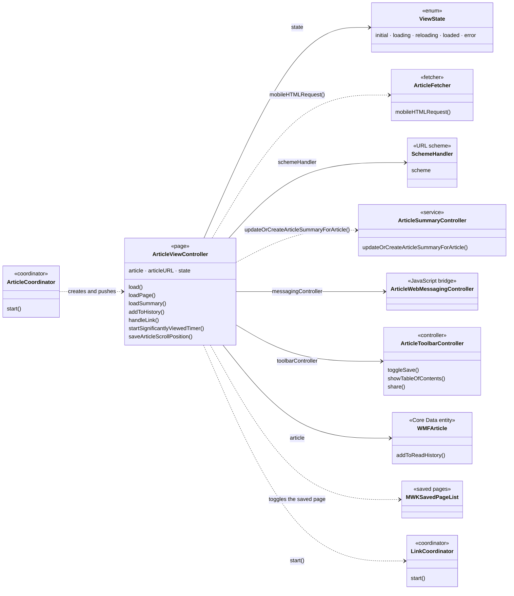
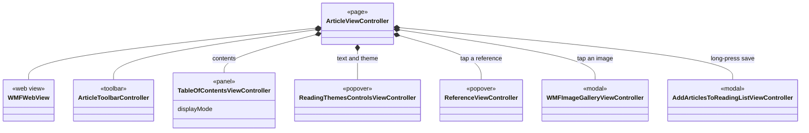
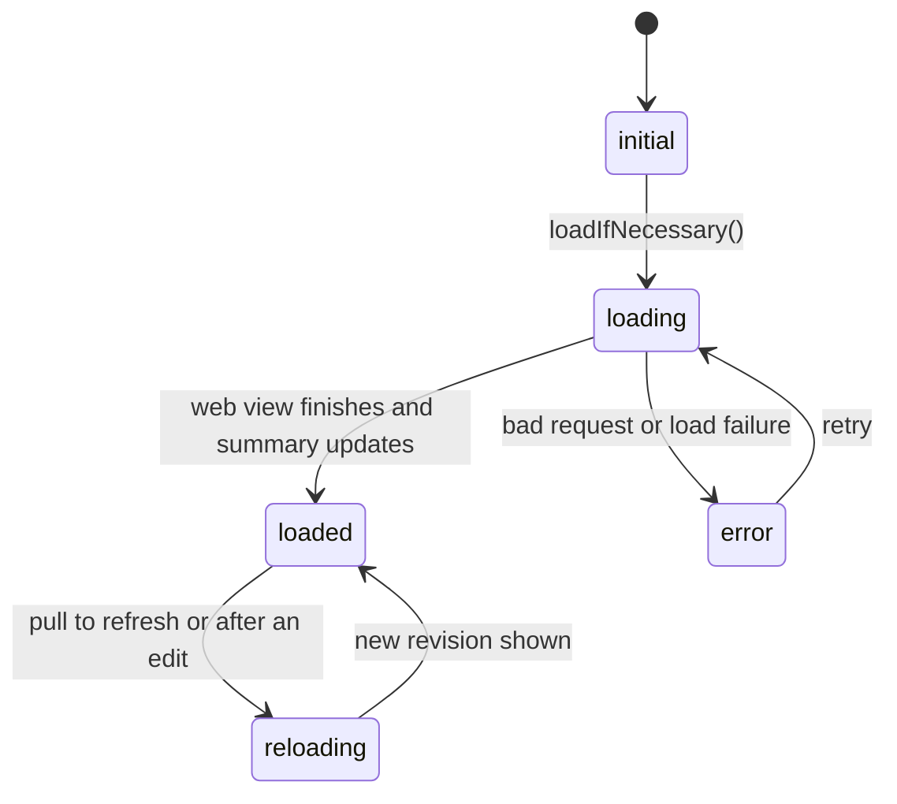
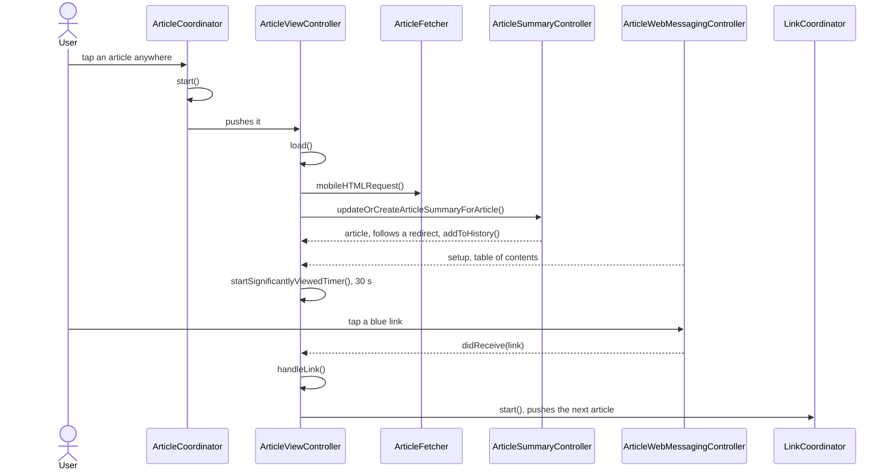

## What it does {#what}

`ArticleCoordinator` creates an `ArticleViewController` for a URL and pushes it on the current tab. The controller asks `ArticleFetcher` for a mobile-HTML request from the Page Content Service, loads it into a `WKWebView` through its own URL scheme handler (so cached and offline copies are served from disk), and in parallel updates the article summary in Core Data with `ArticleSummaryController` — following redirects and adding the article to the read history. The page's JavaScript talks back through `ArticleWebMessagingController`: when setup finishes it sends the table of contents, and every tap on a link, reference, image or edit pencil arrives as an `Action`. A link to another article pushes a new article (through `LinkCoordinator`); a link to an anchor in the same article scrolls there. The bottom toolbar saves or unsaves (a long press adds to a reading list), opens the reading-themes popover (text size, theme), the table of contents, the language picker, find in page and share, and its **More** menu has revision history, talk page, watch and edit. After 30 s on screen an article is marked as significantly viewed, which feeds Because You Read; the scroll position is saved for when you come back.

## Logic · class diagram {#classes}

The view controller is split across about twenty extensions; the core is load, message handling and the toolbar delegate.

- `──▷` holds
- `┄┄▷` uses

## Screen · view composition {#widgets}

A native shell around one web view: lead image and toolbar outside, the article inside.

- `◆──` contains

## Load states · state machine {#states}

`ViewState` guards against loading twice and drives the refresh overlay.

## Open an article and follow a link · sequence {#sequence}

HTML and the summary load side by side; the page's JavaScript reports back as typed actions.

## Key files {#files}

- `Wikipedia/Code/ArticleViewController.swift` · article loading, web view, scroll state
- `Wikipedia/Code/ArticleViewController+ArticleWebMessageHandling.swift` · taps from the page
- `Wikipedia/Code/ArticleViewController+ArticleToolbarHandling.swift` · toolbar actions
- `Wikipedia/Code/ArticleWebMessagingController.swift` · JavaScript bridge and actions
- `Wikipedia/Code/ArticleToolbarController.swift` · bottom toolbar and More menu
- `Wikipedia/Code/ArticleCoordinator.swift` · opens an article in a tab
- `Wikipedia/Code/TableOfContentsViewController.swift` · contents panel
- `Wikipedia/Code/SchemeHandler/` · cached and offline page loading
