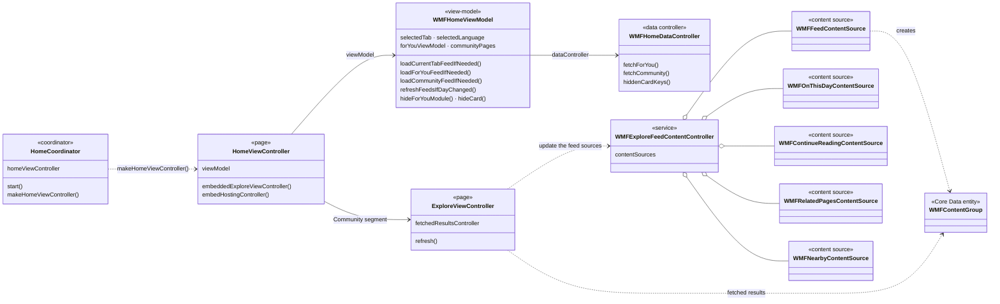
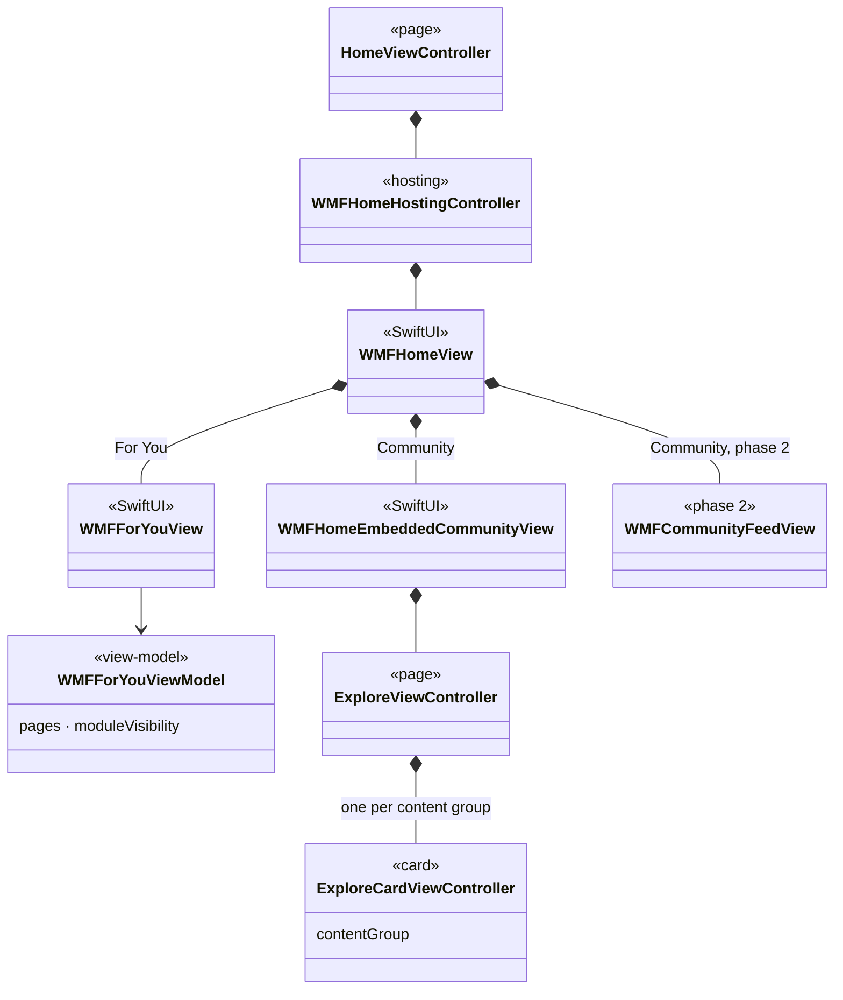
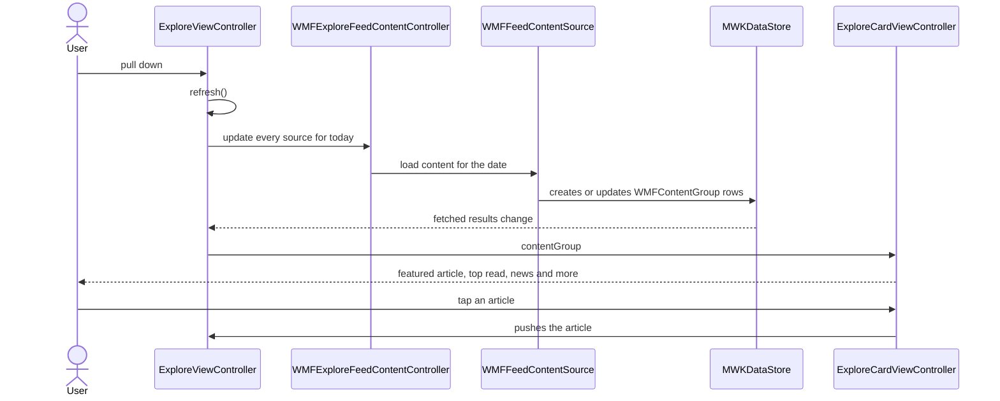

## What it does {#what}

`HomeCoordinator` builds the Home tab: a UIKit `HomeViewController` hosting the SwiftUI `WMFHomeView`, with a **For You / Community** segmented control and a language menu in the navigation bar. **For You** is fetched from `WMFHomeDataController` for the selected wiki and has three modules — based on your interests, because you read, and continue reading — each of which can be hidden, as can single cards. **Community** is, unless the phase-2 developer flag is on, the classic Explore feed embedded as a child view controller: `ExploreViewController` shows a Core Data–backed list of `WMFContentGroup` cards produced by `WMFExploreFeedContentController` from content sources — related pages, continue reading and suggested edits once, plus per preferred language a daily game, nearby places, the featured article / top read / in the news / picture of the day feed, a random article, announcements and on this day. Pull to refresh asks every source to update for today; scrolling to the end loads the previous day. The feeds reload when the day changes, and tapping a card pushes the article on the Home tab's navigation stack. Card actions (save, share, hide) are logged through the coordinator's closures.

## Logic · class diagram {#classes}

A UIKit shell around a SwiftUI view model, with the legacy Core Data feed plugged in as the Community segment.

- `──▷` holds
- `◇──` list of
- `┄┄▷` uses

## Screen · view composition {#widgets}

SwiftUI on top, UIKit cards underneath when Community shows the classic feed.

- `◆──` contains
- `──▷` reads model

## Pull to refresh the Community feed · sequence {#sequence}

Every source writes content groups into Core Data; the fetched-results controller animates the new cards in.

## Key files {#files}

- `Wikipedia/Code/HomeCoordinator.swift` · builds the Home tab and logs card actions
- `Wikipedia/Code/HomeViewController.swift` · hosts the SwiftUI home, embeds Explore
- `WMFComponents/Sources/WMFComponents/Components/Home/` · home, For You and Community views
- `Wikipedia/Code/ExploreViewController.swift` · classic Explore feed
- `Wikipedia/Code/ExploreCardViewController.swift` · one feed card
- `WMF Framework/WMFExploreFeedContentController.m` · content sources and updates
- `WMFData/Sources/WMFData/Data Controllers/Home/` · For You and Community data
